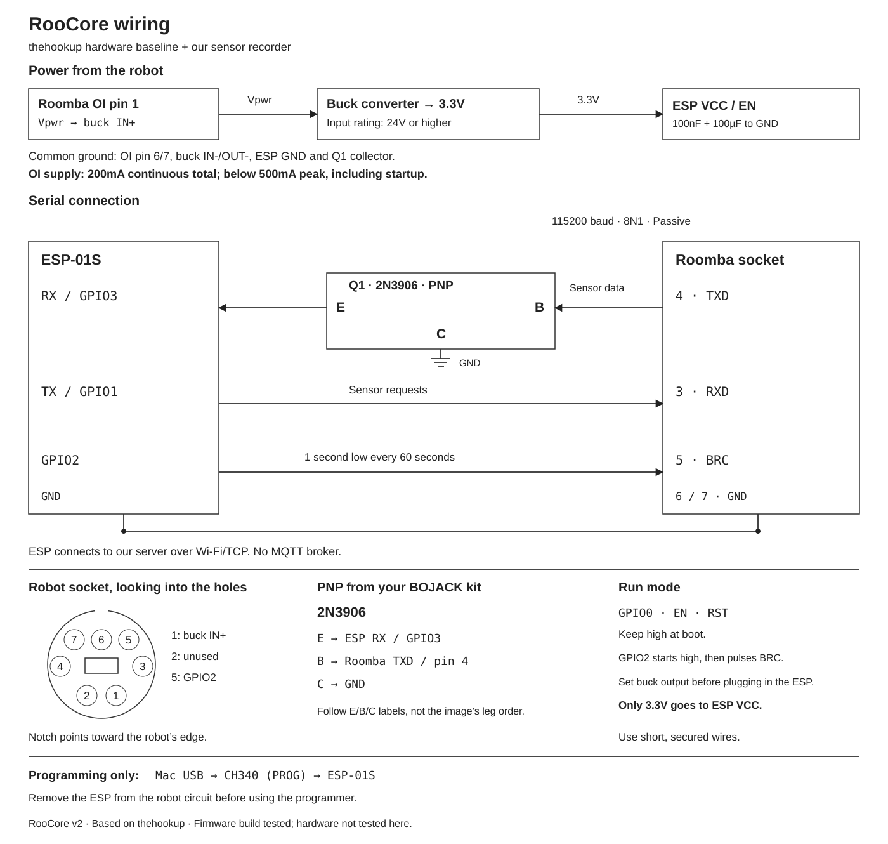

# RooCore

Roomba 620 sensor recording with an ESP-01S and our own server.
The hardware starts from [thehookup/MQTT-Roomba-ESP01](https://github.com/thehookup/MQTT-Roomba-ESP01): battery power, a 3.3V buck converter, a PNP receive interface and GPIO2 connected to BRC.
RooCore uses a direct TCP connection to our server. It does not need an MQTT broker or a separate Arduino board.

[First recording](docs/first-session-he.md) · [Wiring](docs/wiring.md) · [Wiring quick guide](docs/wiring-he.md) · [LiDAR plan](docs/lidar-plan-he.md)



[English SVG](docs/diagrams/wiring.svg) · [Alternate SVG](docs/diagrams/wiring-he.svg)

## What works in software

- UART0 TX on GPIO1, RX on GPIO3, 115200 8N1.
- GPIO2 pulses BRC low for one second each minute, as in the upstream 600-series sketch.
- The ESP joins the existing Wi-Fi network and reconnects to our TCP server.
- One serial reader forwards sensor bytes. There is no competing battery poller.
- The server stores raw transport records, decoded sensor CSV and connection events in one run folder.
- Reconnects, ESP restarts, skipped records and receive overruns create discontinuities. Analysis does not join wheel travel across those gaps.
- No Drive, Safe/Full, Clean, Dock, Reset or robot firmware-update commands are implemented.

Use the robot's CLEAN button for now. The aim is to record its native cleaning behavior before writing our own planner.
The firmware build and automated tests pass. This version has not been flashed or tested on the physical robot.

## Configure and build

From this folder, with Python 3 installed:

```sh
python3 -m venv .venv
.venv/bin/pip install platformio
python3 tools/configure.py --ssid YOUR_WIFI --server 192.168.1.10
.venv/bin/pio run -d firmware
```

Use the server's LAN IPv4 address and reserve it in the router. The setup tool prompts for the Wi-Fi password.
It writes ignored `firmware/include/network_config.h` and `.roocore-token` files. Do not publish either file.
The server and ESP must share access to the same LAN. The transport is plaintext and intended for a trusted local network; do not expose it to the internet.

A build without local settings uses placeholders and will not connect to Wi-Fi. It is a compile check, not configured firmware.
The existing v1 `secrets.h`/AP password file is unused.

The build uses the ESP8266 Arduino framework as a software SDK. The only controller board is the ESP-01S.
For a 1 MB module, the build target is `esp01_1m`. Flash the ESP separately from the robot:

```sh
.venv/bin/pio run -d firmware -t upload --upload-port /dev/cu.YOUR_PROGRAMMER
```

No robot firmware is flashed. Remove the programmer before attaching the robot circuit.

## Record a cleaning run

On the server or Mac:

```sh
python3 server/recorder.py --token-file .roocore-token
```

Port 8765 must be reachable from the ESP. If the server is on another computer, copy the token file there privately.
Recording starts when the ESP connects. Press CLEAN on the robot and leave the recorder running for the whole cycle.
After cleaning ends, press Ctrl-C in the server terminal. This stops telemetry, not the robot's cleaning program.
The server does not infer that a cleaning cycle has ended from battery or charging data.

Options:

```sh
python3 server/recorder.py --profile basic --seconds 30
python3 server/recorder.py --profile wheels --output recordings
python3 tools/analyze.py recordings/RUN_FOLDER/sensors.csv
```

`wheels` is the default. It adds encoder packets 43/44 to bump, cliff, wall, dirt, IR, button, battery and OI-mode packets.
`tools/record.py` is an alias for the same TCP server. The old UDP/HTTP recorder is replaced.

Each run contains:

| File | Contents |
|---|---|
| `sensors.csv` | Checksum-validated OI samples, raw frame hex, server time, device milliseconds, boot/capture IDs and segment |
| `transport.jsonl` | Original serial bytes in validated transport records, including bytes that fail the OI checksum |
| `events.jsonl` | Connections, disconnections, stream start requests and run boundaries |
| `session.json` | Profile, device, duration, sample count and decoder/loss totals |

The ESP does not store recordings locally. Wi-Fi or server downtime loses samples; those intervals are marked, not reconstructed.
The firmware pauses the stream on link loss or after ten seconds without a server heartbeat.
BRC pulses continue independently of networking while the module has power.

The analyzer reports observed bumper activations and raw wheel counts. It does not estimate a room map, calibrated meters or iRobot's internal planner state.
Packets 39–42 are requested velocities and are not treated as measured wheel speed.

## Tests

```sh
python3 -m unittest discover -s tests -v
clang++ -std=c++11 -Ifirmware/include tests/core_test.cpp -o /tmp/roocore-core-test
/tmp/roocore-core-test
```

[Protocol](docs/protocol.md) · [Upstream changes](docs/upstream-baseline.md) · [Validation](docs/validation.md)
