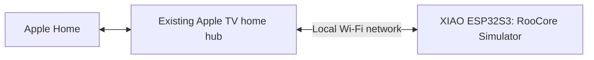

# Apple Home: standalone XIAO simulator

[עברית](APPLE_HOME-he.md)

RooCore now has a separate Matter-over-Wi-Fi test application for the **plain Seeed XIAO ESP32S3**. It exposes one Robotic Vacuum Cleaner endpoint named **RooCore Simulator**. It does not require Home Assistant, Homebridge, Docker, the Linux server, or another always-on computer. A Mac is used to build and, later, provision the board; it does not run the accessory.

**Current status: host simulation tested and ESP32-S3 firmware compiled. Nothing has been flashed or paired with Apple Home. No robot was operated.** This is a development accessory using the SDK's test attestation credentials, not a certified Matter product. Actual Apple Home acceptance and controls still need a device test.

## Connection



The S3 uses 2.4 GHz Wi-Fi; Bluetooth is used for initial Matter commissioning. It does not use Thread. The IKEA bridge is not in this path. The Apple TV does not have to use the same Wi-Fi band as the XIAO, but must have local network reachability to it. The board and home hub need working IPv6 and multicast discovery; isolated guest networks can prevent pairing or control. No domain, Cloudflare route, port forwarding, MQTT credentials or external API is needed for this path.

Apple added Matter robot-vacuum support in iOS 18.4. Use current compatible iPhone and Apple TV software, and confirm the Apple TV appears as a connected home hub in the Home app. The user's exact Apple TV model and software version have not been inspected. Thread support alone does not prove that the Home configuration is ready.

## What the simulator does

| Request/state | Simulated behavior |
|---|---|
| Start cleaning | Runs for 30 seconds, then returns for 5 seconds and becomes docked |
| Pause / resume | Preserves remaining simulated time, including a paused return |
| Return home | Ends simulated cleaning and starts a 5-second return |
| Idle run mode | Cancels cleaning; a return already has Idle run mode, so use Pause to pause it |
| Repeated start or return | Does not extend the current job |
| Wi-Fi disconnect | Cancels activity and clears pending progress |
| Reconnect | Stays stopped until a new explicit command |
| Board restart | Starts inactive; an old persisted Matter run mode is reset to idle |

The times are test fixtures. There is no battery measurement, charging model, map, room selection, mop, suction setting or actual vacuum motor. Apple chooses which controls to display; the table describes the endpoint's command behavior, not a verified Apple Home screen.

The implementation creates RVC Run Mode, RVC Clean Mode (one vacuum mode), and RVC Operational State clusters. Mode tags and command identifiers come from the installed CHIP headers. The SDK handles Matter sessions and access control. Successful simulated cleaning emits an operation-completion event. All model and cluster access runs on the CHIP task; queued timer work is bounded.

## Isolation and authentication

- This is a separate sketch, with no inclusion of `RoombaOI`, `RooNavigation`, LiDAR or power-control libraries. There is no setting that turns it into real robot control. The production `RooCoreXiao` sketch is unchanged.
- The application uses USB CDC for local interaction. **ESP32 ROM/SDK startup messages can still use UART0. A future simulator board test must use a board fully disconnected from the robot and its harness, with USB as its only supply.** This is not a replacement for electrical commissioning.
- The board generates a valid, random per-device Matter PIN and discriminator on first boot, stores them in its own NVS namespace, and reuses them across resets. Entropy is enabled before starting Wi-Fi/BLE, then disabled before RF initialization. There is no shared PIN in the source.
- Wi-Fi credentials come from the Matter commissioner over the commissioning connection; there is no SSID/password header. The firmware has no web administration port or MQTT connection.
- Typing `p` on local USB shows the manual setup code only while unpaired. Keep commissioning codes and serial logs private. The development SDK itself may log onboarding information. This build does not enable flash encryption or secure boot and does not claim resistance to physical extraction.
- Wi-Fi loss is handled by the simulator. This does **not** detect every controller, Apple TV, router or application failure. In particular, a hub can go offline while the XIAO remains connected to Wi-Fi. A future real robot integration needs its own local, bounded authority/watchdog and verified SCI/OI safety behavior. These are not established by this demo.

## Build and test without connecting hardware

Dependencies: Arduino CLI, **Espressif Arduino core 3.3.12**, Python 3, and a C++ compiler with AddressSanitizer/UndefinedBehaviorSanitizer. No framework was upgraded for this change.

```sh
sh tests/test_matter_sim.sh
sh tests/build_matter_sim.sh
```

The build script refuses a different core version and never uploads or opens a serial port. It uses the XIAO ESP32S3 board definition, 8 MB flash, OPI PSRAM, the existing `default_8MB` partition scheme, and USB CDC enabled. In this specific board definition, **`CDCOnBoot=default` means enabled**. Do not substitute another board's option values.

Build artifacts go to a temporary directory printed by the script. To retain them locally under the repository's ignored build directory:

```sh
ROOCORE_MATTER_BUILD_DIR="$PWD/.roocore-build/matter-sim" sh tests/build_matter_sim.sh
```

Sources: [sketch](../firmware/xiao/RooCoreMatterSim/RooCoreMatterSim.ino), [Matter adapter](../firmware/xiao/RooCoreMatterSim/MatterVacuum.cpp), [shared simulation model](../firmware/xiao/RooCoreMatterSim/SimVacuum.h), [host tests](../tests/matter_sim_test.cpp).

## Next device test — not performed

1. Identify the actual plain XIAO ESP32S3, its USB port and current firmware. Confirm it is completely disconnected from the Roomba, LiDAR, external supply and harness. Preserve any existing firmware/configuration before choosing an upload/recovery plan. The simulator replaces the application; it is not an add-on loaded alongside the real sketch.
2. Build the simulator, inspect the partition/image set and provision only that isolated board. No generic upload or erase command is provided here to avoid selecting a live controller accidentally. No flashing command was run during preparation.
3. Open the board's USB console and type `p`. If startup failed, investigate the error before pairing. Add the Matter accessory in Apple Home using its local manual code. Development attestation may produce a warning or a pairing failure; this has not been tested.
4. Confirm the name and vacuum device type. Test start, pause, resume and return. Check that displayed state follows the table and that completion is reported.
5. Interrupt the board's Wi-Fi during simulated cleaning, restore it and verify that cleaning does not restart. Repeat with a board restart. Separately turn off the home hub to observe the distinction from Wi-Fi loss.
6. Verify persistence after a power cycle and removal/recommissioning. Remove the simulator from Apple Home when done. Do not erase NVS or use remote reset casually: that removes commissioning state and can leave a stale accessory in Home. Keep the board isolated until an independently verified real integration exists.

Before adding robot control, unify commands with RooCore's actual local control policy, confirm the Roomba 620 interface and physical watchdog behavior, resolve assembly/calibration checks, and repeat validation on a safe physical setup. The simulator is not evidence for any of those steps.

## Evidence and references

- [Validation record](APPLE_HOME_VALIDATION.md) distinguishes host tests, target compilation and the pending device test.
- [Apple: iOS 18 updates](https://support.apple.com/en-us/121161), iOS 18.4 Home section: robot-vacuum support.
- [Apple: home hubs](https://support.apple.com/en-us/102557): home-hub configuration.
- [Seeed: XIAO ESP32S3](https://wiki.seeedstudio.com/xiao_esp32s3_getting_started/): plain board, 8 MB flash, 8 MB PSRAM, Wi-Fi/BLE. Exact physical board remains to be inspected.
- [Espressif Matter for ESP32-S3](https://docs.espressif.com/projects/esp-matter/en/latest/esp32s3/introduction.html) and [application guide](https://docs.espressif.com/projects/esp-matter/en/latest/esp32s3/app_guide.html): native Wi-Fi endpoints and cluster delegates.
- [Espressif RNG requirements](https://docs.espressif.com/projects/esp-idf/en/stable/esp32s3/api-reference/system/random.html): boot-time entropy before RF initialization.
- Implementation was compiled against the installed Arduino-ESP32 **3.3.12** Matter headers and its bundled CHIP/esp-matter libraries, including `mode-base-server`, `operational-state-server`, and the generated `Rvc*` cluster definitions. Current upstream documentation is background; the installed headers and target build are the API evidence for this revision.
