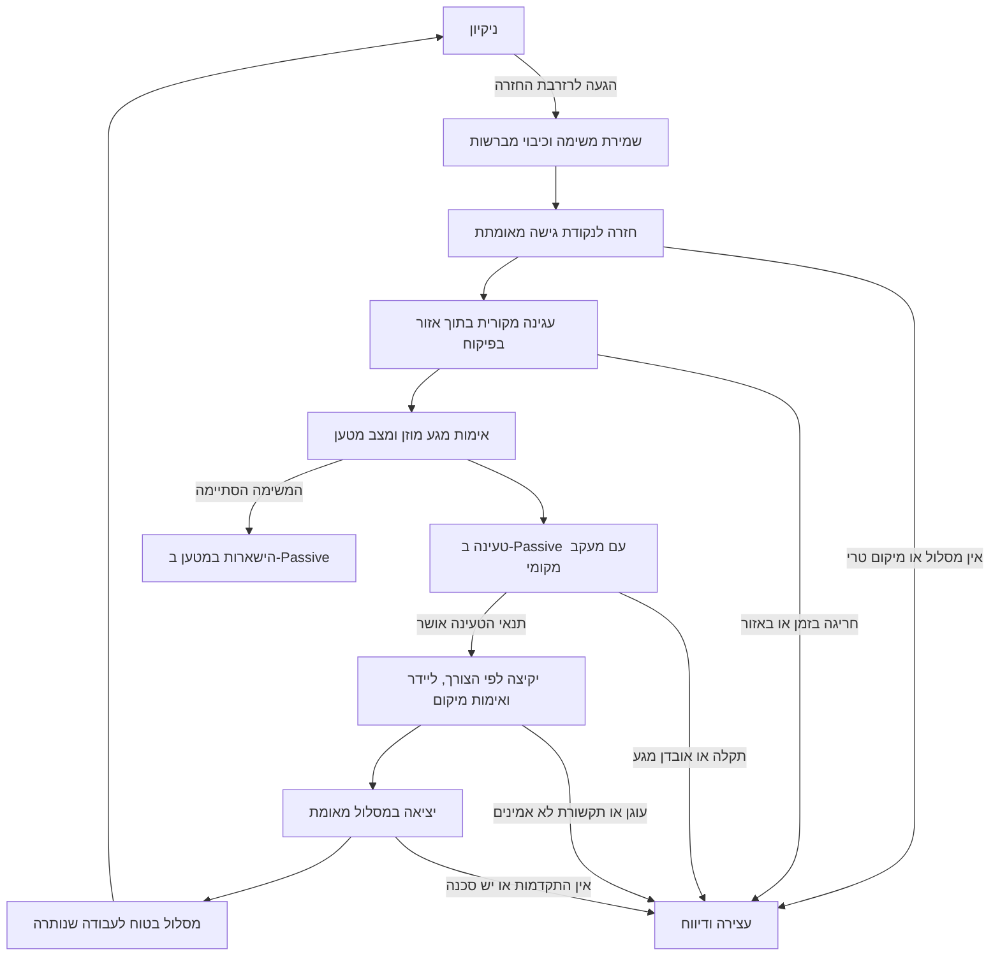

# חזרה למטען, טעינה, המשך ניקיון והגנה על הבסיס

2026-11-10 · מימוש ואימות חומרה שנותר · [English](CHARGE_RESUME_PLAN.md)

מימוש הטעינה, המפות והדיווח המתואר להלן נוסף לקושחה המקומית ונבדק במחשב. היא לא נצרבה ולא נבדקה ברובוט הזה. המסמך אינו מוסיף הוראות חיווט או אישור להזין חיבורים שלא הוכרעו. להרכבה קובעים [קובץ הפריטים](../HARDWARE_INVENTORY.md), [הרכש](../AMAZON_ORDER.md), [הביקורת החשמלית](assembly/ELECTRICAL_REVIEW.md), [רשומת כיבוי ההספק](POWER_SHUTDOWN.md) ו[רצף הליידר](assembly/LIDAR_POWER_UART.md).

## מה מומש בקוד

- [`ChargeSupervisor.h`](../lib/RooNavigation/src/ChargeSupervisor.h) מפריד מצבי מטען, דורש דיווחים טריים ומתואמים, מאמת מגע עם גלגלים עומדים ומחזיק שלב הכנת ליידר יציב. המתנה, מחזור התאוששות, מידע חסר, אחוז לא תקף, תקלת מטען או מדיניות יציאה/טמפרטורה שלא אומתה אינם מאשרים יציאה. זמני מגע, מוכנות והמתנה מבוססים על מסגרות חדשות ועמידים לגלישת שעון. תקלה או חריגת זמן הכנה דורשות התאוששות מפורשת; המנהל אינו שולט במטען המקורי עצמו.
- ברירת המחדל ממתינה לתנאי תחזוקה/סיום מקורי **שאומת**. יציאה לפי אנרגיה למשימה היא בחירה נפרדת. `ROO_CHARGE_DEPARTURE_VERIFIED=false` ותחום טמפרטורה ברוחב אפס חוסמים יציאה אוטומטית עד בדיקה פיזית; 80% נשאר פרמטר משימה לדוגמה. השכמת BRC אוטומטית מושבתת במפורש משום שהמעגל והתמיכה המקורית על המטען לא אומתו. מידע ישן גורם להמתנה, לא להפעלת פונקציית הספרייה החוסמת או למעבר ל־Full.
- `Navigator::activeMs` אינו סופר Charging, Paused, Fault, Idle או Complete. הוא כן כולל חזרה, עגינה והתאוששות פעילות, ולכן **אינו** מדידת זמן מנועי ניקיון. השהיה אינה מאפסת תקציב. המשך מתוך עגינה חוזר קודם לאישור הטעינה. השהיה, מצב סופי או הגנת הספק מבטלים יציאה לאחור.
- מעבר אמיתי לחזרה מתעד `ReturnCause` — ‏`manual`, ‏`battery`, ‏`completed` — עם הזמן והמספר המקוריים. ב־`/status.return_cause` מופיעים `provenance=firmware_mission_event` ומזהי משימה ואתחול. פקודות Home חוזרות אינן משכתבות את האירוע. `reason` הישן לבדו עדיין אינו ראיה לניתוח שחיקת סוללה.
- משימת daily/deep חדשה משתמשת ב־`start(..., reuseMap=true)`: מבנה שנצפה נשמר, וכיסוי וניסיונות של המשימה הקודמת מתאפסים. שינוי גאומטריה/תצורה פוסל שימוש חוזר. `map-clear` היא פקודה מאומתת נפרדת, כשהרובוט עצור, שמחייבת עיגון מחדש. תמונת LittleFS בגרסה 5 שומרת זהויות, גרסאות מפה/עוגן, זמן פעיל, שלב ניקיון, נקודת הפסקה ואירוע חזרה. תמונות ישנות או לא תואמות נפסלות; שחזור נשאר בהשהיה עד עיגון פיזי מחדש.
- [`DockGuard.h`](../lib/RooNavigation/src/DockGuard.h) שולב באיסור תאי תכנון ובבדיקת התנועה האחרונה בקושחה. נבדקת פקודת הגלגלים השלמה אחרי הגבלת מהירות ועיגול, גם קדימה, אחורה, בסיבוב ומפקודת שרת. סיבוב בנקודת הגישה מוגבל בזמן לפני מסירת העגינה המקורית; למסלולי הגישה והיציאה יש הרשאה נפרדת בפיקוח. כל מידות החומרה נשארות לא מאומתות כברירת מחדל. [פירוט ההגנה על הבסיס](DOCK_GUARD-he.md).
- בלי קשר אמין למפה הגלובלית, נהיגה במסגרת מקומית זמנית נשארת עצורה; סיוע שרת לאימות מיקום נשאר זמין. מערכת צירים חדשה אינה יכולה למחוק את מיקום הבסיס המוגן.

### חוזה דיווח התקדמות חי

`GET /progress` מאומת מחזיר `schema:1`, ‏`source:robot`, מזהים טקסטואליים `boot_id`, ‏`mission_id`, ‏`map_id`, ומספרים `map_revision`, ‏`sequence`, ‏`at_ms`. הוא כולל תמונת `/status` מתואמת, מיקום ותקפותו, מידות/ראשית/רזולוציית מפה ומערך תאים בסדר שורות (`-1` פנוי, `0` לא ידוע, `1` תפוס), וכן מערכי בתים `coverage.main`, ‏`coverage.side`, ‏`coverage.excluded`. לכיסוי המרכזי ארבע סיביות לכל מעבר, ולמברשת הצד ארבע סיביות דגימה. זהו כיסוי משוער לפי דיווח, לא הוכחה שאין אבק מיקרוסקופי.

`dock.x/y/yaw` מתאר את **פני מגעי הטעינה** המאומתים, עם `pose_kind` מפורש; `dock.staging` היא נקודת הניווט הנפרדת. גאומטריה לא מאומתת אינה מיקום בסיס תקף. המצב כולל גם זמן דגימת סוללה, תקפות, מטען/קיבולת/זרם/טמפרטורה, מקור ומצב מטען, מדיניות וסיבת המתנה, `profile`, ‏`pass_index` שמתחיל באפס ו־`pass` הקיים שמתחיל באחד. דיווחי סרק ראשוניים משתמשים בזהות `-idle` מפורשת, לא במשימת ניקיון מומצאת. `mission_active` מתאר פעילות ניווט; גם דיווחי השהיה, תקלה וסיום שייכים להיסטוריה.

שתי תמונות מצב גולמיות מוקצות ב־PSRAM בבדיקת הצלחה. בעל הבקרה מעתיק תמונה בגודל מוגבל, בתחילה פעם בשנייה לפי הגדרה; משימת האתר מעתיקה תחת נעילה קצרה ומייצרת את מערכי JSON **אחרי שחרורה**. כשל הקצאה מונע התחלת משימת הבקרה. כשאין תמונה מוחזר מצב לא זמין; חותמת הזמן והמספר מאפשרים לשרת לסמן מידע ישן בלי להמציא תנועה. השוואת בריאות סוללה עדיין דורשת זיהוי רובוט וסוללה בהגדרות השרת.

`tests/charge_resume_test.cpp` עברה עם ASan/UBSan: אי־ספירת טעינה והשהיה ארוכות, מצבי מטען 0/1/2/3/4/5, מידע חסר/ישן/חוזר, גלישת שעון, מדיניות שלא אומתה, יציבות הכנה והגבלת זמנה, דחיית מקור פנימי כתחליף לבסיס, שימוש חוזר במפה ופסילת תצורה, שמירת אירועי חזרה, המשך מתוך עגינה ופקודות גלגלים שהוגבלו. גם בדיקות הניווט המקוריות עברו. אלה סימולציות מחשב; תוצאות הבנייה ליעד מתועדות באימות השילוב, ואין כאן בדיקת רובוט.

## ההחלטות

- בטעינה רגילה נשאיר את הבקר, ממשק הרומבה והפיקוח המקומי פעילים. אפשר לכבות את הליידר עד ההכנה ליציאה. הרומבה המקורית מנהלת את המטען; השרת מספק מדיניות משימה ומציג דיווחים.
- הבקר המקומי מחליט אם בטוח לצאת. אחרי שהמסלול הזה יושלם ויאומת, משימה מקומית שכבר אושרה תוכל להמשיך אחרי טעינה גם בלי חיבור לשרת.
- D10 מיועד להגנת הספק של התוספות, ולא למחזור טעינה רגיל או להפסקת המטען. בקר שנותק לגמרי מהחשמל אינו יכול לקבל פקודת השכמה ב־Wi-Fi. התאוששות אחרי אתחול נשארת בהמתנה למיקום אמין ולהרשאת המשך תקפה.
- 80% בקוד הוא תנאי לחזרה למשימה. הוא אינו הוכחה לשמירה על הסוללה ואינו מממש תקרת טעינה של 80%.
- המשתמש מתאר סוללת ניקל. נתייחס ל־NiMH כאפשרות המיועדת עד אימות תווית הסוללה, היצרן והמק״ט המותקנים. לא נעתיק כללי תקרת טעינה מסוללות ליתיום. ברירת המחדל המוצעת היא לאפשר למטען המקורי להשלים מחזור רגיל שאומת, לפני יציאה נוספת; יציאה מוקדמת היא מדיניות משימה נפרדת לבחירה מפורשת.
- נגן על גוף בסיס הטעינה בזמן ניקיון, גם מהצדדים. נשלב את צורתו ומיקומו במפה עם דיווחי IR שאומתו. תיאור המשתמש, שלפיו ההימנעות המקורית עבדה טוב אך התרחקה מדי, הוא מידע שימושי לבדיקה — לא מדידת מרחק ולא הוכחה שההגנה פועלת בעת נהיגה שלנו.

## המצב שנבדק לפני המימוש

הביקורת ההיסטורית הבאה מסבירה את המימוש לעיל. הפניות השורה מתארות את המקור שלפני השינוי, ולא את מספור השורות הנוכחי או התנהגות שנפרסה ברובוט.

| התנהגות קיימת | הקוד האחראי | מגבלה |
|---|---|---|
| שמירת נקודת עצירה, ניווט הביתה, בקשת עגינה מקורית וחזרה לנקודת ההפסקה | `lib/RooNavigation/src/RooNavigation.h:205`, `:428`, `:502`; `firmware/xiao/RooCoreXiao/RooCoreXiao.ino:986` | אין בדיקת עגינה פיזית; נדרשים מיקום אמין ומסלול שעדיין פנוי |
| חזרה ב־25%, המשך ב־80%, חסימה ב־6% מלבד מצב המדווח כטעינה | `RooNavigation.h:449`, `:496`, `:764` | ברירות מחדל בתוכנה, לא גבולות שנמדדו לסוללה; האחוז הוא מטען חלקי קיבולת, לא המרת מתח |
| כיבוי ליידר בטעינה מתחת ל־78%, והכנתו מעל הסף | `RooCoreXiao.ino:1296`; `RooNavigation.h:766` | במצב טעינה מותר שאין סריקות; יציאה דורשת סריקות ומיקום טריים. חסרה מניעת תנודות סביב הסף ומדיניות לכשל התנעה |
| קבלת זרם דיווחים של סוללה, מקור טעינה, מצב OI ואנקודרים ב־Passive | `RooCoreXiao.ino:1143`, `:1184` | רציפות הדיווח ויקיצה לאחר שינה על המטען לא אומתו |
| פרסום `dock_ir_raw` | `RooCoreXiao.ino:497` | הניווט אינו מפענח אותו ואינו אוכף אזור הגנה לבסיס |
| מסלול יציאה לאחור עם הגבלות זמן, זווית, התקדמות ורצפה | `RooCoreXiao.ino:1226`; `config.example.h:20` | `ROO_DOCK_EXIT_VERIFIED=false`; ‏0.60 מ׳ הוא ערך דוגמה, לא מידת בסיס או אזור מוגן שנמדדו |
| הגנת מתח מקומית שעוצרת ויכולה לבקש ניתוק דרך D10 | `lib/RooNavigation/src/PowerShutdown.h:124`; `RooCoreXiao.ino:432` | הספים הפיזיים עדיין אפס/לא מוגדרים; התאוששות ההגנה אינה מוציאה לבד את המשימה מהשהיה |
| שתי תמונות מצב מתחלפות ב־LittleFS עם בדיקת שלמות; שחזור בהשהיה | `RooCoreXiao.ino:324`, `:375` | מידע שמור אינו הוכחה למיקום הפיזי הנוכחי |

### ממצאי הביקורת שטופלו במימוש או נשארו לאימות חומרה

1. **הטעינה נספרת בתקציב זמן הניקיון.** ב־`RooNavigation.h:357` מגבלת השעתיים חלה גם על Charging. טעינה ארוכה יכולה לסיים את המשימה בתקלה `NoProgress`. בסימולציה הקיימת הטעינה מואצת, ולכן הצלחתה אינה מוכיחה המתנה תקינה במשך שעות.
2. **מגע במטען וטעינה מעורבבים.** ב־`RooCoreXiao.ino:670–673` מקור Home Base פעיל נחשב לעגינה, `Waiting` נחשב לטעינה ו־`Reconditioning` אינו נכלל. נשמור בנפרד מגע, מצב מטען ומעבר אנרגיה לסוללה. בנוסף, אחוז סוללה לא תקף פוסל כיום גם את `latest.sensorsValid` בשורה 654; צריך להפריד בין אומדן סוללה לא ידוע לבין חיישני עגינה ובטיחות תקינים, תוך המשך חסימת יציאה.
3. **השכמה על המטען טרם שולבה.** יש `wakeViaBrc()` ב־`RoombaOI.cpp:179`, אבל היישום רק מאתחל את הפין (`RooCoreXiao.ino:1435`). הפונקציה חוסמת, ולכן אין להכניסה ללולאת תנועה פעילה: נדרש רצף התאוששות מוגבל ולא חוסם, כשהרובוט עומד, בלי חכירת תנועה ובלי זרם נתונים ישן. בקושחות מקוריות ישנות ייתכן ש־BRC אינו מעיר על המטען [S1, עמודים 7, 41].
4. **היציאה ב־Safe אינה מאומתת.** הקוד מבקש Safe וממתין לאישור לפני נהיגה (`RooCoreXiao.ino:1034`). צריך לבדוק אם ה־620 הזה יכול לצאת כך מהבסיס המוזן. כשל במעבר מצב מחייב עצירה; Full אינו מעקף.
5. **אין אזור הגנה פיזי ייעודי לבסיס.** `Navigator::allowsMotion()` ב־`RooNavigation.h:229` בודק גבול חדר בזמן Cleaning. ניפוח מכשולים כללי בשורה 689 אינו צורת בסיס קבועה. נדרש כלל משותף גם לקצוות, נסיגות, שליטה מהשרת ועגינה מקורית.
6. **סיבת החזרה אינה מדווחת באופן אמין.** `goHome()` ב־`RooNavigation.h:205` לא מתעד מדוע נקרא; חזרה בגלל סוללה ופקודת בית ידנית משתמשות בו. נוסיף אירוע `return_cause` ייעודי עם מזהי משימה/אתחול ומקור ההחלטה. `reason=Battery` או מעבר למצב חזרה אינם לבדם הוכחה לחזרה בגלל סוללה. ניתוח בריאות הסוללה ישמור סיבה לא ידועה עד שיש ראיה מפורשת.

## חלוקת אחריות והספק

| שלב | בעל סמכות התנועה | מסילת הבקר וממשק הרומבה | ליידר | מי מנהל טעינה |
|---|---|---|---|---|
| ניקיון וחזרה לנקודת הגישה | הבקר; לשרת יכולה להיות הרשאת תנועה קצרה | פועלת | פועל ותקין | הרומבה המקורית |
| עגינה סופית | Seek Dock המקורי, בפיקוח הבקר | פועלת | פועל לצורך מיקום ופיקוח | הרומבה המקורית |
| טעינה, תחזוקה או המתנה | אין תנועה; OI ב־Passive | פועלת | כבוי, מלבד הכנה ליציאה | הרומבה המקורית |
| יציאה וחזרה לנקודת העבודה | הבקר המקומי במסלול שאומת | פועלת | פועל עם סריקות תקפות | הרומבה המקורית; היציאה משנה את מצבה |
| עצירה עקב תקשורת, מפה, מטען או סוללה | אין תנועה | פועלת כל עוד הגנת ההספק מאפשרת | כיבוי אחרי רצף העצירה | הרומבה המקורית; Passive כשיש תקשורת |
| ניתוק D10 | אין עוד שליטה מהתוספת | כבויה אם הניתוק מצליח | נכבה קודם | הרומבה המקורית נשארת מחוברת בנפרד |

ענף הסוללה המתוכנן מזין את D36V28F5 ואת הבקר; Pololu #2810 מפעיל רק את הליידר. הוא אינו מנתק את מסלול המטען המקורי. פדי הסוללה, חזרת הזרם ששומרת על השנט, זיהוי ורגלי Q1/Q2, מיפוי הזנת NOYITO ודירוג הנתיך עדיין מותנים באימות לפי מסמכי ההרכבה. אין כאן הוראה להוסיף דיודה, ממסר או רכישה חדשה.

EN מאפשר התנעה מחדש בהתאם למתח ואינו נעילה. חישוב 12.81/14.41V הישן אינו כיול ואינו המלצה לסוללה המותקנת. התאוששות המקור יכולה להדליק את הבקר אחרי ניתוק; השרת אינו הגורם להדלקה. שומרים את סמן הניתוק, מרווח התאוששות המתח, דרישת הדגימות הטריות והשהיית ההתאוששות הקיימת.

## רצף הפעולה המתוכנן

1. **לחזור מוקדם מספיק.** הרזרבה צריכה לכסות את המסלול הידוע, ניסיונות העגינה וצריכת התוספות. בתחילה יהיו פרמטרי בדיקה שמרניים ומפורשים; בהמשך נאמוד אנרגיית חזרה מהיסטוריה בתנאים דומים. 25% בקוד אינו הוכחה לרזרבה מספקת, במיוחד בסוללה שנשחקה. הגנת מתח נמוך עצמאית וקודמת להחלטת המשימה.
2. **לשמור לפני החזרה.** עוצרים מנועי ניקיון ושומרים גרסת מפה, מזהה משימה, שלב ומעבר שנקטעו, כיסוי, מיקום ואיכות המיקום, יעד לא גמור וגרסת עוגן הבסיס. נוסעים לנקודת הגישה עם מברשות כבויות. אם המסלול נחסם מתכננים מחדש; אין ניסיונות בלתי מוגבלים שיבזבזו את הרזרבה האחרונה.
3. **להעביר את הגישה האחרונה במפורש.** מבטלים הרשאות תנועה מהשרת ומאפשרים Seek Dock רק באזור גישה מאומת ועם ראיות עגינה מתאימות. המערכת המקורית שולטת אז בגלגלים. הבקר משגיח על מיקום, גבולות, סכנות, מגע ותקציב ניסיונות. מתכנן החדרים אינו יכול לבדו להגביל את המסלול הפנימי של הרומבה; חריגה באזור, דיווח קריטי לא טרי או מיצוי ניסיונות מחייבים עצירה.
4. **לאמת מגע בנפרד מזרימת אנרגיה.** מאשרים באמצעות כמה מסגרות חדשות שמצב המקור יציב ושהגלגלים עומדים. מתעדים מצב מטען, זרם עם סימן, מתח, טמפרטורה, מטען וקיבולת מדווחת. זיהוי מקור רגעי אינו טעינה שהושלמה. מפרידים המתנה, טעינה עיקרית, מחזור התאוששות מקורי, תחזוקה, היעדר מקור ותקלה.
5. **להמתין מקומית ב־Passive.** משמרים את המשימה ומכבים ליידר ברצף ההספק וה־UART המשולב; הבקר ממשיך לפקח. מפרידים זמן תנועה פעילה, זמן עגינה וזמן היעדר התקדמות טעינה. תחזוקה/התאוששות מקורית אינה `NoProgress` של ניקיון, אך המתנה בלי אנרגיה ותקלה כן דורשות אבחון מוגבל. זמני המתנה וגבולות טמפרטורה ייקבעו לסוללה ולבקר המקוריים; המלצת טמפרטורת חדר אינה סף לחיישן שבתוך הסוללה.
6. **להכין יציאה פעם אחת.** נועלים שלב הכנה במקום לכבות ולהדליק ליידר שוב ושוב סביב 78%. משחזרים ובודקים OI לפי הצורך, מקבלים דיווחים טריים ומתואמים, מפעילים ליידר עם זמן העלייה שנמדד ומאמתים מיקום במפה ובעוגן בסיס שלא השתנה. יציאה דורשת משימה ממתינה מורשית, אומדן סוללה ומדיניות תקפים, היעדר תקלת מטען או מחזור התאוששות, תנאי טמפרטורה בטוחים שיוגדרו, אישור הגנת ההספק ומסלול פנוי. מתח בלבד אינו תנאי יציאה.
7. **לצאת ולהמשיך מקומית.** לפי פרוטוקול Safe שאומת, נוסעים לאחור רק במסלול היציאה שנמדד, במהירות שנבדקה ועם גבולות זמן והתקדמות. מאמתים אובדן מגע ותנועה צפויים. בודקים מחדש מסלול לעבודה שנותרה ומחזירים את שלב הניקיון והמעבר; מזכים בכיסוי רק על ניקיון שבוצע בתנאים תקפים. נקודת ההפסקה נחסמה? אפשר לבחור עבודה נגישה שנותרה, בלי להציג את האזור החסום כנקי.
8. **לסיים על המטען.** כשלא נשארה עבודה, נשארים ב־Passive על הבסיס. הבקר יכול להמשיך לנטר אם הצריכה שנמדדה מאפשרת את תחזוקת הטעינה המקורית; הליידר כבוי. לא מפעילים ניקיון מיותר כדי לרוקן סוללה ולא משתמשים ב־D10 כדי ״להפסיק טעינה״.

## ניקל, אחוזי סוללה ושליטה במטען

הנחיות התחזוקה הכלליות של iRobot ממליצות להטעין סמוך לסיום השימוש, בטמפרטורת חדר, לשמור את הרובוט נקי ולהשאירו על בסיס מוזן בין שימושים [S2]. אין שם המלצה לתקרה של 80%. צריך לזהות את הסוללה המותקנת לפני טענה על הארכת חייה בהתאם לכימיה.

בפקודות OI שנבדקו אין פקודת תקרת טעינה ייעודית לפי אחוז. מצבי Safe/Full משפיעים על הטעינה המקורית, אבל החזקת אחד מהם כדי לעכב טעינה אינה שיטת התחזוקה המוצעת [S1, עמודים 4, 7–10]. D10 מנתק את התוספות, לא את המטען. לכן השרת **אינו ״מפסיק טעינה ב־80%״** בתכנון הזה.

| מדיניות מוצעת | משמעות | מצב |
|---|---|---|
| `native_cycle_complete` | המתנה לאישור מהימן שהמחזור המקורי הרגיל הסתיים/עבר לתחזוקה, לפני יציאה נוספת | ברירת המחדל המוצעת; צריך לאמת את תנאי הסיום ב־620 ובסוללה שלנו, ולא להסתפק בדגימת 100% בודדת |
| `mission_energy_ready` | יציאה כשיש די אנרגיה משוערת להמשך העבודה ולרזרבת החזרה | אפשרות עתידית לאחר מדידות; 80% הישן אינו הוכחה להארכת חיי סוללה |
| `charge_ceiling` | מניעה פעילה של טעינה מעבר לאחוז מסוים בזמן הישארות על הבסיס | לא נתמך בתכנון הזה; מחייב תכנון נפרד לשליטה במטען וראיות לסוללה המסוימת |

לא יוזמים פריקה עמוקה, איפוס מד הסוללה כדי להעלים התרעה או הפסקת מחזור התאוששות מקורי לפי כלל כללי מהרשת. אחוז OI מחושב מנתון המטען חלקי הקיבולת ב־`RoombaOI.cpp:538`; המתח מנוטר בנפרד. אלה אינם מדידת מעבדה עצמאית של קיבולת. אומדן לא אמין יוצג כלא ידוע/בהמתנה, ולא כאחוז מומצא.

## אובדן תקשורת, אתחול ומפות שמורות

אובדן Wi-Fi מסיים הרשאת תנועה מרחוק; `ControlArbiter` הקיים עוצר לפני חזרה לבקר המקומי. פיקוח הטעינה יהיה מקומי גם ללא שרת. חיבור שחזר אינו יכול להשתמש בעידן שליטה ישן או לשחזר פקודת יציאה באופן עצמאי. באתר יוצגו זמן הדיווח האחרון וסימון מידע לא עדכני; התקדמות מדומה אינה דיווח חי מהרובוט.

אובדן OI על המטען מחייב חסימת תנועה. אין להחזיק Safe במכוון כדי למנוע שינה. משתמשים ברצף השכמה ובדיקה מוגבל רק לאחר אימות מעגל BRC ותמיכת הקושחה המקורית. שומרים את קצב התקשורת: רצף פולסים יכול לשנות baud ואינו אסטרטגיית ניסיונות יקיצה. אם ההשכמה אינה זמינה, מדווחים שנדרשת התערבות; אין טענה שהשרת מסוגל לפתור זאת. המגע האחרון נשאר מידע היסטורי, לא אישור שהרובוט עדיין מחובר.

תמונות המצב הקיימות ב־LittleFS שומרות מפה וכיסוי מקומיים. עותק בשרת מועיל להיסטוריה ולהתאוששות, אך אינו דרוש לכל לולאת בקרה. נוסיף גרסת מבנה, זהות רובוט וסוללה, מזהי אתחול ומשימה, גרסת מפה ועוגן בסיס, חתימת כיול גאומטריה, מועד שלב הטעינה וסיבת הפסקה. נשמרות בדיקות שלמות ושתי תמונות מתחלפות. אחרי אתחול אין לשחזר הרשאת תנועה חיה או לסמוך על המיקום השמור; הקוד הנוכחי בצדק דורש עיגון מחדש. המשך אוטונומי אחרי אתחול הוא יכולת עתידית נפרדת, עם מיקום אמין, הרשאה תקפה וללא השהיית ניתוק/התאוששות מתח.

## ניקיון קרוב בלי להזיז את הבסיס

### המצב הנוכחי וזיהוי IR

נשמר דיווח המשתמש: בניקיון המקורי הרובוט נמנע היטב מהבסיס, אבל השאיר סביבו שטח גדול מדי. בנהיגה הישירה שלנו הבקר מנהל תנועה ב־Safe; אין להניח שההימנעות המקורית ממשיכה לשמש מגן עצמאי. הרומבה מנהלת את תנועת העגינה רק אחרי העברת סמכות מפורשת.

מפרט OI מפריד בין משפחת בסיסי 600 לבין קודי Discovery הישנים [S1, עמודים 25–26]. למשפחת 600: ‏`161` שדה הרחקה; `164/168` אות ירוק/אדום; `165/169` האות המתאים עם שדה; `172/173` שניהם בלי/עם שדה. `162` הוא קיר וירטואלי. אלו קודים שנקלטו, לא סנטימטרים; יש לזהות את הבסיס והקושחה שלנו. אין להפעיל מסכת ביטים אחידה על משפחות IR שונות. זרם הנתונים הנוכחי משתמש בחיישן הכל־כיווני, חבילה 17; תמיכה במקלטים נוספים 52/53 אינה הנחה מותרת לגבי 620.

### הגאומטריה ובדיקת כל פקודת תנועה

נשמור מצולע שנמדד לבסיס, כיוון, צד מגעי הטעינה, מקום הכבל/הספק אם הם חשופים, נקודת גישה ומסלולי כניסה ויציאה מאושרים. נכלול את גוף הרובוט והתוספות וגם את טווח המברשת במקום שבו היא עלולה לדחוף בסיס או לתפוס כבל. מידה חסרה היא משימת בדיקה — לא מספר שמנחשים מתמונה.

בתכנון רגיל, השטח האסור הוא צורת הבסיס בתוספת מעטפת הרובוט ומרווח לשגיאות ולעצירה. המרווח ייגזר משגיאת גאומטריה ומיקום, זמן תגובת המערכת ומרחק עצירה. נוסחת עבודה אפשרית: `שגיאת גאומטריה + שגיאת מיקום + מהירות × זמן תגובת עצירה + מרחק בלימה`. לכל איבר דרוש חסם שמרני שנמדד; בפנייה בודקים את המעטפת לאורך כל הסיבוב. מוסיפים גם שגיאת רזולוציית המפה והדגימה. אין כאן מרחק קבוע שהוכרז בטוח.

אותה בדיקת מסלול ומעטפת תיאכף בשער התנועה האחרון בבקר לכל המקורות: מסלול מקומי, קצוות, ניקוי נקודתי/מעבר נוסף, נסיגה, פקודות שרת, סיבוב במקום וכל תמרון אוויר עתידי בפינה. מסכת חדר או מקטע סריקה קדמי אינם מגינים מפגיעה מהצד. הגאומטריה השמורה נשארת בתוקף גם כשהליידר רואה רצפה פנויה: בסיס נמוך או כבל יכולים להימצא מתחת למישור הסריקה.

חריג הגישה והמגע יהיה מוגבל למצב, למסלול, לכיוון ולזמן, ובבעלות הבקר. הוא מאפשר רק עגינה מכוונת ויציאה מאומתת ממיקום שכבר עגון; הוא אינו מבטל את כל האזור האסור ואינו מאפשר פגיעה בצד או מאחור. ניקיון רגיל ופקודות מהשרת אינם פותחים את החריג. העגינה המקורית מפוקחת ביחס למעטפת המותרת שלה; היא אינה פטורה מכל בדיקת גאומטריה.

משתמשים ב־IR טרי ומאומת לזיהוי סביבת הבסיס ולחיזוק העוגן במפה. שדה הרחקה רחב ומוכר יכול להפעיל האטה ובדיקת מרווחים במקום מעגל איסור גדול, **רק לאחר** אימות יכולת התקרבות ועצירה. עד אז נשארים שמרניים. היעדר IR אינו הוכחה שאין בסיס, ואותות אדום/ירוק אינם טווח מדויק. אות בסיס לא מוסבר במקום אחר, מגע טעינה בלתי צפוי, פגוש ליד הבסיס, שינוי צורה או אי־התאמה במיקום פוסלים את העוגן וסוגרים גישה רגילה. עוצרים, שומרים אירוע ומאמתים מיקום/בסיס; לא דוחפים את הבסיס בחזרה ולא מבצעים נסיגות חוזרות לעברו אוטומטית.

עד פתרון אי־הוודאות נשמור אזור איסור זמני גם סביב העוגן הקודם וגם סביב מיקום הבסיס החשוד החדש. הזזת בסיס מחייבת גרסת עוגן חדשה ואימות חוזר למסלול ולכבל. באתר אפשר להציג ״הבסיס זז / צריך לאמת מיקום״; לא מזיזים בשקט את ראשית המפה כדי להתאים למגע מפתיע.

## סדר מימוש ותנאי קבלה

| משימה | קוד אחראי | הוכחת קבלה נדרשת |
|---|---|---|
| מנהל טעינה ושעונים נפרדים | `RooNavigation.h:347–453`; רכיב מקומי ממוקד חדש | טעינה מדומה ממושכת בזמן אמיתי שאינה צורכת תקציב ניקיון; כל המצבים, במיוחד הפרדה בין 0, 3 ו־4; מגע קופצני, המתנה/תקלה, מידע ישן וגלישת שעון; אין יציאה לא מורשית |
| מדיניות יציאה ניתנת להגדרה ושלב הכנה קבוע | `RooNavigation.h:449`; `RooCoreXiao.ino:1296` | כימיה/אומדן לא ידועים משאירים בהמתנה; אין תנודות סביב 78%; מחזור התאוששות/תקלה חוסמים; חייבות להיות סריקות תקפות |
| רצף השכמה והתאוששות OI | `RoombaOI.cpp:179`; `RooCoreXiao.ino:1184` | התאוששות בלי חסימת הבקרה ובלי תנועה; קושחה לא תומכת; פסילת דיווח ישן ושמירת baud |
| צורת בסיס שמורה ובדיקת תנועה אחרונה | `RooNavigation.h:229`, `:689`; `RooCoreXiao.ino:982` | מקרי פגיעה מלפנים/מהצד/מאחור/בסיבוב מכל מקור פקודה; מעטפת עגינה מקורית, בסיס מתחת לסריקה, בסיס שזז ואי־התאמת IR |
| תמונת מצב עם גרסאות, דיווח התקדמות ואירוע סיבת חזרה מפורש | `RooCoreXiao.ino:324`, `:375`, `:497`; `RooNavigation.h:205` | ניתוק באמצע כתיבה, שינוי מפה/עוגן/כיול, חיבור מחדש/פקודה ישנה, כיסוי מדויק אחרי המשך; הבדל ברור בין חזרה ידנית, סיום וסוללה |
| שמירת קדימות הגנת המתח | `PowerShutdown.h`; `FirmwarePowerPort` | הגעה למטען בזמן הכנת ניתוק, תקלת טעינה, נפילה והתאוששות מתח, אתחול עם סמן; אין לולאת יקיצה או המשך אוטומטי אחרי ניתוק מלא |

בביקורת הראשונית שוחזרה מגבלת השעתיים הישנה בזמן טעינה, למרות הצלחת הבדיקות הקיימות. הבדיקה הייעודית החדשה מאמתת כעת שטעינה אינה צורכת את התקציב הזה. בדיקות הניווט וניתוק ההספק עברו בביקורת; בדיקות השילוב מאמתות את המקור הסופי שהשתנה. אלה בדיקות מודל במחשב, לא מנועים, כימיה או חומרת טעינה.

קבלה פיזית נשארת שלב בדיקה מבוקר בהמשך. מתחילים בזיהוי וברציפות ללא מתח לפי מדריך ההרכבה. בדיקות מוזנות מחייבות מקור, חיווט והגנות שאושרו, ואינן מאושרות רק מכוח המסמך הזה. מתעדים מתח DC במקור המאומת ובמסילות, זרם ומצב מטען מקוריים, גיל דיווחים, מצב OI בפועל, אנקודרים ומעברי הספק לליידר. תנאי מעבר: מסילות יציבות בתחומים המתועדים, אין הזנה חוזרת/אתחול, זרם טעינה נטו בשלב הטעינה העיקרית הצפוי, תחזוקת טעינה תקינה עם עומס ההמתנה שנמדד, דיווח/יקיצה על המטען, יציאה בטוחה ובסיס שלא זז. משווים מתח/זרם OI למדידה עצמאית מתאימה בלי לגשר על השנט. מידות הבסיס, מרווח עצירה, תמיכת השכמה וקריטריוני זמן/טמפרטורה עדיין אינם מוכרעים; לא נטען שעבר מבחן פיזי.

## מקורות

- **S1:** מסמך iRobot [מפרט Create 2 המבוסס על Roomba 600, מ־2021-04-13](https://cdn.hackaday.io/files/1835247851890816/2021-04-13_iRobot_Roomba_600_Open_Interface_Spec-3.pdf), עמודים מודפסים 4, 7–11, 25–29, 41. זהו עותק מתארח של מסמך פרוטוקול, ולא הוכחה לכל יכולות ה־620 שלנו. הגדרות הבתים הרלוונטיות מופיעות גם בספריית OI המקומית.
- **S2:** iRobot, [תחזוקת סוללת Roomba](https://support.irobot.co.uk/articles/en_US/Knowledge/7273), נבדק ב־2026-11-10. זהות הסוללה המותקנת עדיין דורשת אימות.
- שיטת העבודה: [electronics](https://github.com/magnus919/agent-skills/blob/main/electronics/SKILL.md) ו־[esp32-development](https://github.com/magnus919/agent-skills/blob/main/esp32-development/SKILL.md), כולל חומרי ההספק/הגנה ותקשורת/הספק. אלה הוראות ביקורת, לא מדידות חשמליות.
