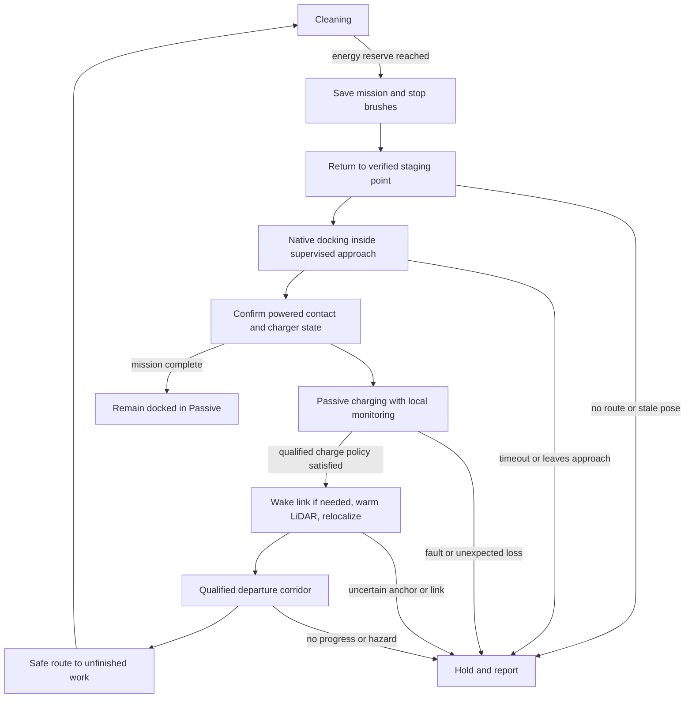

# Return, recharge, resume and Home Base protection

2026-11-10 · Implementation and remaining hardware qualification · [עברית](CHARGE_RESUME_PLAN-he.md)

The charge/map/telemetry implementation described below is now in the local firmware source, with host tests. It has not been flashed or validated on this robot. This document adds no wiring instructions or authority to energize unresolved connections. The current [inventory](../HARDWARE_INVENTORY.md), [order record](../AMAZON_ORDER.md), [electrical review](assembly/ELECTRICAL_REVIEW.md), [power shutdown record](POWER_SHUTDOWN.md) and [LiDAR sequence](assembly/LIDAR_POWER_UART.md) remain authoritative for assembly.

## Implemented in source

- [`ChargeSupervisor.h`](../lib/RooNavigation/src/ChargeSupervisor.h) supervises distinct charger states and fresh coherent packets, confirms contact with stopped wheels, and latches LiDAR preparation. Waiting, reconditioning, missing telemetry, invalid SOC, charger fault and unqualified temperature/departure policy cannot authorize departure. Contact, ready and waiting intervals use fresh generations and wrap-safe time. A charger fault or preparation timeout requires explicit recovery; none of these controls the native charger itself.
- The default policy waits for a **qualified** native maintenance/completion predicate. Mission-energy departure is a separate configuration choice. `ROO_CHARGE_DEPARTURE_VERIFIED=false` and the zero-width pack-temperature range prevent automatic departure until actual qualification; the example 80% remains a mission parameter. Automatic BRC wake is explicitly disabled because the circuit and on-dock native support remain unverified; stale-link handling holds rather than invoking the blocking library helper or Full mode.
- `Navigator::activeMs` excludes Charging, Paused, Fault, Idle and Complete. It includes active return/docking/recovery, so it is **not** a cleaning-motor runtime measurement. Pausing does not reset the budget. A docked resume re-enters charging qualification before departure. Firmware aborts undocking on pause, terminal state or power hold.
- Every actual return transition records `ReturnCause` (`manual`, `battery`, `completed`) and its original timestamp/sequence. `/status.return_cause` adds `provenance=firmware_mission_event`, boot and mission identity. Repeated Home requests do not rewrite the event. Legacy `reason` alone remains insufficient evidence for battery-health analytics.
- New daily/deep missions call `start(..., reuseMap=true)`: observed occupancy is retained and new mission coverage/retries are cleared. Changed geometry/configuration rejects reuse. `map-clear` is a separate authenticated stopped-state command and requires reanchor. LittleFS schema 5 persists identities, map/anchor revisions, active time, cleaning phase, interruption pose and return event; old/incompatible snapshots are rejected, not silently interpreted. Restore remains paused and requires physical reanchor.
- [`DockGuard.h`](../lib/RooNavigation/src/DockGuard.h) is integrated into planner cell exclusion and the final firmware motion gate. The gate checks the actual integer wheel command after saturation/rounding; this includes forward/reverse/turn/remote paths. Ordinary staging rotation is bounded before native docking, with a separate supervised approach/departure permit. All measured geometry defaults remain unqualified. See [dock protection](DOCK_GUARD.md).
- Without a trustworthy transform into the global map, provisional local driving is held; server-assisted relocalization remains available. A fresh local coordinate frame cannot discard the protected base location.

### Live progress contract

Authenticated `GET /progress` returns `schema:1`, `source:robot`, string `boot_id`, `mission_id`, `map_id`, and integer `map_revision`, `sequence`, `at_ms`. It includes a coherent `/status` object, pose validity, map dimensions/origin/resolution with row-major `cells` (`-1` free, `0` unknown, `1` occupied), and byte arrays `coverage.main`, `coverage.side`, `coverage.excluded`. Main coverage has four bits per pass; side coverage has four sample bits. This is estimated reported coverage, not proof of microscopic cleanliness.

`dock.x/y/yaw` describes the qualified **front contact face**, explicitly identified by `pose_kind`; `dock.staging` is the separate navigation waypoint. Unqualified geometry is not a valid dock location. Status also carries coherent battery sample time, validity, charge/capacity/current/temperature, source/state, charge policy/reason, `profile`, zero-based `pass_index` and the existing one-based `pass`. Initial idle observations use an explicit `-idle` session identity, not a fabricated cleaning mission. `mission_active` follows navigation activity; paused/fault/completed records still belong in history.

Two checked PSRAM raw snapshots keep the endpoint coherent. The control owner performs only a bounded snapshot copy, initially at a configurable 1-second cadence; the web task copies under a short lock and serializes the large arrays **after releasing it**. Allocation failure prevents control-task startup. Missing snapshots return unavailable; cached timestamps/sequence let the server show stale data without inventing movement. Server-configured robot/battery identity is still required for health comparisons.

`tests/charge_resume_test.cpp` passes with ASan/UBSan: long charging and pause exclusion, states 0/1/2/3/4/5, missing/stale/repeated frames, rollover, unqualified policy, preparation hysteresis/timeout, internal-source rejection, map reuse/config rejection, return-event preservation, docked resume and saturated wheel commands. The existing native navigation suite also passes. These are host simulations; target build results are recorded by the integration validation, and no robot test is implied.

## Decisions

- Normal recharge keeps the XIAO, its Roomba interface and local supervision powered. LiDAR can be off until preparation for departure. The native Roomba electronics manage the battery charger; the server supplies mission policy and displays telemetry.
- Local firmware decides whether departure is safe. A server connection is unnecessary for an already authorized local mission to finish charging and continue, once this workflow is implemented and qualified.
- D10 is emergency/add-on power protection, not routine docking and not a charger switch. A fully unpowered XIAO cannot receive a Wi-Fi wake command. Reboot recovery remains held pending a trustworthy position and authorization.
- The existing 80% value is a mission-resume threshold. It neither establishes a battery-preservation benefit nor implements an 80% charge ceiling.
- The user reports a nickel battery. Treat NiMH as provisional until the installed pack label identifies chemistry, manufacturer and part number. Do not import lithium-ion charge-ceiling rules. The proposed default is to let the native charger finish its qualified normal cycle before another cleaning sortie; earlier departure is a separate, explicitly selected mission policy.
- Protect the base physically during ordinary cleaning, including its sides. Combine a mapped base footprint with verified native IR observations. The user's observation that native avoidance works well but stays too far away is useful commissioning evidence, not a measured clearance or proof of protection during custom driving.

## Baseline inspected before implementation

The following historical review explains the changes above. Its line references identify the pre-change source, not the current line numbering or deployed behavior.

| Existing behavior | Owning source | Limit |
|---|---|---|
| Saves interruption pose, routes home, invokes native docking, resumes toward the checkpoint | `lib/RooNavigation/src/RooNavigation.h:205`, `:428`, `:502`; `firmware/xiao/RooCoreXiao/RooCoreXiao.ino:986` | No physical docking test; checkpoint must remain reachable and localization valid |
| Returns at 25%, resumes at 80%, blocks operation at 6% except reported charging | `RooNavigation.h:449`, `:496`, `:764` | Software defaults, not measured pack limits; percentage is charge/capacity, not voltage |
| Turns LiDAR off while charging below 78%, prepares it above that level | `RooCoreXiao.ino:1296`; `RooNavigation.h:766` | Charging tolerates absent scans; leaving requires fresh scans and pose. No percentage hysteresis or warm-up failure policy yet |
| Streams battery, charging source, mode and encoder data while Passive | `RooCoreXiao.ino:1143`, `:1184` | Runtime sleep/wake and charging-stream continuity are unverified |
| Publishes `dock_ir_raw` | `RooCoreXiao.ino:497` | Navigation does not interpret it or enforce a dock protection zone |
| Qualified reverse departure has timing, yaw, progress and floor checks | `RooCoreXiao.ino:1226`; `config.example.h:20` | `ROO_DOCK_EXIT_VERIFIED=false`; 0.60 m is an example setting, not a measured base geometry or protected zone |
| Local voltage guard quiesces and may request D10 cutoff | `lib/RooNavigation/src/PowerShutdown.h:124`; `RooCoreXiao.ino:432` | Voltage thresholds remain zero/unconfigured. Guard recovery does not automatically unpause the mission |
| Alternating checksummed LittleFS mission snapshots; boot restore is paused | `RooCoreXiao.ino:324`, `:375` | Persistent data is not proof of current physical pose |

### Review findings addressed by the implementation or remaining qualification

1. **Charging consumes the cleaning time budget.** `RooNavigation.h:357` applies the two-hour elapsed mission timer to Charging. A long recharge can fault with `NoProgress`. Existing simulator tests accelerate battery charging and do not establish long-duration behavior.
2. **Contact and charging are conflated.** `RooCoreXiao.ino:670–673` considers Home Base source presence “docked”, accepts `Waiting` as charging, and excludes `Reconditioning`. Preserve these as distinct raw observations; powered contact alone is not evidence that energy is entering the pack. Invalid percentage currently also invalidates `latest.sensorsValid` (`:654`); represent uncertain battery estimation separately from otherwise valid dock/safety telemetry while continuing to block departure.
3. **On-dock wake is not integrated.** `RoombaOI.cpp:179` has `wakeViaBrc()`, but the application only initializes the BRC pin (`RooCoreXiao.ino:1435`). Do not call its blocking helper from the active motor-control loop: implement a stopped, bounded, nonblocking link-recovery workflow with stream/lease teardown and subsequent verification. Older native firmware may not support waking on the dock [S1, pp. 7, 41].
4. **Safe-mode departure is unqualified.** The code requests Safe and waits for confirmed mode before driving (`RooCoreXiao.ino:1034`). Whether this can back off the installed powered base must be tested on this 620. A mode failure must hold; Full mode is not a fallback.
5. **No physical Home Base exclusion exists.** `Navigator::allowsMotion()` (`RooNavigation.h:229`) checks a room boundary during Cleaning. Generic occupancy inflation (`:689`) is not a persistent base footprint. Edge/recovery motion, reverse motion, remote driving and native docking need an explicit shared base policy.
6. **Return cause is not reported reliably.** `goHome()` (`RooNavigation.h:205`) does not record why it was called. Low-battery return and a manual home request share it. Add a dedicated `return_cause` event with mission/boot identity and provenance; neither `reason=Battery` nor a state transition alone establishes a battery-triggered return. Battery-health analytics must keep cause unknown until that evidence exists.

## Ownership and power states

| Phase | Motion authority | XIAO / interface rail | LiDAR | Charger authority |
|---|---|---|---|---|
| Cleaning, return to staging point | Local firmware; server may hold a short motion lease | On | On and valid | Native Roomba |
| Final docking | Native Seek Dock, supervised by MCU | On | On for localization/guarding | Native Roomba |
| Charging / maintenance / waiting | No motion; OI Passive | On | Off unless preparing departure | Native Roomba |
| Departure and route to checkpoint | Local MCU, qualified corridor | On | On with valid scans | Native Roomba; departure changes its state |
| Held due to link, map, charger or battery concern | No motion | On if protection permits | Off after required stop sequence | Native Roomba, Passive where communication works |
| D10 shutdown | No add-on control remains | Off if hardware cutoff succeeds | Off first | Original robot remains connected independently |

The proposed battery branch feeds the D36V28F5 and XIAO; Pololu #2810 switches only LiDAR. It does not interrupt the original charger path. Battery pads, shunt-preserving return, Q1/Q2 identity/pins, NOYITO supply mapping and fuse rating are still conditional in the assembly records. No extra diode, relay or new purchase is prescribed here.

EN is a voltage-dependent restart path, not a latch. Its old nominal 12.81/14.41 V calculation is neither calibration nor an installed-pack recommendation. Source recovery may boot the XIAO after cutoff; the server does not cause that boot. Persisted cutoff markers, rebound margin, fresh samples and the existing restart hold must remain in force.

## Proposed state machine

1. **Choose the return point early.** Use a conservative energy reserve that covers the known route, docking attempts and add-on consumption. Initially retain separately named conservative commissioning parameters; later estimate return energy from matched workload history. The 25% default is not proof of enough reserve, especially with a deteriorating pack. Low-voltage protection remains independent and higher priority.
2. **Checkpoint before returning.** Stop cleaning motors and save map revision, mission identity, interrupted phase/pass, coverage, pose and localization quality, unfinished target and dock anchor version. Route to the validated staging pose with cleaning off. Replan if blocked; do not repeatedly drive toward an unreachable checkpoint or consume the last reserve searching indefinitely.
3. **Hand over final approach explicitly.** Release remote leases; permit native Seek Dock only from a qualified approach region with usable docking evidence. The native routine controls its wheels. MCU supervision monitors pose, guard boundaries, hazards, contact and a bounded attempt budget; generic room routing cannot constrain an opaque native routine by itself. Abort to a stopped hold on boundary violation, stale critical telemetry or exhausted attempts.
4. **Confirm contact separately from energy flow.** Debounce distinct fresh source/state frames and stopped wheels. Record charger state, signed current, voltage, temperature, charge and estimated capacity. A transient source bit is not a completed recharge. Distinguish waiting, bulk charging, native reconditioning, maintenance, no source and fault; handle each without inventing a generic “charging=true”.
5. **Wait locally in Passive.** Preserve the mission, turn LiDAR off using the integrated UART/power sequence and keep the XIAO supervisor running. Maintain separate active-motion, dock-dwell and charger-no-progress clocks. A native maintenance/reconditioning interval is not cleaning `NoProgress`; fault/wait/no-energy conditions still need bounded diagnostics. Durations and thermal limits must be qualified for the actual pack and native controller, not copied from a room-temperature recommendation.
6. **Prepare departure once.** Latch a preparation stage instead of switching LiDAR repeatedly around 78%. Restore/probe the OI link safely if necessary, obtain fresh coherent battery/contact/mode/encoder data, warm LiDAR using measured rise time, relocalize against the correct map and validate the unchanged dock anchor. Departure requires an authorized pending mission, valid pack estimate/policy, no native charger fault/reconditioning, safe temperature criteria once specified, valid power guard and a clear route. It is not triggered by voltage alone.
7. **Leave and resume locally.** With the qualified Safe-mode departure protocol, reverse only within the measured departure corridor, at commissioned speed and bounded progress/time. Confirm contact loss and movement as expected. Follow a newly checked route to remaining work; restore the previous cleaning phase/pass and credit only actual qualified cleaning. If the old checkpoint is obstructed, choose reachable unfinished work without declaring the obstructed portion clean.
8. **Finish on the base.** With no remaining mission, remain docked in Passive. Keep MCU monitoring if its measured load permits native maintenance charging; leave LiDAR off. Do not manufacture an endless cleaning job to consume charge or use D10 to “stop charging”.

## NiMH, charge percentage and charger control

iRobot's general care guidance recommends prompt recharge, room-temperature charging, keeping the robot clean and leaving it on a powered base between uses [S2]. It does not recommend an 80% ceiling. Confirm the installed battery before making a chemistry-specific longevity claim.

The reviewed OI commands provide no dedicated percentage-based charger ceiling. Safe/Full affect native charging, but deliberately holding one of those modes to inhibit charge is not the proposed battery-care method [S1, pp. 4, 7–10]. D10 disconnects add-ons, not the battery charger. The server therefore does **not** “stop charging at 80%” in this design.

Proposed policy choices:

| Policy | Meaning | Readiness |
|---|---|---|
| `native_cycle_complete` | Wait for qualified evidence of the native normal completion/maintenance state before another sortie | Proposed default; completion predicate must be verified on the actual 620/pack, not equated to one 100% sample |
| `mission_energy_ready` | Depart when enough estimated energy exists for remaining work plus return reserve | Optional future mission policy after measurement; legacy 80% is not battery-longevity evidence |
| `charge_ceiling` | Actively prevent charging past a chosen SOC while remaining docked | Unsupported in this plan; requires a separately justified charger-control design and pack-specific evidence |

Do not force deep discharge, reset the fuel gauge to make a health warning disappear, or interrupt a native recovery cycle based on a generic internet rule. OI percentage is computed from packet 25 divided by packet 26 in `RoombaOI.cpp:538`; voltage is independently monitored. Neither is an independent capacity laboratory measurement. Uncertain estimates produce a visible unknown/held condition, not an invented SOC.

## Link loss, reboot and saved maps

Wi-Fi loss ends any remote motion lease; existing `ControlArbiter` stops before local fallback. Charging supervision must be local and remain functional offline. A returning connection cannot reuse an old epoch or independently replay a departure command. The website shows the last telemetry time and stale status, never simulated progress as current robot reports.

OI loss while docked keeps motion inhibited and must not intentionally hold Safe to prevent sleep. Use a qualified, bounded wake/reprobe sequence only with verified BRC circuitry and native firmware support. Preserve baud configuration; a pulse train can change baud and is not a wake retry strategy. Failed wake means “local wake unavailable / intervention required”, with no claim that the server can fix it. Keep the last contact record as historical rather than asserting it is still connected.

Current LittleFS snapshots preserve map and coverage locally; the server copy is useful for history and recovery but is not required for every loop. Add schema version, robot/battery identity, boot/mission IDs, map revision, dock anchor revision, geometry calibration hash, charge-phase timestamp and interruption reason. Checksum/version checks and alternating snapshots remain. After reboot, do not restore a live motion lease or trust the saved pose; current code correctly requires physical reanchor. Autonomous resume across a reboot is a separate future capability requiring reliable relocalization, valid authorization and no cutoff/rebound hold.

## Close cleaning without moving the base

### Current baseline and IR evidence

The user's native-cleaning observation is retained: the robot avoided its base reliably but left an unnecessarily wide area. The new controller owns motion in Safe; native avoidance cannot be assumed to remain an autonomous collision guard during direct driving. Native docking owns motion only after the explicit handover.

The OI reference distinguishes the Roomba 600 base family from older Discovery codes [S1, pp. 25–26]. For the 600 family the reference values are: `161` force field; `164/168` green/red; `165/169` corresponding buoy plus force field; `172/173` both buoys without/with force field. `162` denotes a Virtual Wall. These are received characters, not centimetres, and the installed base/firmware must be identified. Do not apply a universal bit mask across unrelated IR families. The existing stream uses omni packet 17; extra receiver packets 52/53 are not an assumed 620 capability.

### Required geometry and final motion gate

Store a measured base polygon, its orientation, contact face, cable/adapter footprint where exposed, staging pose and approved arrival/departure corridor. Include robot body/add-ons and brush sweep where contact could push the base or snag a cable. Missing dimensions are a commissioning requirement, not an invitation to guess from a product image.

Ordinary planning excludes the base enlarged by the robot footprint and an uncertainty/stopping margin. Derive the margin from measured geometry and localization error, actuator/telemetry latency and stopping distance. A candidate bound is `geometry_error + pose_error + speed × stop_latency + braking_distance`; every term needs a conservative measured bound, and turns require a swept footprint. The grid resolution/discretization adds its own margin. No fixed distance in this document is a safe value.

Enforce the same continuous/sufficiently bounded swept-trajectory check at the final MCU motion gate for local routes, edging, spot/touch-up, recovery reverse, server commands, in-place turns and any future corner-airflow maneuver. A room mask or forward scan sector alone misses side contact. Use the keep-out geometry even when LiDAR sees open floor: a low base or cable can sit below the scan plane.

The contact/approach exception is state-bound, corridor-bound, direction-bound and short-lived, owned by the MCU. It permits only intentional docking and the validated departure from an already docked pose; it does not remove the whole exclusion zone or allow side/back impact. Ordinary cleaning and remote commands cannot open it. Native docking is supervised against its separate permissible envelope and bounded handover, not silently exempted from all geometry.

Use verified fresh IR to recognize the base region and corroborate its mapped anchor. A known broad force field can trigger reduced speed/clearance checking rather than a blanket large no-go circle **only after** closer geometry/stop validation. Without that qualification, retain conservative avoidance. IR absence does not prove the base absent, and simultaneous/red/green codes do not give precise range. An unexplained beacon elsewhere, unexpected powered contact, a bumper event near the base, changed geometry or pose mismatch invalidates the anchor and closes ordinary access. Stop, save the event and relocalize/reconfirm the base; never push it back into place or repeatedly reverse toward it automatically.

Keep a provisional exclusion around both the old anchor and newly suspected base location until resolved. A relocated base requires a new anchor revision and revalidated approach/cable geometry. The website can show “base moved / location needs confirmation”; it must not silently drag the map origin to match an unexpected contact.

## Implementation order and acceptance

| Work item | Owning code | Acceptance evidence |
|---|---|---|
| Charge supervisor and separate timers | `RooNavigation.h:347–453`; new focused local component | Long real-time simulated recharge excluded from active mission budget; all charger states, especially 0 versus 3 versus 4, contact bounce, waiting/fault, stale packets, rollover; no uncommanded departure |
| Configurable departure policy and preparation latch | `RooNavigation.h:449`; `RooCoreXiao.ino:1296` | Unknown chemistry/estimate holds; no 78% oscillation; reconditioning/fault blocks; valid scans required |
| OI wake/recovery state machine | `RoombaOI.cpp:179`; `RooCoreXiao.ino:1184` | Nonblocking stopped recovery, incompatible firmware, stale stream invalidation and baud preservation |
| Persistent dock geometry and final motion gate | `RooNavigation.h:229`, `:689`; `RooCoreXiao.ino:982` | Front/side/rear/turn collision cases for every command source; native docking envelope, base below scan plane, moved base and IR mismatch |
| Versioned checkpoint and progress telemetry, explicit return-cause events | `RooCoreXiao.ino:324`, `:375`, `:497`; `RooNavigation.h:205` | Power loss/torn slot, changed map/dock/calibration, reconnect/old command, accurate resumed coverage; manual/finished/battery returns remain distinguishable |
| Preserve low-voltage guard priority | `PowerShutdown.h`; `FirmwarePowerPort` | Dock arrival during cutoff prep, charge fault, sag/rebound, marker restart; no wake loops or automatic restart after a hard cutoff |

The initial review reproduced the old two-hour charging deadline despite passing existing tests. The new dedicated test now verifies that charging does not consume that budget. Native navigation and power-shutdown tests passed during the review; integration runs validate the final changed source. These tests exercise host models, not motors, battery chemistry or charging hardware.

Physical acceptance remains a later controlled commissioning activity. First perform the unpowered identification/continuity checks in the assembly guide. Powered tests require the approved source, wiring and protection, and do not follow from this document alone. Log DC voltage at the verified source and add-on rails, native signed current/state, packet age, actual mode, encoder motion and LiDAR power transitions. Pass requires stable rails in their documented ranges, no backfeed/reboot, net charging during the expected bulk phase, maintained native charging with measured standby load, verified on-dock telemetry/wake, safe departure and no base displacement. Compare OI voltage/current with an appropriate independent measurement without bridging the native shunt. The dock size, stop margin, wake compatibility and charge-time/thermal criteria are unresolved until measured; no physical pass is claimed.

## Sources

- **S1:** iRobot-authored [Create 2 OI specification based on Roomba 600, 2021-04-13](https://cdn.hackaday.io/files/1835247851890816/2021-04-13_iRobot_Roomba_600_Open_Interface_Spec-3.pdf), printed pp. 4, 7–11, 25–29, 41. This hosted copy is a protocol reference, not proof of all features on the installed 620. Relevant byte definitions also appear in the local OI library.
- **S2:** iRobot [Battery maintenance tips](https://support.irobot.co.uk/articles/en_US/Knowledge/7273), checked 2026-11-10. Installed pack identity still needs verification.
- Workflow: [electronics](https://github.com/magnus919/agent-skills/blob/main/electronics/SKILL.md) and [esp32-development](https://github.com/magnus919/agent-skills/blob/main/esp32-development/SKILL.md), including power/protection and connectivity/power references. These guide the review; they are not electrical measurements.
