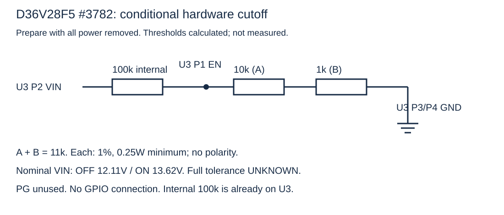
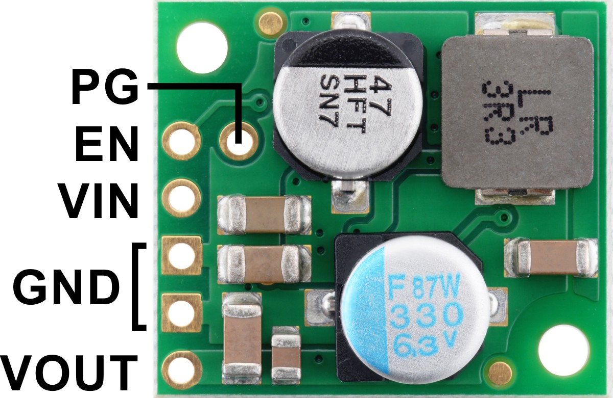

<h1 dir="rtl" lang="he">RooCore · ניהול הספק, חזרה לעמדה ומסירת שליטה בחירום</h1>

<div dir="rtl" lang="he">

<p dir="rtl" lang="he"><strong>החלטת תכנון לניסוי · 14.11.2026 · Roomba 620 עם XIAO ESP32S3 רגיל.</strong> המסמך שומר את הספים והחיבורים שבחרנו לבדוק. הוא אינו אישור להפעיל את הצמה על סוללת הרובוט: נקודות ההספק, הנתיך, ממשק ה־OI, ספי הממיר וההתנהגות הפיזית עדיין דורשים אימות.</p>

## החלטה בקצרה

| מתח הסוללה בזמן עבודה | מצב מתוכנן | פעולה מקומית של RooCore |
|---|---|---|
| ≤ **13.8V** | התרעה | התרעה; אין להתחיל משימה נוספת או להתרחק ביוזמה מהעמדה. |
| ≤ **13.5V במשך 5 שניות** | חזרה לעמדה | להפסיק ניקיון, לכבות שאיבה ושתי המברשות; להשאיר גלגלים, ליידר ובקר פעילים לצורך ניווט חזרה. המצב ננעל עד עגינה או עצירה. |
| ≤ **13.0V** | חזרה דחופה | לנסוע רק לצורך עגינה, בלי חיפוש ממושך או חידוש ניקיון; הליידר נשאר פעיל. |
| ≤ **12.5V** | עצירה והצעת Fallback | לעצור גלגלים ומנועי ניקיון. למסור שליטה לקושחת iRobot רק אם קיים אישור משתמש מפורש מראש או מתקבל כעת **וגם** בדיקות הבטיחות עוברות. אחרת להישאר בעצירה בטוחה. |
| ≈ **12.1V ב־VIN של U3** | ניתוק חומרתי של התוספת | מחלק EN מכבה את יציאת 5V של RooCore ללא תלות בתוכנה, בשרת או באישור המשתמש. |

אלה **ספי הניסוי שבחרנו**, לא ספים שהיצרן קבע ל־620 ולא תוצאות מדידה ברובוט. קריאת המתח התוכנתית היא [OI packet 22, במיליוולטים](sources/iRobot-Roomba-600-OI.pdf), תחת העומס בזמן הפעולה; סף החומרה מתייחס למתח *בפד VIN של הממיר* אחרי הנתיך והחיווט. יש למדוד את הפער ביניהם. במדריך השירות של iRobot לסדרת 500, בעמוד מודפס 21, מתועדת עצירת ניקיון ב־12V תחת עומס לסוללת NiMH בת 12 תאים; זו נקודת ייחוס היסטורית בלבד, שאינה מוכיחה את סף ה־620 המסוים או את סוג הסוללה המותקנת בו ([מסמך iRobot](https://wolf-u.li/upload/2015/09/Roomba_500_Series_SERVICE_Manual.pdf)).

**הניתוק ב־12.1V אינו מותנה במספר ניסיונות עגינה.** במפולת מתח פתאומית הוא עשוי להקדים את רצף העצירה וה־Fallback. פער הספים נותן הזדמנות לחזור, אך אינו מבטיח דקות עבודה או קבלת פקודת Dock.

## מסירת שליטה ל־iRobot: אישור ובטיחות

ברירת המחדל היא **Fallback כבוי**. אישור כללי לניקיון או לשליטה מרחוק אינו אישור למסירת שליטה. אפשר לתת אישור מפורש מראש עבור משימה מוגדרת, או לאשר הצעה בעת האירוע. בזמן שממתינים לתשובה אין תנועה; אם התקשורת או החשמל אובדים, אין להסיק מכך אישור.

גם אחרי אישור, מעבר ייחסם אם יש סכנה ידועה לרובוט או לתוספות, ובכלל זה מעבר מתחת לרהיט שעלול לפגוע בליידר או בחיישני גובה. הקושחה המקורית אינה מכירה את התוספות האלה; אין להניח שהגנות המכשולים או הגובה המקוריות מגינות עליהן. נדרש תנאי בטיחות שניתן לבדוק מקומית, ללא תלות בשרת. אם מידע הבטיחות חסר או יש ספק, נשארים בעצירה בטוחה. אישור אינו עוקף את סף EN.

אם יש אישור ותנאי הבטיחות מתקיימים: לחסום פקודות ניווט חדשות, לעצור גלגלים ב־OI Safe באמצעות `145,0,0,0,0`, לכבות את מנועי הניקיון באמצעות `138,0`, לאמת ככל שניתן שהרובוט אכן עצר, לשמור את סיבת המעבר, לכבות את הליידר **ברצף האותות וההספק המתועד**, ואז לשלוח `143` (Seek Dock) פעם אחת ולחדול מפקודות תנועה של RooCore. לפי מפרט iRobot, פקודת `143` מותרת ב־Passive/Safe/Full ומעבירה ל־Passive בעצמה; `128` הוא Start/Passive ואינו תנאי נוסף לפקודת Dock. ב־Passive טעינה אפשרית, בעוד Safe/Full אינם מאפשרים טעינת הסוללה ([מפרט OI, עמ׳ 7–11](sources/iRobot-Roomba-600-OI.pdf)). שליחת הבתים אינה אישור קבלה, ו־Seek Dock אינה התחייבות להגיע לעמדה: המפרט מתאר נסיעה לעמדה כאשר הרובוט ייתקל באלומות העגינה. יש לבדוק זאת על ה־620 בפועל לפני הפעלה עצמאית.

אם אין אישור או בדיקת הבטיחות נכשלת: להישאר עצור, לכבות את הליידר ברצף המתועד ולא לשלוח `143`. הקושחה נשארת ב־Safe בזמן ההמתנה לאישור. מעבר ל־Passive מתבצע בעת זיהוי מקור טעינה בתצורה שהמעבר בה אומת; הגדרת האימות נשארת false עד בדיקה שהמעבר אינו מחדש תנועה מקורית. Safe עצמו אינו מאפשר טעינה. אין חידוש ניקיון אוטומטי בגלל התאוששות המתח. יש לשמור חסימת חזרה לתנועה גם לאחר אתחול. אובדן קשר עם השרת, נתוני מתח/בטיחות לא תקפים או כשל ברצף החירום מובילים לעצירה, לא למסירת שליטה משתמעת.

בעגינה יש לבדוק בנפרד מקור טעינה (packet 34), מצב טעינה (packet 21) ומתח/זרם סוללה (22/23); עליית מתח לבדה אינה הוכחת טעינה. מצב 5 של packet 21 הוא תקלה. ערכי הפקטות ומצבי OI מפורטים [במסמך iRobot, עמ׳ 27–29](sources/iRobot-Roomba-600-OI.pdf).

## חשמל: טופולוגיית הניסוי והחישוב

```text
פד BAT+ ברובוט — טרם זוהה
        │
        F1 בית+נתיך 5×20, ערך/דירוג DC טרם נבחרו; סמוך למקור
        │  BAT_BRANCH_PLUS   (צד מקור XT30 בעל מגעים שקועים)
        J1 XT30 SOURCE +/−  ⇄  XT30 LOAD +/−
        │ +                            │ −
        │                              └── BAT_BRANCH_RETURN → פד SYS_RTN מועמד, טרם זוהה
        U3 VIN (P2)                         │
        │                                   └── U3 GND (P3/P4) ── GND BUS
        │  Rint=100kΩ מובנה ב־U3
        ├────────/\/\/\/────────┐
        │                       U3 EN (P1)
        │                          │
        │                        R_UV=11kΩ, 1%, ≥0.25W
        │                          │
        │                      U3 GND (P3/P4)
        U3 VOUT (P5) ── 5V BUS ── XIAO 5V/VBUS
                              └── S1 #2810 VIN ── S1 VOUT ── LiDAR VCC
        GND BUS ──────────────── XIAO GND; S1 GND; LiDAR GND
        XIAO D3/GPIO4 ────────── S1 ON       (מתג מכני OFF)
```

כל `│`, `├` ו־`└` הם צמתים; קווים שאינם נוגעים אינם מחוברים. זהו **תרשים תכנון מותנה**, לא שרטוט הרכבה משוחרר. המקור והחזרה של ענף הסוללה טרם אותרו פיזית. בסכמת R3 המקומית קיים שנט בין J14 של מינוס הסוללה לבין SYS_RTN; אין לקצר בין צדדיו או להניח שצפצוף רציפות מזהה את הצד הנכון. פיני Vpwr ‏1/2 של שקע OI אינם מקור ענף ההספק הזה.

ל־[Pololu D36V28F5 #3782](https://www.pololu.com/product/3782), בסעיף **Connections**, יש נגד משיכה פנימי של 100kΩ מ־VIN ל־EN, ניתוק כשה־EN יורד מתחת לכ־1.20V וחזרה כש־EN עולה מעל לכ־1.35V. עם נגד חיצוני יחיד של 11kΩ בין EN ל־GND:

`V_EN = V_IN × 11/(100+11)`; לכן `V_OFF ≈ 1.20×111/11 = 12.11V` ו־`V_ON ≈ 1.35×111/11 = 13.62V`.

בחישוב **סבילות הנגד החיצוני בלבד** (10.89–11.11kΩ, ובהנחת 100kΩ וספי EN מדויקים) מתקבלים בערך 12.00–12.22V לכיבוי ו־13.50–13.75V לחזרה. אלה אינם גבולות מובטחים: אין כאן טולרנס מלא של הנגד הפנימי והספים, נפילת מתח בחיווט, רעש והתאוששות סוללה. בהנחת VIN=18V ההספק ב־R_UV הוא כ־0.29mW, כך ש־0.25W מספק מרווח להספק הנגד; זו אינה בדיקת סף. EN אינו נעילה עד חיבור מטען: קפיצת מתח אחרי הסרת העומס עלולה להדליק מחדש את RooCore. צריכת ה־sleep של U3 אינה אפס.

**החלטת רכיב:** R_UV הוא 11kΩ, ‏1%, ‏0.25W לפחות. במלאי הפעיל מתועדת ערכת נגדים עם 10kΩ ו־1kΩ, אך לא תועד נגד יחיד של 11kΩ; אין לכתוב שהוא כבר נמצא פיזית. מימוש צירוף 10kΩ+1kΩ בטור מתועד כעת בנספח להלן: R_UV_A ו־R_UV_B יוצרים R_UV=11kΩ נומינלי. זהו חיווט הכנה מותנה ללא מתח; אין שינוי בדרישות האימות לפני חיבור לרובוט. תכנון ה־100kΩ החיצוני במקביל ל־100kΩ הפנימי עם 4.7kΩ+470Ω ל־GND (12.81/14.41V נומינליים) הוא **טיוטה ישנה שהוחלפה בהחלטה הזאת**. Q1/D10 של מסלול הכיבוי התוכנתי הישן אינם חלק ממחלק 11kΩ; המסלול הישן הוסר מהיישום הפעיל, ו־GPIO9 אינו מוגדר כפלט.

## טבלת חיבורים ומפת מבט

המספרים `P1–P6` ב־U3 ומיקומי פדי ה־XIAO הם **מספור מקומי לצורך הטבלה**, לא מספרי רגל של שבב. במבט הרכיבים של U3 לפי תמונת Pololu: שורת חמשת הפדים החיצונית משמאל מלמעלה למטה היא P1=EN, ‏P2=VIN, ‏P3=GND, ‏P4=GND, ‏P5=VOUT; ‏P6=PG הוא הפד הפנימי ליד EN. במבט רכיבים של XIAO עם USB למעלה: משמאל D0–D6 מלמעלה למטה; מימין 5V, GND, 3V3, D10, D9, D8, D7 מלמעלה למטה. ב־S1 משתמשים **בשמות הפדים המודפסים**; Pololu אינה מספקת בטבלת המוצר מספר רגל ייחודי לפדים האלה. השווה את היחידות שבידך למפות היצרן לפני כל חיבור.

| רשת / קוטביות | מקצה: רכיב ופד פיזי | אל: רכיב ופד פיזי | מצב ודרישה |
|---|---|---|---|
| `BAT_BRANCH_PLUS` + | פד BAT+ ברובוט — **לא זוהה** | F1 כניסה, חוט 16AWG של בית הנתיך | תכנון בלבד; נתיך סמוך למקור, ערך/כושר ניתוק DC לא אומתו. |
| `BAT_BRANCH_PLUS` + | F1 יציאה | J1 XT30 SOURCE + → LOAD + → U3 P2 `VIN` | תכנון מותנה; מקור עם מגעים שקועים, 18AWG בצמת XT30; קוטביות ברציפות. |
| `BAT_BRANCH_RETURN` − | פד החזרה בצד SYS_RTN — **לא זוהה** | J1 XT30 SOURCE − → LOAD − → U3 P3 `GND` | תכנון מותנה; אין גשר לשנט J14↔SYS_RTN. |
| `EN_SENSE` | U3 P1 `EN` | R_UV קצה 1, 11kΩ 1%, ≥0.25W | מחלק חדש לניסוי; טרם הורכב/נמדד. |
| `GND BUS` | R_UV קצה 2 | U3 P3/P4 `GND` | אותו GND של VIN; לא אל BAT− בצד שנט לא מאומת. |
| `5V BUS` + | U3 P5 `VOUT` | XIAO פד `5V/VBUS` עליון מימין; S1 פד `VIN` | חיבורי צמת הכנה קיימים; 5V בלבד אחרי הממיר. |
| `GND BUS` − | U3 P4 `GND` | XIAO פד `GND` שני מימין; S1 `GND`; LiDAR `GND` | צומת משותף מבודד; אין חיבור ל־SW. |
| `5V_LIDAR_SWITCHED` + | S1 `VOUT` | T-mini Plus `VCC` דרך מחבר GH | מיפוי התקע לפי מבט **לתוך שקע החיישן**; זנב 28AWG. |
| `LIDAR_ENABLE` | XIAO פד D3/GPIO4, רביעי משמאל | S1 `ON` | מתג מכני OFF; אין נגד חיצוני בטור. `SW` פנוי. |
| `LIDAR_TX` | XIAO D4/GPIO5, חמישי משמאל | LiDAR `RX` | UART ‏3.3V קבוע; ללא NOYITO. |
| `LIDAR_RX` | LiDAR `TX` | XIAO D5/GPIO6, שישי משמאל | UART ‏3.3V קבוע; לא מחליפים חוטים בכיבוי שגרתי. |

ל־[Pololu #2810](https://www.pololu.com/product/2810), בסעיף **Using the MOSFET Slide Switch**, `ON` גבוה מכ־1V מפעיל ו־LOW/פתוח מכבה כשהמתג המכני OFF. בסכמה הרשמית שלו [R4=10kΩ ו־R5=10kΩ פנימיים](https://www.pololu.com/file/0J888/mini-mosfet-slide-switch-schematic-diagram.pdf); **אין R8 חיצוני**. `SW` מיועד לשליטה במתג חלופי ואינו GPIO בתכנון. #2810 מוזן מ־5V, בתחום העבודה המומלץ 1.8–16V; 6A בכותרת אינו דירוג זרם מתמשך ב־55°C, שבו מצוין 3A. הוא מפסק ענף הליידר, לא מפסק חירום למנועי הרומבה.

ה־[D36V28F5](https://www.pololu.com/product/3782) נותן 5V בדיוק 4% (4.8–5.2V ביציאה). ה־[T-mini Plus, טבלה 2](sources/YDLIDAR-T-mini-Plus-v1.1.pdf) דורש 4.8–5.2V בשקעו; לכן בקצה הנמוך אין מרווח מובטח לנפילה במתג, בכבל ובמגעים. מודדים במגעי החיישן תחת עומס ובהתנעה. זרם התנעת הליידר עד 1A לפי המסמך; יש להוסיף את זרם ה־XIAO ושאר עומסי ה־5V בבחירת הממיר/נתיך. נתיך כניסה אינו בהכרח מגן על כל זנב 28AWG בצד היציאה.

## ממשק OI/SCI של הרומבה — נתיב מותנה

מפת השקע היא **מבט מלמעלה לתוך שקע הנקבה ברובוט**, כשמגעים 6/7 לכיוון ההיקף, לפי [iRobot, עמוד 3](sources/iRobot-Roomba-600-OI.pdf). צמת OI המתוכננת היא חוטים נמוכי פרופיל עם בידוד וקיבוע בדבק כדי שהמכסה המקורי ייסגר; גוף תקע Mini-DIN אינו דרישת רכש. כל מגע ייבדק מול כיוון המבט על היחידה הפיזית לפני חיבור, בלי להסתמך על צבע החוט.

| מגע OI | שם ותפקיד לפי iRobot | יעד תכנוני בצד RooCore | מצב |
|---:|---|---|---|
| 1, 2 | `Vpwr`, פלוס סוללה דרך PTC משותף של 200mA | **ללא חיבור**; אין להזין מהם את RooCore. | החלטה סופית. |
| 3 | `RXD`, קלט 0–5V לרובוט | XIAO D0/GPIO1 ‏TX, פד שמאלי עליון, **דרך** ערוץ מתאם רמות מתאים | מותנה במיפוי NOYITO U1 ובבדיקת רמות/כיוון. אין חיבור ישיר מאושר. |
| 4 | `TXD`, פלט 0–5V מהרובוט | XIAO D1/GPIO2 ‏RX, פד שני משמאל, **דרך** ערוץ מתאם רמות מתאים | מותנה באותו מיפוי; אסור להזין GPIO ב־5V. |
| 5 | `BRC`, בקרת baud/wake | Q2 משיכה ל־GND מ־XIAO D9/GPIO8 | חיבור Q2/נגדיו טרם שוחרר; לא לחבר GPIO ישירות ל־BRC. |
| 6, 7 | `GND`, ייחוס OI | ייחוס ממשק בלבד; התאמה ל־`GND BUS`/SYS_RTN רק אחרי זיהוי צד השנט | אין לגשר אוטומטית למינוס הסוללה. מגע אחד מספיק לייחוס אות לאחר אימות. |

מפרט OI מציין UART ‏115200 או 19200, ‏8N1 ללא בקרת זרימה ([עמ׳ 4](sources/iRobot-Roomba-600-OI.pdf)). הקושחה הנוכחית מנתבת UART1 אל GPIO1 כ־TX ו־GPIO2 כ־RX; זהו תכנון D0/D1, אף שהכיתובים D6/D7 בלוח כוללים TX/RX כברירת מחדל. המהירות בפועל של ה־620 וגרסת הקושחה טרם נבדקו. U1 הוא **מודול NOYITO TXB0104/WCMCU-401 אחד** המיועד ל־OI; ניתוב פדי `VCC/3V3/OE` שלו אינו מאומת, ולכן לא נרשמו כאן מספרי חורי A/B או חיבורי הזנה כפקודת הלחמה. המודול השני ספייר ואינו נחוץ ל־UART ‏3.3V של הליידר. לא מחברים יציאת 3V3 של XIAO לפד 3V3 של U1 בניחוש. [מפת הבדיקות החסרות](ELECTRICAL_REVIEW.md) מגדירה כיצד לסגור זאת.

## מה כבר קיים בקוד ומה נדרש כדי לממש את ההחלטה

המדיניות משולבת כעת בקושחת `RooCoreXiao` באמצעות `PowerManagement.h`: ספי 13.8/13.5/13.0/12.5V, חזרה ננעלת, עצירה, שמירה לפני משימה, אישור מפורש הקשור לאתחול ולמשימה, ובדיקת בטיחות מקומית לפני `143`. גם פקודת Dock בנקודת הגישה לעמדה מייצרת הצעת מסירת שליטה במקום לעקוף אישור; ההצעה עשויה להופיע לפני 12.5V. מסלול D10/Q1 הישן אינו מופעל בקושחה החדשה. [התנהגות, API, כיול ובדיקות](../POWER_MANAGEMENT-he.md).

הפעלת החומרה נשארת חסומה: דגלי האימות החדשים `false`, ערכי המדידה 0, ולא בוצעו צריבה או בדיקות רובוט. אישור משתמש אינו מפעיל דגלי אימות. חיישני גובה נוספים אינם משולבים עדיין; Fallback מוגבל למסדרון עמדה שעוגן ואומת פיזית לגובה ולמעטפת כל התוספות, עם חיישני OI, פוזיציה ו־IR טריים. מחוץ למסדרון או בלי אימות כזה נשארים עצורים. ב־Critical/Handoff מחכים לאנקודרים ללא שינוי ואז מכבים את הליידר; ללא אישור נשארים ב־Safe. כניסה לטעינה משחררת ל־Passive רק בתצורה שהמעבר בה אומת פיזית. אין חידוש ניקיון אחרי חזרת מתח בלבד.

## תנאי הכרעה לפני חיבור לסוללה ולפני נסיעה עצמאית

| שלב | נקודת בדיקה ושיטה | תוצאה הנדרשת / הכרעה |
|---|---|---|
| ללא מתח | לזהות דגם/סימון U3, S1, XIAO, R_UV ונתיך; למפות XT30, GH ושקע OI ברציפות/התנגדות | אין קצר בין רשתות; מגעי המקור שקועים; מגעי OI נמוכי הפרופיל מבודדים ובעלי אחיזה; לא נבחרו פדי רובוט בניחוש. |
| ללא מתח | לזהות את פדי BAT+ ו־SYS_RTN בלוח 620 ולבחור נתיך לפי מפרט DC, זרם התנעה וכושר ניתוק | עד שאין זיהוי ומפרט נתיך, ענף הסוללה אינו מוכן לחיבור. |
| ספק מעבדה, בלי רובוט | למדוד ב־U3 VIN/GND, ‏EN/GND ו־VOUT/GND בעת עליה/ירידה מבוקרת, עם עומס מייצג | להשוות לספי 12.11/13.62V **המחושבים**; לרשום ספי היחידה בפועל, תנאי עומס ואי־ודאות. חריגה שמשנה את סדר 12.5→12.1 מחייבת שינוי תכנון. |
| ספק מעבדה, אחרי בדיקת ההזנה | למדוד בכניסת ה־XIAO וב־VCC/GND של הליידר, כולל התנעה, כיבוי, reset וניתוק | 4.8–5.2V במגעי הליידר בתנאים המותרים, ללא הזנה חוזרת מזיקה דרך UART/USB. |
| רובוט בפיקוח לאחר השלמת הממשק | להשוות OI packet 22 מול VIN תחת ניקיון/נסיעה, למדוד התאוששות מתח, ולבדוק עצירה, Dock וטעינה | הספים מסודרים בפועל; `143` נבדק על 620; אישור חסר/סכנה חוסמים Fallback; packet 21/34 מאשרים טעינה. לא בוצע. |

בדיקות מתח נעשות במולטימטר במצב **DC V** עם ייחוס GND מאומת; רציפות/התנגדות רק כשהכול מנותק. צריבת USB נעשית כשה־XIAO מנותק **מכל** הצמה, כולל אותות, לפי בחירת מקור יחיד ללא דיודה. אין לקדוח או לחתוך את הרובוט; חריג ההלחמה היחיד שנבחר הוא שני מוליכי ההספק לפדים חשופים **לאחר** אימותם כמסילות הסוללה. כל היתר ניתן להסרה.

## מקורות ומצב הראיות

- [Pololu #3782](https://www.pololu.com/product/3782), **Details → Features/Connections**: טווח כניסה, דיוק יציאה, 100kΩ פנימי, EN ו־PG. אלה נתוני יצרן; ספי 12.11/13.62V הם חישוב שלנו.
- [Pololu #2810](https://www.pololu.com/product/2810), **Using the MOSFET Slide Switch** ו־[סכמת היצרן](https://www.pololu.com/file/0J888/mini-mosfet-slide-switch-schematic-diagram.pdf): VIN/VOUT/GND/ON/SW, מצב ON ונגדי הבקרה.
- [Seeed XIAO ESP32S3](https://wiki.seeedstudio.com/xiao_esp32s3_getting_started/), **Hardware Overview → Pin Map**: 5V/GND, ‏D3–D10 ומספרי GPIO. מפת פדי הלוח אינה מספור רגלי השבב.
- [iRobot Roomba 600 OI, מהדורת 2021](sources/iRobot-Roomba-600-OI.pdf), עמ׳ 3–4, 7–11, 13–15, 27–29: שקע, UART, מצבים, פקודות וחיישני טעינה. מסמך iRobot חל על משפחת 600/Create 2; התאמה ל־620 ולגרסת הקושחה שלו עדיין תיבדק.
- [iRobot Roomba 500 Service Manual](https://wolf-u.li/upload/2015/09/Roomba_500_Series_SERVICE_Manual.pdf), עמ׳ מודפס 21: ייחוס היסטורי ל־12V תחת עומס, לא סף שנמדד אצלנו.
- [מלאי הפרויקט](../../HARDWARE_INVENTORY.md), [רשומת הרכש](../../AMAZON_ORDER.md), [ביקורת המודולים](MODULE_AUDIT.md), [הביקורת החשמלית](ELECTRICAL_REVIEW.md), [רצף הליידר](LIDAR_POWER_UART.md): מצב החלקים, הבדיקות שנותרו והקושחה הקיימת. הרכישות מתועדות; קבלה פיזית והרכבה לא אומתו כאן.

</div>


למידת הסוללה משולבת בקושחה, ללא שינוי מחלק EN או חיווט: [מעקב, שמירה ורזרבת חזרה](../BATTERY_LEARNING-he.md). הפעלה מסתגלת ושמירה ב־Flash נשארות חסומות עד כיול ואימות.


## הכנת שני הנגדים לניתוק החומרתי — ללא מתח

**לממיר D36V28F5 #3782 בלבד, אחרי השוואת היחידה למפת היצרן.** שני נגדים מערכת ELEGOO B072BL2VX1: ‏R_UV_A=10kΩ ו־R_UV_B=1kΩ, כל אחד 1% ו־0.25W לפחות. הרכש מתועד; לא אומתה קבלה או זהות של נגד פיזי. מספר חלק יצרן פרטני ומידות המארז לא פורסמו. לנגדים אין קוטביות; המספרים 1/2 הם שמות מקומיים לקצות החוט שלהם.





מבט **מצד הרכיבים, בדיוק בכיוון שבתמונה**: חמשת החורים החיצוניים משמאל מלמעלה למטה הם P1 EN, ‏P2 VIN, ‏P3 GND (הפד הריבועי), ‏P4 GND, ‏P5 VOUT. החור הפנימי ליד EN הוא P6 PG. המספרים מקומיים ואינם מספור יצרן של שבב. שני GND מחוברים פנימית, וניתן לבחור אחד מהם לקצה התחתון.

| רשת | מקצה — רכיב וקצה/פד | אל קצה — רכיב וקצה/פד |
|---|---|---|
| EN_SENSE | U3 P1, המסומן EN | R_UV_A ‏10kΩ, קצה 1 |
| UV_MID | R_UV_A ‏10kΩ, קצה 2 | R_UV_B ‏1kΩ, קצה 1 |
| GND | R_UV_B ‏1kΩ, קצה 2 | U3 P3 או P4, המסומן GND |

1. נתק סוללה, מטען, USB וכל חיבור חיצוני; התחל בנגדים נפרדים מהממיר.
2. במולטימטר במצב Ω, מדוד כל נגד בנפרד. טווחי הרכיב הנומינליים לפי 1%: ‏9.90–10.10kΩ ו־990–1010Ω. חבר קצה של 10kΩ לקצה של 1kΩ ובודד את החיבור. מדוד בין שני הקצוות החופשיים לפני חיבורם לממיר: ‏10.89–11.11kΩ. יש להביא בחשבון דיוק המכשיר; אם לא ניתן לאשר את הערכים, אל תמשיך לחיבור.
3. רק לאחר התאמת מפת הפדים: הקצה החופשי של 10kΩ ל־EN, הקצה החופשי של 1kΩ לאחד מפדי GND. אפשר להחליף את סדר הנגדים בלי לשנות את הסף. אין לחבר את נקודת האמצע לשום מעגל נוסף.
4. לזוג הזה נבחר חיבור בטור ללא לוח PCB נפרד כדי לחסוך מקום. השתמש בחוט אות גמיש, קצר ומבודד, למשל 22AWG, כדי שלא יופעל מנוף על פדי הממיר. הלחם ובודד כל חיבור מתכתי חשוף בכיווץ חום וקבע בצורה נשלפת עם שחרור מתיחה, הרחק מחלקים נעים וחמים. כשהכול ללא מתח, בדוק שהמכסה המקורי נסגר ללא לחץ על הנגדים או צביטת חוטים; המרווח בפועל טרם נבדק. זה אינו נתיב זרם העומס ואין מפת חורים ללוח מחורר שלא נבדק ברציפות.
5. PG נשאר פנוי. VIN/VOUT נשארים בתפקידי ההזנה הקיימים. נגד 100kΩ שמופיע בסכמה כבר מובנה בממיר; אין להוסיף אותו. אין חיבור של EN ל־XIAO, ל־D10 או ל־Q1 במסלול הזה.

בחיבור הטורי, שני נגדי 1% נותנים יחד 11kΩ ±1% במקרה הגרוע. בהנחת VIN=18V והערכים הפנימיים הנומינליים, הזרם במחלק כ־162µA; ההספק המחושב ב־10kΩ כ־0.263mW וב־1kΩ כ־0.0263mW. גם בקצה הנגדים הגבוה, 0.25W מספק מרווח גדול להספק; דירוג זה אינו מאמת את סף הניתוק. חישובי הספים והטולרנסים לעיל עדיין חלים.

**בדיקת ההמשך היא בספק מעבדה מוגבל זרם ללא רובוט**, עם מדידת VIN/GND ו־VOUT/GND במצב DC ורישום מתח הכיבוי בירידה ומתח החזרה בעלייה. הצפי הנומינלי הוא 12.11V/13.62V; סבילות הסף הפנימי לא פורסמה ולכן אין טווח קבלה מובטח מהחישוב. יש לוודא שהסף בפועל משאיר את סדר העצירה ב־12.5V לפני ניתוק, תוך התחשבות בנפילת חיווט ובאי־ודאות המדידה. אין להשתמש בסוללת הרובוט לניסוי הראשון. זה מכבה את מסילת התוספת; הוא אינו מנתק את סוללת הרומבה או את מנועיה, אינו נעילה עד טעינה ואינו בידוד USB/UART. סוגיות הנתיך, פדי המקור, השנט והזנה חוזרת נשארות פתוחות.

[טבלת CSV](uv-divider.csv) · [רכיבים ורשתות JSON](uv-divider.json) · [שרטוט draw.io](uv-divider.drawio). אלה נספחי תכנון נפרדים מצמת ההכנה בת 13 החוטים; לא בוצעו ERC/DRC של CAD או בדיקת חומרה.
