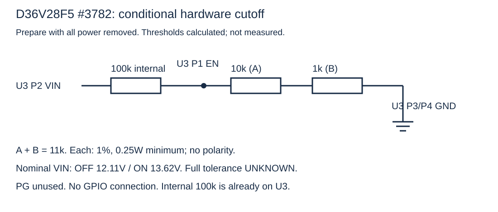
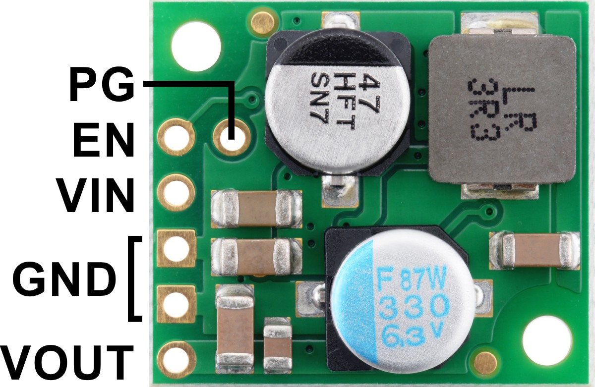

# RooCore — הוראות לאחר ביקורת מודולים
2026-11-14 • electronics + esp32-development • גרסה 11 — מחלק EN קומפקטי, כיבוי ליידר בבקר וסנכרון מלא
[English version](en/README.md)


[החוברת עם תמונות וחוטים](RooCore-assembly.html) · [כל החוטים בתמונה משולבת](combined-wiring.html) · [ביקורת המודולים](MODULE_AUDIT.md) · [הביקורת החשמלית ומפות הרגליים](ELECTRICAL_REVIEW.md) · [סכמת המודולים](electrical-schematic.svg)

**אין עדיין אישור לחיבור לסוללת הרומבה.** תנאי כל שלב מחייבים.

## הגדרה ראשונית — USB, בחירת Wi-Fi וחיבור לשרת

הקוד משולב ונבנה; מסך ההגדרה נבדק מול שרת מדומה. לא בוצעו צריבה, בדיקת רדיו, שמירת NVS על בקר או בדיקת רובוט פיזית. אלה הוראות לביצוע עתידי בתנאים המפורטים, ולא רשומה של שלבים שכבר בוצעו.

**עושים את הכנת התוכנה ב־USB לפני חיבור הבקר לצמה. מנתקים את XIAO מכל החוטים החיצוניים, כולל מתח ואותות, מהרומבה ומהמטען. הבקר מקבל מתח רק מכבל USB נתונים. אין בשלב הזה חיבור לסוללת הרובוט, הפעלת מנועים או שינוי בדגלי אימות החומרה.**

### מה מכינים בקובץ הפרטי

| שדה | מה מגדירים | למה הוא משמש |
|---|---|---|
| ROO_WIFI_SSID / ROO_WIFI_PASSWORD | ריקים לבחירה במסך ההגדרה; אפשר להשאיר גם אחרי שהרשת נשמרה בבקר. | חיבור לרשת הבית בלבד; אינם פרטי הכניסה לאתר. |
| ROO_SETUP_AP_PASSWORD | סיסמה ייחודית של 12–63 תווי ASCII מודפסים ללא רווחים. ערך ריק משבית את רשת ההגדרה. | כניסה לרשת RooCore-Setup הזמנית. |
| ROO_CLOUD_ENABLED / ROO_CLOUD_REQUIRE_POLICY | true / true בתצורה הפרטית המיועדת לענן. | שידור לשרת והחזקת תנועה עד שמירת מדיניות האזורים המתאימה. |
| ROO_CLOUD_DEVICE_TOKEN | מפתח פרטי שהונפק בשרת עבור roomba-620. אין להשתמש במפתח sim-620 או בסיסמת משתמש. | אימות הבקר מול השרת; אינו ניתן לשינוי במסך Wi-Fi. |
| ROO_API_TOKEN / ROO_OTA_ENABLED | לשלב ההכנה הזה משאירים את API ה־LAN ללא מפתח ואת OTA כבוי, אם אינם נדרשים בנפרד. | שירותי LAN/עדכון נפרדים; אינם נדרשים לשידור HTTPS יוצא. |
| ROO_COMMISSIONED וכל דגלי האימות/הכיול | נשארים false וערכי מדידה שלא אומתו נשארים 0. | חיבור לשרת אינו אישור להפעלת חומרה. |

### 1 · מזהים את הבקר ומכינים את הקובץ

1. היעד הוא XIAO ESP32S3 רגיל, עם 8MB Flash ו־OPI PSRAM. זהו תהליך לקושחת RooCoreXiao המלאה, ולא ל־RooCoreMatterSim, לדוגמת LinkSetup או לתצורת הבדיקה הסינתטית.
2. בעמדת הבעלים קובץ התצורה נמצא ב־/Users/ransaymour/Documents/Codex/RooCore Server/XIAO-cloud-config.private.h. שומרים אותו פרטי; אין לשים סיסמאות בצ׳אט, במדריך, ב־Git או בחבילת ההרכבה. בעמדה אחרת מתחילים מעותק config.example.h ומקבלים את מפתח ההתקן מהמנהל בדרך פרטית.
3. מעתיקים את התוכן הפרטי אל firmware/xiao/RooCoreXiao/config.local.h, המוחרג מ־Git, ובודקים את השדות בטבלה. הקובץ שמחוץ לפרויקט אינו נטען אוטומטית בבנייה. אין לערוך לתוכו את config.example.h הציבורי.
4. מפתח roomba-620 כבר הונפק לשרת הנוכחי. אם מכינים התקן חדש, רק מנהל השרת מנפיק מפתח מתאים ומעביר אותו בפרטיות; בחירת Wi-Fi אינה רישום התקן ואינה יוצרת מפתח.
5. אחרי יצירת config.local.h מריצים את הפקודה הבאה להגבלת קריאה/כתיבה לבעלים בלבד. היא משנה הרשאות קובץ ואינה ניגשת לבקר.

```sh
chmod 600 firmware/xiao/RooCoreXiao/config.local.h
```

**בדיקת סוף השלב:** יש קובץ config.local.h פרטי עם מפתח ההתקן וסיסמת AP נפרדת, ללא הרשאה להפעיל חומרה.

### 2 · בונים את הקושחה לפני צריבה

1. משתמשים ב־Arduino CLI ובחבילת esp32:esp32 בגרסה 3.3.12, שעליה בוצעו הבניות המתועדות. בעמדה חדשה יש להכין את כלי העבודה לפני המשך; אין להתעלם משגיאת חבילה או ספרייה חסרה.
2. מריצים את הפקודה הבאה משורש RooCore. היא בונה עם PSRAM=opi, FlashSize=8M ו־PartitionScheme=default_8MB. היא אינה צורבת ואינה פותחת פורט סריאלי. umask מגביל הרשאות של תוצרים חדשים; אחרי בנייה מוצלחת מצמצמים גם את הרשאות תיקיית התוצרים לבעלים בלבד.
3. דורשים סיום מוצלח. תוצרי הבנייה נמצאים ב־output/xiao-ota וכוללים תמונת יישום, bootloader, טבלת מחיצות ו־manifest.json. כיוון שנבנו מהתצורה הפרטית, הם מכילים סודות: שומרים אותם מקומית ולא מצרפים ל־Git/ZIP ציבורי.
4. tests/build_xiao.sh נועד לבדיקות קומפילציה וכולל תצורה סינתטית עם דגלים מופעלים. אין לצרוב את תוצרי הבדיקה האלה לרובוט.

```sh
umask 077
sh tools/build_xiao_ota.sh && chmod -R go-rwx output/xiao-ota
```

**בדיקת סוף השלב:** תוצרי RooCoreXiao נבנו מהתצורה הפרטית; הצלחת בנייה עדיין אינה בדיקת חומרה.

### 3 · מזהים את פורט ה־USB ואת דרך השחזור

1. כשהבקר מנותק לחלוטין מהצמה, מחברים אותו למחשב בכבל USB נתונים. הפקודה הבאה מציגה פורטים בלי לפתוח אותם. מאמתים את הלוח והפורט לפי ההתקן עצמו; אין לבחור debug-console, Bluetooth או רמקול מתוך הרשימה.
2. אם הזיהוי אינו ברור, עוצרים ומחליפים כבל/בודקים את זיהוי ה־USB. אין לנחש פורט. עצם הופעת פורט אינה מוכיחה שהוא XIAO או שהבקר במצב הורדה.
3. לפני צריבה מזהים את תמונת היעד, גודל הזיכרון והמחיצות, שומרים תמונה קודמת ידועה אם קיימת, ומוודאים דרך כניסה ל־ROM download לצריבת USB חוזרת לפי הוראות Seeed. דרך השחזור טרם נבדקה על היחידה שלנו. אין למחוק את כל ה־Flash/NVS/LittleFS כפתרון כללי לתקלה.

```sh
arduino-cli board list
```

**בדיקת סוף השלב:** יש פורט XIAO מזוהה ותכנית צריבה/שחזור המתאימה ללוח המסוים. אם חסר אחד מהם, לא ממשיכים לצריבה.

### 4 · צורבים רק אחרי השלמת הזיהוי והבידוד

1. הפקודה להלן מותנית בכך שכל תנאי השלבים הקודמים התקיימו. מגדירים במעטפת את ROO_XIAO_PORT לפורט שאומת בפועל; אין במדריך ערך פורט קבוע. השורה הראשונה מסרבת להמשיך אם המשתנה חסר.
2. זו פעולת כתיבה ל־Flash שמחליפה קושחה ואת רכיבי האתחול/המחיצות שבתוצרים. מתכון Espressif מבצע reset לפני הצריבה ו־hard reset אחריה; פתיחת כלי סריאלי עשויה גם לאפס דרך DTR/RTS. אין רובוט או צמה מחוברים.
3. משתמשים בתוצרים שזה עתה נבנו ובאותו FQBN. לא מנחשים כתובות Flash ולא צורבים תוצר Matter/סימולטור במקום RooCoreXiao. אם הצריבה נכשלת, נשארים ב־USB בלבד וחוזרים לזיהוי/שחזור; אין לחבר את הרובוט כדי לעקוף את הכשל.

```sh
: "${ROO_XIAO_PORT:?Set the confirmed USB-only XIAO port first}"
arduino-cli upload --fqbn 'esp32:esp32:XIAO_ESP32S3:PSRAM=opi,FlashSize=8M,PartitionScheme=default_8MB' \
  --port "$ROO_XIAO_PORT" --input-dir output/xiao-ota \
  firmware/xiao/RooCoreXiao
```

**בדיקת סוף השלב:** רק אחרי דיווח העלאה מוצלח ואתחול של התמונה המיועדת עוברים למסך Wi-Fi. אין כאן דיווח שצריבה זו כבר בוצעה.

### 5 · מתחברים לרשת ההגדרה של הבקר

1. כאשר אין רשת בית שמורה ואין SSID מקומפל, והוגדרה סיסמת AP תקינה, הקושחה מבקשת מצב הגדרה. בהכנת USB לא מכוילת נדרש גם שלא זוהה קישור רובוט ושאין בעלות תנועה. תוכנה אינה מוכיחה ניתוק פיזי, ולכן הבידוד בשלב הראשון נשאר חובה.
2. בטלפון או במחשב פותחים את רשימת רשתות Wi-Fi ובוחרים RooCore-Setup-xxxxxx. מזינים את ROO_SETUP_AP_PASSWORD מהקובץ הפרטי, ולא את סיסמת הבית, מפתח ההתקן או סיסמת האתר. מותר לקוח אחד ברשת ההגדרה.
3. הטלפון עשוי להודיע שלרשת אין אינטרנט. נשארים מחוברים אליה לצורך ההגדרה. פותחים ידנית http://192.168.4.1/setup בדיוק — HTTP מקומי בתוך AP מוגן WPA2-PSK/CCMP. אין צורך שייפתח חלון אוטומטי או בשם DNS.
4. חלון ההגדרה נסגר אחרי חמש דקות. אם כבר נשמרה רשת בית, הקושחה תנסה אותה ולא תפתח AP אוטומטית; לשינוי רשת משתמשים בשלב 11.

**בדיקת סוף השלב:** מוצג מסך בחירת הרשת של RooCore בדפדפן המקומי. עדיין לא הוכח חיבור לבית או לשרת.

### 6 · סורקים ובוחרים את רשת הבית

1. לוחצים על סריקת רשתות וממתינים לרשימה. בוחרים רשת בית בתדר 2.4GHz; השם מועתק לשדה שם הרשת. לרשת מוסתרת, או אם הסריקה לא מצאה אותה, מזינים את ה־SSID ידנית בדיוק.
2. מזינים את סיסמת רשת הבית ולוחצים חיבור ושמירה. הסיסמה היא 8–63 תווי ASCII מודפסים; ברשת פתוחה משאירים ריק. שם הרשת מוגבל ל־32 בתים, ולכן שם בעברית עשוי להגיע לגבול לפני 32 תווים. רשת Enterprise ומפתח PSK גולמי בן 64 ספרות אינם נתמכים בטופס הזה.
3. ממתינים לתוצאה; ניסיון חיבור מוגבל ל־25 שניות. אם נכשל, בודקים שם וסיסמה ומנסים שוב באותו חלון. אין לשנות מפתח התקן או דגלי בטיחות כדי לפתור שגיאת Wi-Fi.

**בדיקת סוף השלב:** מופיעה הודעת הצלחה או הודעת כשל מפורשת; לחיצה על הכפתור לבדה אינה מוכיחה חיבור.

### 7 · מאמתים שמירה וחוזרים לרשת הבית

1. רק אחרי חיבור לרשת המקומית נכתבת רשומת NVS אחת ונקראת בחזרה. מחכים להודעה שהרשת נשמרה. שגיאת שמירה היא כשל, גם אם ההתחברות לרדיו הצליחה; מתקנים/מנסים שוב ולא מניחים שהפרטים ישרדו אתחול.
2. בהצלחה, הסיסמה נמחקת מהטופס ורשת ההגדרה נסגרת אחרי חלון תשובה של שמונה שניות. מחזירים את הטלפון לרשת הבית. הפרטים נשמרים בבקר ולכן אין צורך למלא אותם מחדש בקובץ התצורה.
3. הודעת השמירה בודקת חיבור Wi-Fi, לא זמינות אינטרנט או שרת. סכום הביקורת של הרשומה אינו הצפנת Flash. הגדרה, תום הזמן או אתחול אינם מתחילים ניקוי.

**בדיקת סוף השלב:** הבקר מחובר לרשת הבית לפי דיווח התוכנה והפרטים נשמרו; את חיבור השרת בודקים בנפרד בשלב הבא.

### 8 · נכנסים לאתר הניהול ומזהים את הרובוט

1. פותחים בדפדפן https://roocore.saymour.co.il/ ומתחברים בשם המשתמש והסיסמה האישיים. משלימים את הקוד בן שמונה הספרות שנשלח לדוא״ל הרשום. אין סיסמת משתמש מובנית או סיסמה ציבורית במדריך; קובץ הבקר אינו קובץ החשבון באתר.
2. אם הסיסמה נשכחה, משתמשים באפשרות שכחתי סיסמה ובקישור האישי בדוא״ל. יצירת משתמשים והקצאת הרשאות לכל רובוט נעשות בידי הבעלים באתר, ולא דרך מסך Wi-Fi.
3. בוחרים את roomba-620. sim-620 מסומן כסימולציה ואינו הרובוט הפיזי. הצלחה בכניסה לאתר לבדה אינה מוכיחה שהבקר התחבר.

**בדיקת סוף השלב:** נפתח החשבון המתאים ונבחר roomba-620; אין להציג נתוני סימולציה כמידע מהרובוט.

### 9 · בודקים שידור מאומת מהבקר לשרת

1. ממתינים לדיווח מקוון ועדכון זמן אחרון של roomba-620. קצב התוכנה הרגיל הוא חיישנים/מצב כל שנייה ומפה/כיסוי כל עשר שניות, כאשר יש תמונת מצב זמינה. השרת מסמן מקוון רק על סמך דיווח טרי, עד חמש שניות; בודקים שהזמן ממשיך להתעדכן.
2. הבקר פונה ביוזמתו ב־HTTPS לכתובת קבועה עם מפתח roomba-620 ואימות תעודה ושם שרת. נדרשים אינטרנט, DNS וסנכרון זמן לפני TLS. אין לפתוח פורטים בנתב, לחשוף MQTT ביתי או להחליש בדיקת תעודה.
3. בבדיקת USB מבודדת אין חיישני רומבה/ליידר מאומתים ואין מיקום בית מאומת. חיבור מקוון או מפה שהתקבלה מהבקר אינם הופכים אותם למדידות תקפות. רושמים בנפרד: חיבור שרת, תוקף חיישנים, מיקום ואישור אזורים.
4. אם לא מגיע דיווח, בודקים בטבלת התקלות: חיבור Wi-Fi, אינטרנט/זמן, ROO_CLOUD_ENABLED ומפתח ההתקן. לוגים לצורך בירור נשארים ללא סיסמאות או כותרות Authorization.

**בדיקת סוף השלב:** השרת קיבל שידור מאומת וטרי מזהות הבקר הנכונה. אימות פיזי של החיישנים והבטיחות עדיין נפרד.

### 10 · שומרים מפה ואזורים ומבדילים בין שמירה לאכיפה

1. בעורך המפה בוחרים את המפה הנוכחית ששודרה מהבקר עבור roomba-620. מפת תכנון, מפה מיובאת, מפה ישנה או מפה של sim-620 אינן אישור של מפת הבית הפיזית. לפני פעולה ברובוט נדרשים עיגון מיקום וכיול במציאות.
2. מסמנים את האזורים הרצויים, שומרים את העריכה בשרת ורק לאחר מכן לוחצים על שליחת אזורים לבקר. בדיקה זו דורשת הרשאת עריכת מפה. שינוי שנשמר בענן בלבד עדיין אינו פעיל בבקר.
3. ממתינים לאישור שהבקר דיווח על שמירה מקומית של הגרסה המדויקת. היישום דורש מפה תואמת ורובוט כבר עומד עם חיישנים/אנקודרים ומתח שמירת Flash מאומתים; שני עותקי משימה נקראים בחזרה לפני האישור. בבדיקת USB ללא הרובוט צפוי שהמדיניות תישאר ממתינה, ואין לעקוף זאת בהפעלת דגלי בדיקה.
4. גם אישור תוכנה אינו הוכחת אכיפה פיזית. מדיניות נדרשת חסרה/פגומה מחזיקה תנועה. כפתורי ניקוי חדר/הגעה לנקודה באתר שומרים טיוטות, ואינם שולחים כעת פקודת תנועה פיזית. אין ללחוץ על Clean המקורי לצורך בדיקת גבולות: ניקוי מקורי עצמאי אינו אוכף את מפת RooCore.

**בדיקת סוף השלב:** נרשמים בנפרד שמירה בענן, שליחה ממתינה ואישור בקר. אין אישור ניקוי לפני השלמת בדיקות החומרה והאכיפה.

### 11 · שינוי רשת, אתחול וניתוק אינטרנט

1. לשינוי רשת, אחרי שהקושחה כבר פועלת והרובוט כבר עומד, מחזיקים BOOT שלוש שניות ומשחררים. ב־XIAO ESP32S3 זהו GPIO0; D0 במחבר הוא GPIO1 ומשמש ל־OI, ואינו הכפתור. אין להחזיק BOOT במהלך reset/הדלקה לצורך הגדרת Wi-Fi — זה בוחר ROM download.
2. בזמן ניקוי, יציאה מהעמדה, פעולה מקורית או OTA הבקשה נדחית. ברובוט מכויל נדרשים גם תנאי העמידה/Passive, החיישנים ורף מתח הכתיבה המאומת; אם חסרים תנאים לא מחלישים אותם כדי לפתוח AP. בעת פתיחת ההגדרה נשמרת החזקת תנועה, וסיום ההגדרה אינו מחדש משימה אוטומטית.
3. אחרי שמירה מוצלחת, בדיקת אתחול חוזר נעשית תחילה באותה הכנת USB מבודדת: מוודאים חיבור לרשת השמורה ועדכון חדש בשרת, בלי הזנת סיסמה מחדש. זו בדיקה מתוכננת על הלוח, לא תוצאה שכבר נמדדה.
4. ניתוק Wi-Fi או אינטרנט רגיל אינו פותח רשת הגדרה ואינו מוחק מפה/אזורים שהתקבלו ונשמרו. ניקוי מקומי יכול להמשיך רק כשמיקום, חיישנים ומדיניות מקומית תקפים. הגבלה חדשה שנערכה בענן אינה ידועה לרובוט עד שקיבל ושמר אותה. אחרי אתחול נדרשים עיגון פיזי מחדש והמשך מפורש; בדיקת ניקוי/ניתוק אינטרנט על הרצפה תבוצע רק אחרי שחרור החומרה.

**בדיקת סוף השלב:** יש נוהל שינוי רשת ובדיקת התאוששות, בלי תלות בענן לצורך בדיקות הבטיחות המקומיות ובלי הפעלה אוטומטית מההגדרה.

### אם התהליך נעצר — מה בודקים

| מה רואים | מה לבדוק או לעשות | מתי עוצרים |
|---|---|---|
| אין רשת RooCore-Setup | בדקו שנצרבה RooCoreXiao עם סיסמת AP תקינה. רשת בית שכבר שמורה מונעת פתיחה אוטומטית; נסו BOOT רק לאחר האתחול ובעמידה. חלון ההגדרה מוגבל לחמש דקות. | אם הלוח/התמונה/בידוד ה־USB אינם ברורים, אין לצרוב או לחבר לרובוט. |
| הטלפון מחובר אך הדף לא נפתח | הישארו ברשת ההגדרה והקלידו http://192.168.4.1/setup. אל תחליפו ל־HTTPS ואל תסתמכו על חלון אוטומטי; בדקו שהטלפון לא עבר לרשת אחרת. | אין לפתוח פורטים או לבטל אבטחה בנתב/שרת. |
| החיבור נכשל או הרשת חסרה | בדקו 2.4GHz, שם מדויק וסיסמה; הזינו רשת מוסתרת ידנית. אחרי ניסיון בן עד 25 שניות אפשר לתקן ולנסות שוב. | שגיאת שמירה מחייבת תיקון; אין להניח שהחיבור יישמר אחרי reset. |
| הרשת נשמרה אך roomba-620 לא מקוון | בדקו אינטרנט ו־DNS/זמן, הפעלת cloud ומפתח התקן של roomba-620; ודאו שלא נבחר sim-620. הצלחת אתר בטלפון אינה בודקת את קישור הבקר. | אין להחליף למפתח משתמש או לעקוף TLS/דרישת מדיניות. |
| יש חיבור אך חיישנים/מיקום אינם תקפים | ב־USB מבודד זו תוצאה צפויה. תקפות החומרה דורשת הרכבה, כיול ומדידות לפי שערי השחרור במדריך. | אין להפעיל commissioning רק כדי לשנות את הצבע במסך. |
| האזורים נשמרו בענן אך האישור ממתין | בדקו מפה נוכחית תואמת, גרסה מדויקת, תקשורת ותנאי כתיבה בעמידה. רובוט מנותק לא יכול לקבל עריכה חדשה. | לא מסתמכים על הגבלות חדשות לפני אישור, ולא רואים באישור תוכנה בדיקת רצפה. |

בסיום ההכנה משאירים את הבקר ללא חיבור לצמה עד להשלמת הבדיקות החשמליות והפיזיות במדריך. רושמים מה בוצע בפועל ומה נשאר ממתין. חיבור Wi-Fi, כניסה לאתר, קבלת חיישנים ושמירת מדיניות הם ארבע בדיקות נפרדות; אף אחת מהן לבדה אינה שחרור להפעלת הרובוט.

## 1 · מוציאים ומסמנים את הרכיבים

**קח:** ממיר D36V28F5, מפסק Pololu #2810, בקר XIAO ESP32S3 רגיל, זוג XT30, חוטים ובידוד.

**תנאי:** כל הרכיבים מנותקים מהסוללה, מהמטען ומ־USB. אין נתיך מותקן ואין מקור מתח מחובר לצמה.

1. סמן על הממיר U3, על המפסק S1 ועל הבקר XIAO. NOYITO אחד מיועד לתקשורת הרומבה לאחר השלמת מיפויו; השני ספייר ואינו נדרש לליידר. שניהם מחוץ לשלבי צמת הליידר האלה.
2. הכן שתי נקודות חלוקה מבודדות ונפרדות: 5V BUS ו־GND BUS. כל נקודה היא חיבור מוליך משותף רק לחוטים בעלי אותו שם.
3. בלוח מחורר, בדוק את חיבורי הפדים כשהלוח ריק. פדים סמוכים או פדים משני צדי הלוח אינם בהכרח מחוברים.
4. לצמת ההספק השתמש בחוטי 18AWG שנרכשו. אל תעביר הספק דרך Dupont או לוח ניסוי ללא הלחמה.
5. בשלבים 1–7 אין חיבורי נגדים או טרנזיסטורים. לזוג נגדי EN יש סעיף הכנה נפרד בהמשך, ללא PCB. מעגל BRC עם Q2 עדיין ממתין לאימות; Q1 שייך למסלול הישן.

**בסיום:** יש רכיבים מזוהים ושתי נקודות חלוקה נפרדות. שום דבר אינו מחובר לרובוט.

## 2 · מכינים את הממיר ואת צד העומס של XT30

**קח:** U3, צד העומס של זוג XT30, חוטי 18AWG ונקודות 5V BUS / GND BUS.

**תנאי:** הדגם הוא D36V28F5. צד המקור של XT30 נשאר מנותק ומבודד. בדוק +/− לפי הסימון והרציפות, לא רק צבע חוט.

1. במבט שבתמונת Pololu: בשורת חמשת החורים משמאל, מלמעלה למטה: EN, VIN, GND, GND, VOUT. PG הוא החור הפנימי ליד EN.
2. בחר את חצי הזוג כך שבצד המקור העתידי יהיו מגעי מתכת שקועים. אל תחבר את צד המקור לסוללה.
3. LOAD + ו־LOAD − נמצאים לפני ההמרה: בעתיד יהיה ביניהם מתח ענף הסוללה, אחרי הנתיך שייבחר. אלה אינם חוטי 5V. נקודת חזרת ההספק ברובוט עדיין אינה נקודת הלחמה מזוהה.
4. חבר את ארבעת החוטים בטבלה, אחד בכל פעם. בדוק את סימון הפד לפני כל הלחמה.
5. השאר EN ו־PG ללא חיבור בשלב ההכנה הזה. אין הגנת פריקה מכוילת במצב הזה.

| חוט | קצה ראשון | קצה שני | רשת | חוט ובדיקה |
|---|---|---|---|---|
| 1 | XT30 LOAD + | U3 VIN | BAT_BRANCH_PLUS | 18AWG; רציפות רק בין + של חצי המחבר לבין VIN; הצד השני של המחבר מנותק. |
| 2 | XT30 LOAD − | U3 GND 1 | GND | 18AWG; זהה GND לפי התמונה והכיתוב. שני פדי GND בממיר משותפים. |
| 3 | U3 VOUT | 5V BUS | 5V | 18AWG; VOUT הוא החור התחתון בשורה; אין חיבור מ־VIN אל 5V BUS. |
| 4 | U3 GND 2 | GND BUS | GND | 18AWG; נקודת האדמה נפרדת מנקודת 5V. |

[תמונת החיווט לשלב זה](photo-power.svg)

**בסיום:** הממיר מחובר לצמת עומס בלבד. אין סוללה, אין חיבור ללוח הרומבה, EN ו־PG פנויים.

## 3 · מוסיפים את מפסק הליידר

**קח:** S1 — המפסק שנרכש דרך 4project/5274, המזוהה כ־POL-2810.

**תנאי:** הממיר והצמה אינם מוזנים. זהו מפסק ההזזה #2810, לא דגם Pushbutton.

1. העבר את המתג הקטן שעל S1 ל־OFF לפי מפת היצרן שבסוף השלב. בתמונת התקריב המקורית הנורית דולקת לצורך ההדגמה; זה אינו מצב ההרכבה שלנו.
2. חבר את כניסת המפסק ואת האדמה לפי שתי השורות. פדים כפולים באותו שם הם אותה נקודה; אין צורך לגשר את כל החורים הכפולים.
3. השאר ON פנוי עד שלב 5, ואת VOUT פנוי עד שלב 6. SW וחורי המפסק החיצוני נשארים פנויים.
4. אין להוסיף R8 או נגד בטור ל־ON. במפסק הזה כבר קיימים נגדי הבקרה. התמונה אינה הוראה להוסיף מפסק חיצוני.

| חוט | קצה ראשון | קצה שני | רשת | חוט ובדיקה |
|---|---|---|---|---|
| 5 | 5V BUS | S1 VIN | 5V | 18AWG; VIN הוא צד הכניסה; המפסק מקבל רק את יציאת 5V של הממיר. |
| 6 | GND BUS | S1 GND | GND | 18AWG; בחר פד GND מסומן. אין לחבר GND אל SW. |

[תמונת החיווט לשלב זה](photo-switch.svg)

**בסיום:** S1 מקבל כניסת 5V ואדמה בצמה המנותקת. המתג OFF, ואין חוט ל־SW.

## 4 · מחברים את הזנת הבקר

**קח:** XIAO ESP32S3 רגיל, האנטנה שלו ושני חוטי הזנה.

**תנאי:** תחילה בדוק את U3 לבדו לפי סעיף בדיקות. כעת נתק שוב את הספק. USB וכל חיבורי האות החיצוניים מנותקים מה־XIAO.

1. חבר בעדינות את האנטנה לשקע האנטנה של הבקר כשהוא מנותק.
2. חבר GND ואז 5V לפי הטבלה. פין 5V נקרא VBUS בתמונת היצרן.
3. השאר 3V3 ו־BAT ללא חיבור. אל תחבר 3V3 ל־NOYITO ואל תזין את הליידר ממנו.
4. בתצורה שנבחרה ללא דיודה, לפני כל חיבור USB מוציאים את ה־XIAO מהצמה כולה: מתח וגם אותות. EN נמוך או ספק כבוי אינם ניתוק של החוטים.

| חוט | קצה ראשון | קצה שני | רשת | חוט ובדיקה |
|---|---|---|---|---|
| 7 | GND BUS | XIAO GND | GND | 22AWG קצר; במבט רכיבים, USB למעלה: GND הוא הפד השני מלמעלה בצד ימין. |
| 8 | 5V BUS | XIAO 5V | 5V | 22AWG קצר; הפד הימני העליון. USB מנותק; לא פד 3V3 ולא BAT. |

[תמונת החיווט לשלב זה](photo-xiao.svg)

**בסיום:** שני חוטי הזנה לבקר, מקור יחיד. כל פיני האות עדיין פנויים.

## 5 · מחברים רק את בקרת המפסק

**קח:** חוט אות 22AWG קצר בין XIAO ל־S1.

**תנאי:** שני הלוחות ללא מתח. לפני הפעלת הצמה דרושה קושחה שהוגדרה ונבדקה עם D3/GPIO4 נמוך באתחול. תוכנת המפעל אינה אישור לכך.

1. חבר D3 של ה־XIAO לפד ON של S1. D3 הוא הפד הרביעי מלמעלה בצד שמאל, במבט רכיבים עם USB למעלה. הוא GPIO4 בתוכנה; לא רגל 4 בשבב.
2. אין נגד חיצוני בחיבור הזה. המתג המכני נשאר OFF.
3. השאר את שאר פיני D פנויים בשלב זה. D4 ו־D5 יתחברו לתקשורת בשלב 7; אין כאן חיבור BRC או כיבוי EN.

| חוט | קצה ראשון | קצה שני | רשת | חוט ובדיקה |
|---|---|---|---|---|
| 9 | XIAO D3 / GPIO4 | S1 ON | LIDAR_ENABLE | 22AWG קצר; רציפות מ־D3 לפד ON בלבד; אין חיבור ל־SW. |

[תמונת החיווט לשלב זה](photo-control.svg)

**בסיום:** חוט בקרה יחיד מחובר. הקושחה המלאה עודכנה לאתחול כבוי ולרצף הספק/אותות; צריבה ובדיקת GPIO על החומרה עדיין לא בוצעו.

## 6 · מכינים את שני חוטי ההזנה לליידר

**קח:** T-mini Plus ותקע GH1.25 בעל ארבעה מקומות מערכה B0H3Q98C58.

**תנאי:** הליידר והצמה מנותקים. יש להתאים את התקע לשקע ולמפות כל מגע לפני חיבור חוטי ההזנה. אם כיוון המבט אינו ברור — לא מחברים.

1. הסתכל לתוך השקע שעל החיישן כפי שמופיע באיור היצרן. הסדר באותו מבט הוא VCC, TX, GND, RX. זה אינו סדר להעתקה לצד כניסת החוטים של התקע.
2. מפה וסמן כל חוט לפי המגע שאליו הוא מגיע בתקע המנותק. צבעי החוטים הם בחירה שלך ואינם הוכחה לתפקידם. ודא שהמגעים נעולים ושאין קצר ביניהם.
3. חבר רק את זוג ההזנה לפי הטבלה. זנבות ערכת GH הם 28AWG; אל תנסה לדחוף אליה מגעים או חוטי 18AWG שאינם מתאימים.
4. בודד בנפרד את קצות TX ו־RX והשאר אותם ללא חיבור בשלב בדיקת ההספק. אלה שני פיני התקשורת במחבר GH, ברמת 3.3V. הם מיועדים לחיבור קבוע במערכת הסופית; זו אינה הוראה לנתק אותם ידנית בכל כיבוי.
5. השאר את תקע GH מנותק מהחיישן עד בדיקת הצמה. בהמשך נדרש מתח 4.8–5.2V במגעי הליידר גם תחת עומס והתנעה, בהתחשב בדיוק המדידה. 5V בממיר ללא עומס אינו מוכיח זאת.
6. טווח הממיר הוא גם 4.8–5.2V. בקצה הנמוך אין מרווח לנפילה בחוטים ובמפסק; אם המדידה בקצה הכבל אינה תקינה, אין להמשיך לחיבור החיישן.

| חוט | קצה ראשון | קצה שני | רשת | חוט ובדיקה |
|---|---|---|---|---|
| 10 | S1 VOUT | LiDAR cable VCC | 5V_LIDAR_SWITCHED | זנב GH של 28AWG; המגע שסומן VCC לפי מבט שקע החיישן, לא לפי צבע. |
| 11 | GND BUS | LiDAR cable GND | GND | זנב GH של 28AWG; המגע שסומן GND. TX ו־RX מבודדים בנפרד. |

[תמונת החיווט לשלב זה](photo-lidar.svg)

**בסיום:** צמת הזנה מוכנה אך מנותקת מהליידר. TX/RX יתחברו בשלב 7. זו עדיין אינה מערכת שמותר לחבר לסוללה.

## 7 · מוסיפים שני חוטי תקשורת שנשארים מחוברים

**קח:** שני זנבות האות של אותו כבל GH. אין צורך במודול NOYITO, נגד, קבל או טרנזיסטור נוסף עבור החיבור הזה.

**תנאי:** הכול ללא מתח, USB מנותק, ומגעי GH כבר מופו. רצף הכיבוי משולב בקושחה המלאה; לפני הפעלה נדרשות צריבת הגרסה הנכונה ובדיקות ההרכבה שב־LIDAR_POWER_UART.md. הגדרות ההפעלה נשארות false/0 עד בדיקה פיזית.

1. במבט רכיבים על XIAO כש־USB למעלה: D4 הוא הפד החמישי בצד שמאל, D5 השישי. בתוכנה הם GPIO5 ו־GPIO6. הכיתובים SDA/SCL אינם מחייבים I²C; בתצורה הזאת הפינים שמורים ל־UART של הליידר.
2. חוט 12: חבר D4/GPIO5 לחוט שסימנת RX בכבל הליידר. זהו השידור מהבקר לכניסת הליידר.
3. חוט 13: חבר את החוט שסימנת TX בכבל הליידר ל־D5/GPIO6. זהו השידור מהליידר לכניסת הבקר. אין לחבר TX ל־TX.
4. שני אותות התקשורת הם 3.3V. אל תחבר אותם ל־5V BUS או ל־VOUT של המפסק. האדמה המשותפת כבר מחוברת בחוטים 7 ו־11; אין צורך בחוט אדמה נוסף.
5. הלחם ובודד כל חיבור בנפרד; שמור את זנבות GH באורך 15 ס״מ שסופק ואל תוסיף הארכה לפני בדיקת אות. אין נגד או קבל בטור לשני החוטים האלה.
6. בכיבוי רגיל התוכנה מפסיקה כתיבות, מסיימת או מבטלת שידור ומנתקת את ה־UART מהפינים; אחר כך D4 מוציא LOW ו־D5 נעשה כניסה עם משיכה פנימית לאדמה, ורק אז D3 יורד ל־LOW ומכבה S1. המשתמש אינו מנתק שום חוט.
7. בהדלקה התוכנה משאירה את האותות במצב הכבוי, מעלה D3 וממשיכה לבדוק את חיישני הרובוט בזמן ההתייצבות. רק לאחר הזמן שהוגדר היא מפעילה UART2 במהירות 230400, ‏8N1, ללא pull-up ב־RX. ROO_LIDAR_POWER_VERIFIED=false ו־ROO_LIDAR_RISE_MS=0 מונעים הפעלה עד בדיקת החומרה; זמן ההתייצבות עדיין לא נמדד.
8. אותו רצף משמש בכיבוי רגיל, בזמן טעינה ובמסלול כיבוי הסוללה. אין עוד שליטה ב־D8/OE. כשל בפתיחת UART או בשליחת פקודת הסריקה מכבה את הליידר ומשאיר תקלה; אין ניסיונות הדלקה חוזרים אוטומטיים.
9. בזמן טעינה הבקר המקומי דורש מצב מטען תקף לפני הכנת הליידר ליציאה. המוכנות נשמרת בזמן ההתייצבות; אחוז סוללה לבדו אינו פקודת יציאה. טעינה אינה צורכת את תקציב זמן הניקיון. הגנת העמדה, היציאה והטמפרטורה נשארות חסומות עד כיול פיזי; השרת מקבל מפת התקדמות לקריאה בלבד.
10. זה פתרון לכיבוי יזום כשה־XIAO נשאר מוזן. הוא אינו מבודד אותות במקרה של נפילת מתח, תקלה במפסק או כיבוי הבקר כולו. בדיקות reset והפסקת ההספק הכולל הן שלב נפרד לפני שימוש ברובוט.

| חוט | קצה ראשון | קצה שני | רשת | חוט ובדיקה |
|---|---|---|---|---|
| 12 | XIAO D4 / GPIO5 | LiDAR cable RX | MCU_TX_LIDAR_RX | זנב GH של 28AWG; קצר; D4 אל RX בלבד; לפי איור שקע החיישן RX הוא הימני, לא לפי צבע. |
| 13 | LiDAR cable TX | XIAO D5 / GPIO6 | LIDAR_TX_MCU_RX | זנב GH של 28AWG; קצר; TX הוא השני משמאל באיור שקע החיישן; מגיע ל־D5 בלבד. |

[תמונת החיווט לשלב זה](photo-uart.svg)

**בסיום:** 13 חוטים מוגדרים בצמה. TX/RX נשארים מחוברים בכל כיבוי ליידר רגיל. הרצף משולב ב־RooCoreXiao המלא; ברירת המחדל כבויה עד בדיקת החומרה. לא בוצעה צריבה.

## ניתוק חומרתי — שני נגדים בטור ללא לוח PCB

הכנה ללא מתח בלבד: סוללה, מטען ו־USB מנותקים. מיועד לממיר Pololu D36V28F5 #3782 לאחר השוואת הפדים לתמונת היצרן. הספים מחושבים וטרם נמדדו; אין כאן הוראה לחבר לסוללת הרובוט.

כיבוי הליידר השגרתי נקבע בקושחת ה־ESP32: קודם משביתים UART ומעבירים D4 LOW ו־D5 לכניסה עם pull-down, ואז D3/GPIO4 LOW מכבה את S1 #2810 דרך ON. המתג המכני נשאר OFF וה־ESP32 ממשיך לקבל מתח. מחלק EN שבסעיף הזה הוא הגנת מתח נפרדת לכל התוספת; הוא אינו מנגנון ההחלטה לכיבוי ליידר שגרתי.

R_UV_A: נגד 10kΩ; R_UV_B: נגד 1kΩ. כל אחד 1%, ‏0.25W לפחות, מתוך הערכה המתועדת. אין קוטביות. שני הנגדים יחד נותנים 11kΩ נומינלי.

U3 EN → חוט גמיש קצר → 10kΩ → 1kΩ → חוט גמיש קצר → U3 GND





במבט הרכיבים שבתמונת Pololu: חמשת הפדים החיצוניים משמאל מלמעלה למטה הם P1 EN, P2 VIN, P3 GND (ריבועי), P4 GND, P5 VOUT. הפד הפנימי ליד EN הוא P6 PG. אלה מספרי מיקום מקומיים, לא מספרי רגל של שבב.

| רשת | מקצה | אל קצה |
|---|---|---|
| EN_SENSE | U3 P1 EN | R_UV_A 10kΩ — 1 |
| UV_MID | R_UV_A — 2 | R_UV_B 1kΩ — 1 |
| GND | R_UV_B — 2 | U3 P3/P4 GND |

1. מדוד את הנגדים כשהם נפרדים מהממיר, במצב Ω: ‏10kΩ בטווח 9.90–10.10kΩ ו־1kΩ בטווח 990–1010Ω, תוך התחשבות בדיוק המכשיר. חבר אותם בטור ובדוק 10.89–11.11kΩ בין הקצוות החופשיים לפני חיבור לממיר.
2. חבר קצה חופשי של 10kΩ לפד EN ואת הקצה החופשי של 1kΩ לאחד משני פדי GND באותו ממיר. הנקודה שבין הנגדים אינה מתחברת לשום דבר נוסף. אפשר להחליף את סדר הנגדים.
3. אין צורך בלוח PCB נפרד לזוג הזה: השתמש בחוטי אות גמישים, קצרים ומבודדים, למשל 22AWG, כדי שהנגדים לא יפעילו מנוף על פדי הממיר. הלחם ובודד כל חיבור מתכתי חשוף בכיווץ חום, בלי להשאיר רגליים חשופות שעלולות לגעת זו בזו.
4. קבע את המכלול בצורה נשלפת, ללא קידוח או חיתוך ברובוט, עם שחרור מתיחה. הרחק מחלקים נעים ומרכיבים חמים. כשהכול ללא מתח, בדוק שהמכסה המקורי נסגר ללא לחץ על הנגדים וללא צביטת חוטים. לא נמדד עדיין מרווח פיזי ברובוט.
5. PG נשאר פנוי. נגד 100kΩ שבסכמה כבר מובנה בממיר; אין להוסיף אותו. אין חיבור של מחלק EN ל־XIAO, ל־D10 או ל־Q1.

ניתוק מחושב סביב 12.11V וחזרה סביב 13.62V ב־VIN. זה מכבה את מסילת התוספת, ולא מנתק את מנועי הרומבה או את הסוללה. EN אינו נעילה עד טעינה ואינו בידוד USB/UART. בדיקת ספים ראשונה נעשית בספק מעבדה מוגבל זרם, בלי רובוט. בדיקת U3 הבסיסית ב־12V בסעיף הבדיקות מתייחסת לממיר ללא מחלק EN; אחרי התקנת הזוג בודקים לפי תכנית ספי העלייה והירידה, ולא מצפים להפעלה ב־12V. הפדים ברומבה, הנתיך וספי היחידה עדיין דורשים אימות.

[החישוב, הסכמה וטבלת הבדיקות המלאה](POWER_DOCKING_PLAN.md)

## מפת קצות החוטים

J1 הוא חצי XT30, ‏J2 הוא כבל הליידר ו־U4 הוא XIAO. שמות הפדים במודולים אינם מספרי רגליים בשבב. מספרי החוטים 1–13 אחידים בכל התרשימים.

| קצה חוט | רכיב / פד | מיקום | רשת |
|---|---|---|---|
| XT30 LOAD + | J1 / + | סימון + על חצי המחבר; קצה מזוהה ברציפות | BAT_BRANCH_PLUS |
| XT30 LOAD − | J1 / − | סימון − על חצי המחבר; חזרת ענף עתידית, לא פד רובוט שנבחר | GND |
| U3 VIN | U3 / VIN | שורה חיצונית, שני מלמעלה בתמונת Pololu | BAT_BRANCH_PLUS |
| U3 GND 1 | U3 / GND | שלישי מלמעלה; הכינוי 1 מבחין בין שני חורים משותפים | GND |
| U3 GND 2 | U3 / GND | רביעי מלמעלה; הכינוי 2 מבחין בין שני חורים משותפים | GND |
| U3 VOUT | U3 / VOUT | תחתון בשורה החיצונית בתמונת Pololu | 5V |
| 5V BUS | BUS5 / 5V | נקודת חלוקה מבודדת אחרי הממיר | 5V |
| GND BUS | BUSG / GND | נקודת חלוקה נפרדת מ־5V | GND |
| S1 VIN | S1 / VIN | פד מסומן VIN לפי מפת #2810 | 5V |
| S1 GND | S1 / GND | פד מסומן GND לפי מפת #2810 | GND |
| S1 ON | S1 / ON | פד מסומן ON; לא SW | LIDAR_ENABLE |
| S1 VOUT | S1 / VOUT | פד מסומן VOUT, יציאה ממותגת | 5V_LIDAR_SWITCHED |
| XIAO GND | U4 / GND | USB למעלה, צד רכיבים: שני בצד ימין | GND |
| XIAO 5V | U4 / 5V / VBUS | USB למעלה, צד רכיבים: עליון בצד ימין | 5V |
| XIAO D3 / GPIO4 | U4 / D3 / GPIO4 | USB למעלה, צד רכיבים: רביעי בצד שמאל | LIDAR_ENABLE |
| XIAO D4 / GPIO5 | U4 / D4 / GPIO5 | USB למעלה, צד רכיבים: חמישי בצד שמאל | MCU_TX_LIDAR_RX |
| XIAO D5 / GPIO6 | U4 / D5 / GPIO6 | USB למעלה, צד רכיבים: שישי בצד שמאל | LIDAR_TX_MCU_RX |
| LiDAR cable VCC | J2 / VCC | מגע מול השמאלי באיור שקע החיישן; לא מספור חלל תקע | 5V_LIDAR_SWITCHED |
| LiDAR cable GND | J2 / GND | מגע מול השלישי משמאל באיור שקע החיישן; לא לפי צבע | GND |
| LiDAR cable RX | J2 / RX | מגע מול הימני באיור שקע החיישן; לא צד כניסת חוטי התקע | MCU_TX_LIDAR_RX |
| LiDAR cable TX | J2 / TX | מגע מול השני משמאל באיור שקע החיישן; לא לפי צבע | LIDAR_TX_MCU_RX |

## פינים שנשארים ללא חוט — NC

- **U3:** EN, PG — פנויים בצמת 13 החוטים. בסעיף מחלק EN הנפרד מוסיפים 10kΩ+1kΩ ל־GND; PG נשאר פנוי. אין הגנת פריקה מכוילת
- **S1:** SW וחורי המפסק החיצוני — פנויים; המתג המובנה OFF
- **U4 / XIAO:** 3V3, BAT, D0/D1/D2/D6/D7/D8/D9/D10 — ללא חוטים בתצורה זו; USB מנותק
- **U1 / NOYITO לרומבה:** כל המחברים בשלב זה — נשאר בתכנון; מיפוי מסילות הלוח לפני חיווט OI
- **U2 / NOYITO הנוסף:** כל המחברים — ספייר; לא נדרש לנתיב הליידר
- **Q1, Q2, נתיך ורובוט:** מחוץ לצמת ההכנה — אין כאן חיבור חלקי שמותר להשלים בניחוש

## בדיקות — מתחילים בממיר בלבד

ספק מעבדה מוגבל זרם לא נמצא ברכש שנבדק. אם אין ספק כזה זמין, נשארים בבדיקות ללא מתח; הסוללה אינה תחליף לבדיקה הראשונה. נקודות המדידה TP1–TP4 והגבולות מפורטים בביקורת החשמלית.

1. ללא מתח: בדוק כל חוט מול הטבלה, משיכה עדינה, בידוד ורסיסי בדיל. מדוד רציפות של חוטים מנותקים והשווה להתנגדות הגששים. צפצוף אינו אישור כולל להיעדר קצר; קבלים עשויים לגרום לקריאה משתנה.
2. U3 לבדו: נתק את כל העומסים. EN ו־PG פנויים. כוון ספק כבוי ל־12V ומגבלת זרם 0.1A, חבר פלוס ל־VIN ומינוס ל־GND. אלה תנאי בדיקה זמניים, לא ספי הסוללה. אין רובוט מחובר.
3. TP1 — יציאת הממיר: שחור ב־COM ואדום ב־V/Ω, מצב מתח DC. חבר גששים מבודדים בין VOUT ל־GND כשהספק כבוי, ורק אז הפעל. הצפי סביב 5V בתחום 4.8–5.2V, בהתחשב בדיוק המכשיר. אם הספק נשאר בהגבלת זרם, המתח שגוי או יש חימום חריג — כבה ובדוק. הגבלה רגעית בעת טעינת קבלים אינה לבדה קצר; אין להעלות זרם כדי לעקוף תקלה לא מוסברת.
4. כבה ונתק את הספק לפני שינוי חוטים. בדיקה ללא עומס אינה מאשרת מתח תקין בהתנעת הליידר. טווח 4% של הממיר משאיר אפס מרווח לנפילת מתח כאשר יציאתו 4.8V.
5. TP4 — בהמשך, בקצה כבל הליידר: נדרשים 4.8–5.2V במגעי VCC/GND תחת עומס, כולל התנעה ופעילות הבקר. מולטימטר בודק DC; כדי לאמת שקיעות ונחשולים קצרים צריך מדידת צורת גל. תוצאה שחוסר הוודאות שלה חוצה את הגבול אינה מעבר. זו דרישת שחרור, לא הוראה לחבר את הליידר כעת.
6. TP5 — UART בכיבוי: בצע את בדיקות D4/D5, סדר כיבוי S1 וזמן עליית ההספק המתוארות ב־LIDAR_POWER_UART.md לפני שימוש. בכיבוי רגיל החוטים נשארים מחוברים. מדידות רצף וצורת גל דורשות אוסצילוסקופ; הן לא בוצעו.
7. בדיקת USB או צריבת XIAO נעשות כשהוא מנותק מכל הצמה, גם מהאותות. לפני בקרת S1 דרושה קושחה שנבדקה עם D3/GPIO4 נמוך באתחול וב־reset. הרצף משולב כעת בקושחת RooCoreXiao המלאה, כולל מסלול כיבוי הסוללה. היא נבנתה בשתי תצורות; פרטי הקוד ב־FIRMWARE_INTEGRATION.md והתוצאות ב־VALIDATION.md. הגדרות ההפעלה נשארות false/0 עד בדיקת ההרכבה. לא בוצעה צריבה או בדיקת חומרה.

**כאן עוצרים:** השלמת מיפוי NOYITO, ההגנות ונקודות הרובוט עדיין נדרשת למערכת מלאה. מדידות עומס, ספי EN והתאוששות סוללה לא בוצעו. אין בחוברת הוראה לחבר את ההרכבה לסוללה.

אין לשים מולטימטר במצב אמפר במקביל לסוללה. אין לבצע בדיקת התנגדות או רציפות על מעגל מוזן. הפירוט והבדיקות המכריעות.

## מה עדיין אינו מאושר

- **שרת הניהול ומפות — קוד HTTPS ואזורי עצירה מקומיים:** נוסף בקושחה שידור HTTPS יוצא עם סוד התקן נפרד, חיישנים ומפה, ומשימת רשת נפרדת מלולאת הבקרה. אזורים נבדקים ונשמרים בשני עותקי המשימה לפני אישור לשרת; ניתוק אינטרנט אינו מוחק אותם. מדיניות חסרה או פגומה מחזיקה תנועה. Fallback ועגינה מקורית חסומים כשיש מחסומי מפה. נדרשים הגדרה פרטית, צריבה ובדיקה פיזית; אין כאן דיווח של חיבור רובוט פעיל. דגלי החומרה נשארו כבויים ואין חוט חדש. נוספה גם הגדרת Wi-Fi פרטית: רשת AP מוגנת, רשימת רשתות ושמירה רק אחרי חיבור; היא נפתחת בהגדרה ראשונה או בבקשת BOOT בזמן עמידה, ולא עקב ניתוק אינטרנט. אין עדיין בדיקת בקר אמיתי. פירוט ב־WIFI_SETUP-he.md, ב־CLOUD_STREAM-he.md ובתיעוד שרת הניהול.
- **Apple Home — סימולטור נפרד:** RooCoreMatterSim הוא סקץ׳ Matter נפרד שנבנה ונבדק במודל מארח בלבד. לא בוצעו צריבה, צימוד או שילוב בשליטה האמיתית. לניסוי עתידי משתמשים ב־XIAO מנותק לחלוטין מכל צמת הרובוט ומוזן מ־USB בלבד; טעינת הסימולטור מחליפה את הקושחה הראשית שעל הלוח. אין חוטי Apple Home להוספה למערכת. ההוראות במקור Apple Home להלן.
- **מעקב ולמידת הסוללה:** הקושחה צוברת זרם ואנרגיה, שומרת 32 מחזורים ו־256 דגימות בשני עותקים, ומחשבת אומדן קיבולת התלוי במד OI ורזרבת חזרה. פערים ואתחול פוסלים רצף; חזרה נלמדת יכולה להתחיל מוקדם בלבד. אין שינוי בספי המתח, במחלק EN או באישור Fallback. שמירה ושימוש מסתגל נשארים חסומים עד אימות דיוק, כל עומסי התוספת, מתח כתיבה ומרווח עגינה. אין חיבור חדש. התיעוד: ../BATTERY_LEARNING-he.md.
- **הקלטת ניקוי מקורי ועדכון XIAO אלחוטי:** בקושחת RooCoreXiao נוספו record-start/record-stop, איסוף חיישני OI לקבצים במחשב וחישוב אנרגיה. הנתונים המורחבים דורשים opt-in; אין דיווח PWM פנימי או זרם נפרד למנוע השאיבה. OTA מוגן בסיסמה ובמצב שירות עם עצירה, טלמטריה טרייה וסף מתח שנמדד; ברירת המחדל כבויה. נדרשת התקנת USB ראשונה, ואין אימות פיזי. ראו NATIVE_RECORDING.md.
- **ניהול הספק וחזרה לעמדה — החלטת ניסוי חדשה:** סוכמו התרעה ב־13.8V, חזרה ב־13.5V, חזרה דחופה ב־13.0V, עצירה והצעת Fallback ב־12.5V וניתוק RooCore מחושב סביב 12.1V באמצעות 11kΩ בין EN ל־GND. מעבר ל־iRobot דורש אישור משתמש מפורש ובדיקת בטיחות מקומית; ללא שניהם הרובוט נשאר עצור. המדיניות והאישור משולבים בקושחה; מסלול D10 הישן אינו פעיל. דגלי החומרה נשארים false וערכי המדידה 0 עד כיול ובדיקות. גם Dock בנקודת הגישה עובר דרך אישור; אין עקיפה. פירוט ב־POWER_DOCKING_PLAN.md: נוסף נספח הכנה ללא מתח עם סכמה וטבלה ל־EN → 10kΩ → 1kΩ → GND של U3, כל נגד 1% ו־0.25W לפחות. אין חיבור GPIO. זהו נספח תכנון מותנה, נפרד מצמת 13 החוטים; ספי היחידה טרם נמדדו.
- **מידות הגוף והמברשות — מדידות משוערות:** דיווח המשתמש: גוף כ־33 ס״מ, מברשות ראשיות 16×7 ס״מ, רדיוס צד 7 ס״מ ובליטה עד 5 ס״מ מעבר לגוף. בקוד שולבו מלבן 160×70 מ״מ, היסט משוער 35 מ״מ לאחור ורדיוס צד 70 מ״מ. תוקן מסלול שחזר למרכז תא ההתחלה ונחסם ליד פינת רהיט; גם יעדי הניקוי מתחשבים כעת בהיסט המברשות. בדיקות המרחק לא הוחלשו. מעטפת ההתנגשות נשארה 340 מ״מ; מיקום ציר הצד והבדל המסגרת 17×8 אינם מכוילים. הכיול נשאר false. פירוט ב־ROBOT_GEOMETRY.md.
- **NOYITO אחד לרומבה; השני ספייר:** הרומבה משתמשת ב־UART של 5V והבקר ב־3.3V, ולכן מודול אחד נשאר בתכנון התקשורת שלה. מיפוי מסילות VCC/3V3 ו־OE בלוח הזה עדיין נדרש לפני חיווטו. הליידר כבר 3.3V ויש לו רצף כיבוי בתוכנה; המודול השני אינו נדרש עבורו. אין R9/R10/R11 או C1–C4 להוספה.
- **UART — משולב בקושחה; נותרה בדיקת חומרה:** חוטים 12–13 מחברים D4→RX ו־TX→D5. RooCoreXiao משתמש ב־UART2 וברצף כיבוי אחיד; זמן ההתייצבות מוגדר רק אחרי מדידה. נותרו צריבה, רמות אות, reset ואובדן הזנה כולל. זה אינו בידוד חומרתי מתקלות; פירוט ב־LIDAR_POWER_UART.md.
- **Q1/Q2 — נמצאה מפת ייחוס:** אלה שני 2N3904, לא שני דגמים חדשים. במפרט onsemi TO-92: פנים שטוחות אליך ורגליים למטה, משמאל E–B–C. לא נמצא מפרט BOJACK שמאשר את החלק המסופק. יש להתאים סימון/יצרן או לזהות E/B/C בבדיקה מתאימה; בדיקת שתי דיודות מזהה בסיס בלבד. Q1 שייך למסלול EN התוכנתי הישן ו־Q2 ל־BRC; שניהם מחוץ לחיווט ההכנה. מחלק 11kΩ החדש אינו דורש Q1.
- **הנתיך קיים — מיקומו ברור; הערך והדירוג להשלמה:** בית הנתיך מתחבר בטור לפלוס של ענף הפרויקט, סמוך למקור הסוללה ולפני XT30 LOAD + והממיר. לא חסר רכיב ולא נדרשת קנייה כפולה. טרם נבחר נתיך מתוך הערכה לפי זרם העבודה/ההתנעה וכושר ניתוק DC; 2A נשאר מועמד בלבד. סימון 250V וטענת 13A אינם הנתונים האלה.
- **נקודות ההספק ברומבה:** אין פד פלוס/חזרת הספק מזוהה על הלוח שלך. J14 ו־SYS_RTN מופרדים בשנט לפי סכמת R3; אין לגשר ביניהם. צפצוף אינו מבדיל בין שני צדדיו.
- **צמת OI נמוכה — ללא גוף תקע:** לפי החלטת המשתמש מחברים חוטים ללא גוף תקע Mini-DIN 7 ומקבעים בדבק, כדי לסגור את הכיסוי המקורי. הכבל הוסר מרשימת הפריטים החסרים. מפת המגעים בשקע הרומבה נשארת לזיהוי; בודקים כל חוט ומבודדים מגעים סמוכים לפני קיבוע. פינים 1/2 אינם מזינים את הפרויקט.
- **בדיקות אחרי הרכבה — אינן פינים לא מזוהים:** פיני U3/S1/XIAO והליידר אומתו במסמכים. נדרשים מתח בקצה כבל הליידר, זרם הבקר, ספי EN והתאוששות הסוללה. 12.81/14.41V שייכים למחלק הישן; 11kΩ בתכנון החדש נותן חישוב נומינלי של 12.11/13.62V, שלא נמדד. פירוט ב־POWER_DOCKING_PLAN.md ובביקורת.

## מקורות

- [Pololu D36V28F5 — דגם ופינים](https://www.pololu.com/product/3782)
- [Pololu #2810 — שימוש וסכמה](https://www.pololu.com/product/2810)
- [קישור המשתמש: 4project 5274 = POL-2810](https://www.4project.co.il/product/5274)
- [סכמת המפסק המקורית](https://www.pololu.com/file/0J888/mini-mosfet-slide-switch-schematic-diagram.pdf)
- [Seeed XIAO ESP32S3 — מפת הפדים וההזנה](https://wiki.seeedstudio.com/xiao_esp32s3_getting_started/)
- [NOYITO B07GMF3BWR — תמונות הדגם](https://www.amazon.com/dp/B07GMF3BWR)
- [TI TXB0104 — מפרט השבב בלבד](https://www.ti.com/lit/ds/symlink/txb0104.pdf)
- [YDLIDAR — מסמך היצרן, איור 3 וטבלאות 2–4](https://cdn.robotshop.com/media/Y/Ydl/RB-Ydl-28/pdf/ydlidar-t-mini-plus-2d-compact-lidar-sensor-datasheet.pdf)
- [EGSCST GH1.25 — חוטי 28AWG](https://www.amazon.com/dp/B0H3Q98C58)
- [Yiqigou XT30U — חוטי 18AWG](https://www.amazon.com/dp/B0CFJKK6BX)
- [BOJACK — ערכת הטרנזיסטורים שנרכשה](https://www.amazon.com/dp/B07T61SY9Y)
- [סכמת R3 שסופקה — טיוטה, לא מפת פדים](sources/R3.MainPCA.Pwr.n.Gnd.pdf)
- [הביקורת החשמלית — ממצאים, מפות רגליים ובדיקות](ELECTRICAL_REVIEW.md)
- [Espressif — ESP32-S3 v2.2, פינים ומתחי לוגיקה](sources/Espressif-ESP32-S3-v2.2.pdf)
- [onsemi 2N3904 — מפת ייחוס; לא מפרט BOJACK](sources/onsemi-2N3904-Rev9.pdf)
- [electronics — הסקיל ששימש בביקורת](https://github.com/magnus919/agent-skills/blob/main/electronics/SKILL.md)
- [esp32-development — הסקיל ששימש בביקורת](https://github.com/magnus919/agent-skills/blob/main/esp32-development/SKILL.md)
- [Espressif — הגדרת GPIO ומשיכות פנימיות](https://docs.espressif.com/projects/esp-idf/en/stable/esp32s3/api-reference/peripherals/gpio.html)
- [Espressif Arduino 3.3.12 — ניתוק UART ומשיכת RX](https://github.com/espressif/arduino-esp32/blob/3.3.12/cores/esp32/esp32-hal-uart.c)
- [שילוב הרצף בקושחת RooCoreXiao המלאה](FIRMWARE_INTEGRATION.md)
- [חיבור קבוע ורצף כיבוי הליידר — קוד ותנאי בדיקה](LIDAR_POWER_UART.md)
- [תכנון ספי ניסוי, מחלק EN ואישור ל־Fallback](POWER_DOCKING_PLAN.md)
- [מידות הגוף והמברשות — דיווחי המשתמש ומצב השילוב](ROBOT_GEOMETRY.md)
- [Apple Home — קושחת סימולציה נפרדת](../APPLE_HOME-he.md)
- [שרת הניהול — מצב תקשורת ומפות](../../server/control/README-he.md)

בדיקות ונקודות מדידה מפורטות: [ELECTRICAL_REVIEW.md](ELECTRICAL_REVIEW.md). תוצאות בדיקת הקבצים: [VALIDATION.md](VALIDATION.md).

