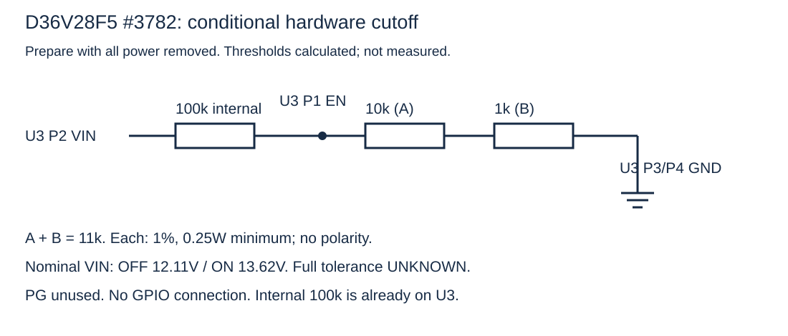
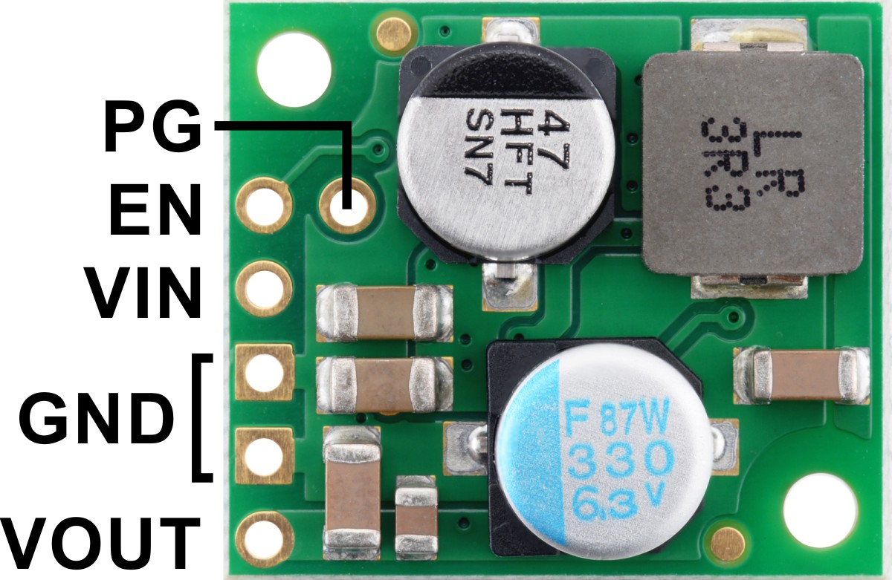

# RooCore — power management, docking and emergency control handoff

**Trial design decision · 14 November 2026 · Roomba 620 with plain XIAO ESP32S3.** This is the English companion to the [Hebrew plan](../POWER_DOCKING_PLAN.md). The thresholds are the values chosen for testing, not measurements or verified Roomba 620 factory limits. The robot battery connection, fuse, OI interface and physical behavior remain unqualified. Do not energize the robot branch from this document.

## Chosen trial policy

| Loaded battery voltage | Local behavior |
|---|---|
| **13.8 V or below** | Alert; start no new task and do not deliberately move farther from the dock. |
| **13.5 V or below for 5 s** | Latch return-to-dock mode. Stop cleaning and turn off vacuum, main brush and side brush. Keep wheels, LiDAR and controller active for navigation. |
| **13.0 V or below** | Urgent return: only motion needed for docking, no prolonged search or cleaning restart; keep LiDAR active. |
| **12.5 V or below** | Stop wheels and cleaning motors. Offer native iRobot fallback. Handoff requires explicit user approval in advance for the mission or at the event, plus a passing local safety check. Without both, remain safely stopped. |
| **About 12.1 V at regulator VIN** | The external 11 kΩ resistor on U3 EN lets hardware shut down RooCore's 5 V rail independently of firmware, server and user approval. |

Software uses fresh OI packet 22 battery voltage under load. Hardware sees the voltage at U3 VIN after wiring and fuse losses; measure their difference. The old iRobot 500 service manual describes a 12 V loaded cleaning stop for a 12-cell NiMH pack (printed p. 21), but does not establish this 620's threshold or installed battery chemistry. The hardware cutoff must **never wait** for docking attempts or user approval; a sudden sag can preempt the planned 12.5 V handoff.

## Approval and fallback safety

Fallback defaults **off**. General permission to clean or drive does not approve handing control to native iRobot firmware. A user can explicitly approve it for a defined mission in advance or approve the offer at the event. Motion remains stopped while approval is pending; silence, loss of communication and loss of power do not imply approval.

Even with approval, the local controller blocks handoff when it knows of immediate risk to the robot or additions, including low furniture or obstacles that could strike the LiDAR or added height sensors. Native firmware does not know those additions. Missing safety information means no handoff.

When both gates pass, block new RooCore drive commands; in OI Safe mode send `145,0,0,0,0` for zero wheel speeds and `138,0` for zero cleaning motors; confirm stop to the extent observable; save the reason; shut down LiDAR with the documented UART-before-power sequence; send `143` Seek Dock once; then stop RooCore motion commands. iRobot's OI specification permits `143` in Passive, Safe or Full and says it enters Passive itself. `128` separately enters Passive and is not required before `143`. Sending bytes is not delivery acknowledgement; the native Seek Dock command does not guarantee that the 620 reaches the base. It must be tested on this robot.

Without approval or after a safety check fails, stay stopped, shut down LiDAR in the same sequence, and do **not** send `143`. Passive mode is needed for charging, but it must first be verified on this 620 that entering Passive after the stop does **not** restart native motion; until then, this is not a proven safe-stop action. If that transition is unsafe, hold stopped in Safe until user intervention or hardware cutoff, while recognizing that Safe itself prevents charging. Persist the no-restart state across reset. Loss of sensors or server communication never authorizes native motion. On docking, check charging source packet 34, charging state packet 21, and voltage/current packets 22/23 separately. Safe/Full prevent charging; Passive permits it. See the [iRobot OI specification](../sources/iRobot-Roomba-600-OI.pdf), printed pp. 7–11 and 27–29.

## Proposed electrical nets and exact endpoints

This is a **conditional design**, not a released assembly diagram. In Pololu's U3 top view, its outer five holes from top to bottom are locally named P1 EN, P2 VIN, P3 GND, P4 GND, P5 VOUT; the inner hole by EN is P6 PG. These P numbers are local positions, not IC pin numbers. On XIAO viewed component side with USB at top, the left edge is D0–D6 downward; the right edge is 5V, GND, 3V3, D10, D9, D8, D7 downward. On S1 use the printed pad names; no unique manufacturer pad number is documented.

| Net | From | To | Qualification |
|---|---|---|---|
| `BAT_BRANCH_PLUS` | Unidentified Roomba BAT+ pad | F1 input, 16 AWG holder lead | F1 is the purchased 5×20 fuse holder; fuse value and DC interrupt rating pending. Place close to source. |
| `BAT_BRANCH_PLUS` | F1 output | XT30 SOURCE + (recessed live contacts) → LOAD + → U3 P2 VIN | Conditional; verify polarity and connector orientation on actual parts. XT30 leads are 18 AWG. |
| `BAT_BRANCH_RETURN` | Unidentified Roomba SYS_RTN-side return pad | XT30 SOURCE − → LOAD − → U3 P3 GND | Conditional; do not bypass the shunt shown between J14 battery negative and SYS_RTN in the supplied R3 drawing. |
| `EN_SENSE` | U3 P1 EN | R_UV 11 kΩ, 1%, at least 0.25 W, end 1 | New trial divider; not assembled or measured. |
| `GND BUS` | R_UV end 2 | U3 P3/P4 GND | Same verified regulator reference as VIN. |
| `5V BUS` | U3 P5 VOUT | XIAO 5V/VBUS (right top), S1 VIN | Regulated 5 V only. |
| `GND BUS` | U3 P4 GND | XIAO GND (right second), S1 GND, LiDAR GND | Separate insulated bus; not S1 SW. |
| `5V_LIDAR_SWITCHED` | S1 VOUT | T-mini Plus VCC through mapped four-position GH lead | GH tails are listed as 28 AWG; map plug contacts from the view into the sensor socket. |
| `LIDAR_ENABLE` | XIAO D3/GPIO4 (left fourth) | S1 ON | Slide switch physically OFF; no external series resistor; SW open. |
| `LIDAR_TX/RX` | XIAO D4/GPIO5 → LiDAR RX; LiDAR TX → XIAO D5/GPIO6 | Permanent 3.3 V UART | No NOYITO; perform UART shutdown before switching S1 off. |

The [Pololu D36V28F5 #3782](https://www.pololu.com/product/3782) has an internal 100 kΩ pull-up VIN→EN, with published EN shutoff at about 1.20 V and restart at about 1.35 V. With a single external 11 kΩ resistor EN→GND: `V_EN=V_IN×11/111`; nominal shutdown `1.20×111/11=12.11 V`, restart `1.35×111/11=13.62 V`. Varying **only the external 1% resistor**, and treating internal values as exact, gives about 12.00–12.22 V off and 13.50–13.75 V on. These are not guaranteed system limits. At an assumed 18 V VIN, calculated resistor dissipation is about 0.29 mW. EN is not a charger-only latch; battery rebound can restart RooCore. Sleep current is not zero.

The active inventory records 10 kΩ and 1 kΩ resistors in the purchased kit, but no single 11 kΩ resistor. The series 10 kΩ+1 kΩ implementation is now documented in the unpowered preparation appendix below as R_UV_A and R_UV_B; qualification before robot connection remains required. The previous external 100 kΩ in parallel with the internal resistor and 4.7 kΩ+470 Ω to ground (nominal 12.81/14.41 V) is superseded for this trial. The new active firmware does not use the old Q1/D10 path and leaves GPIO9 as an input.

The [Pololu #2810](https://www.pololu.com/product/2810) ON pin turns on above roughly 1 V and is off when low or open with its mechanical switch OFF. Its [schematic](https://www.pololu.com/file/0J888/mini-mosfet-slide-switch-schematic-diagram.pdf) already has internal R4/R5 of 10 kΩ; no external R8 is required. The #2810 switches the regulated 5 V LiDAR branch, not the original Roomba motors. The regulator's specified 5 V ±4% means 4.8–5.2 V at U3; the [T-mini Plus datasheet, Table 2](../sources/YDLIDAR-T-mini-Plus-v1.1.pdf) requires 4.8–5.2 V at the sensor. There is no guaranteed cable/switch voltage-drop margin at the lower regulator corner. Measure at LiDAR VCC/GND during startup and operation.

## Roomba OI/SCI contact plan

The [iRobot connector map, printed p. 3](../sources/iRobot-Roomba-600-OI.pdf) is a top view into the robot's female socket, with contacts 6/7 toward the outside circumference. The user chose insulated, adhesive-retained low-profile direct wires so the original cover closes; a Mini-DIN cable body is not a missing purchase. Map and insulate every actual contact before retention.

| OI contact | Manufacturer function | RooCore plan |
|---:|---|---|
| 1/2 | Vpwr, common 200 mA PTC-limited battery supply | Deliberately unconnected; do not power RooCore here. |
| 3 | RXD, robot input, 0–5 V | XIAO D0/GPIO1 TX (left top) through a qualified level-shifter channel only. |
| 4 | TXD, robot output, 0–5 V | XIAO D1/GPIO2 RX (left second) through a qualified level-shifter channel only. |
| 5 | BRC | Planned Q2 low-side transistor controlled by XIAO D9/GPIO8; not released for wiring. |
| 6/7 | GND signal reference | Relate to GND BUS/SYS_RTN only after resolving the R3 shunt and physical board. |

Current firmware routes UART1 TX/RX to GPIO1/GPIO2 at 115200 8N1; the actual 620's baud and firmware remain unverified. One purchased NOYITO TXB0104/WCMCU-401 module is planned for the robot UART. Its VCC/3V3/OE routing is unknown, so its A/B holes, supply and enable are **not** a pin-to-pin assembly instruction yet. Do not connect its 3V3 pad to XIAO 3V3 by assumption. The second NOYITO is spare. See the [electrical review](../ELECTRICAL_REVIEW.md) for the exact mapping work.

## Implementation and acceptance state

`RooCoreXiao` now integrates `PowerManagement.h`: the four voltage states, latched return, stop, a durable pre-mission marker, explicit boot/mission-scoped approval and a local safety gate before `143`. Planner Seek Dock at the approach also offers handoff instead of bypassing approval, so an offer may appear before 12.5 V. The old D10/Q1 path is not active and GPIO9 is not configured as an output. [Firmware behavior, API, qualification and tests](../../POWER_MANAGEMENT.md).

All new hardware-verification flags remain false and measured fields remain zero. User approval never changes them. Height sensors are not integrated; native handoff is limited to an anchored dock corridor physically qualified for the complete add-on height/envelope, with fresh OI safety, pose and IR. Missing qualification or being outside the corridor holds motion. Critical/Handoff waits for stationary encoders, then powers LiDAR off; without approval it remains in Safe. A detected charging source releases to Passive only under a physically qualified configuration. No firmware was flashed or robot tested.

Before connecting the battery: identify actual BAT+ and SYS_RTN pads, select a fuse with a documented DC rating and interrupt capacity, check connector polarity and insulation without power, map NOYITO and validate the return path. With a current-limited bench supply and no robot, measure U3 VIN/EN/VOUT while sweeping voltage with representative load, recording actual cutoff/restart and uncertainty. Check LiDAR supply at its contacts, startup current, reset and USB/UART back-power. Only after the interface is qualified, test the 620 under supervision: compare packet 22 against VIN, measure rebound, confirm stop and `143` behavior, verify approval and hazard blocks, and verify charging with packets 21/34. No such physical tests were performed for this plan. Disconnect XIAO from the **entire** external harness before USB in the chosen single-source design.

Manufacturer sources: [Pololu #3782](https://www.pololu.com/product/3782) (Details, Connections); [Pololu #2810](https://www.pololu.com/product/2810) (Using the MOSFET Slide Switch and schematic); [Seeed XIAO ESP32S3](https://wiki.seeedstudio.com/xiao_esp32s3_getting_started/) (Hardware Overview, Pin Map); [iRobot Roomba 600 OI](../sources/iRobot-Roomba-600-OI.pdf) (printed pp. 3–4, 7–11, 13–15, 27–29); [iRobot 500 Service Manual](https://wolf-u.li/upload/2015/09/Roomba_500_Series_SERVICE_Manual.pdf) (printed p. 21, historical only). Project evidence: [inventory](HARDWARE_INVENTORY.md), [purchase record](../../../AMAZON_ORDER.md), [module audit](MODULE_AUDIT.md), [LiDAR shutdown](LIDAR_POWER_UART.md).

Battery learning is integrated without changing EN or wiring: [monitoring, persistence and return reserve](../../BATTERY_LEARNING.md). Adaptive use and Flash writes remain blocked until qualification.

## Prepare the two hardware-cutoff resistors with power removed

For **Pololu D36V28F5 #3782 only**, after matching the actual board to the manufacturer photograph. Use R_UV_A=10kΩ and R_UV_B=1kΩ from the recorded ELEGOO B072BL2VX1 assortment, each 1%, at least 0.25W. Purchase is recorded; delivery and individual physical parts are unverified. Individual manufacturer MPN/package dimensions were not published. Resistors have no polarity; lead numbers below are local labels.

In exactly this component-side orientation, the five outer left pads top-to-bottom are locally P1 EN, P2 VIN, P3 GND (square), P4 GND, P5 VOUT. Inner P6 is PG. These are local positions, not manufacturer IC numbers. Both GND pads are internally connected.

| Net | From | To |
|---|---|---|
| EN_SENSE | U3 P1 EN | R_UV_A 10kΩ lead 1 |
| UV_MID | R_UV_A lead 2 | R_UV_B 1kΩ lead 1 |
| GND | R_UV_B lead 2 | U3 P3 or P4 GND |

1. Remove battery, charger, USB and all external connections. Start with the resistors separate from U3.
2. Measure each resistor in ohms mode: nominal 1% intervals are 9.90–10.10kΩ and 990–1010Ω. Join one end of each in series and insulate. Before attaching to U3, measure across the two free ends: 10.89–11.11kΩ, accounting for instrument uncertainty. Do not proceed if values cannot be confirmed.
3. Attach the free 10kΩ end to EN and free 1kΩ end to either GND pad. Order does not affect the threshold. Leave the midpoint isolated from all other circuits.
4. Use an inline series pair without a separate PCB to save space. Use short, flexible insulated signal wire, for example 22AWG, to avoid levering U3 pads. Solder and heat-shrink every exposed metal joint. Use removable retention and strain relief, clear of moving/hot parts. With all power removed, verify that the original cover closes without pressure or pinched wires; physical clearance remains untested. This is not a load-current path. Do not assume perforated-board hole connectivity without an unpowered check.
5. PG remains unused. VIN/VOUT keep their existing power functions. The shown 100kΩ is already inside U3; do not add another. This divider has no XIAO/D10/Q1 connection.

The series pair totals 11kΩ ±1% worst case. Assuming 18V VIN and exact nominal internal values, divider current is about 162µA, with calculated dissipation about 0.263mW in 10kΩ and 0.0263mW in 1kΩ. The 0.25W rating has ample dissipation margin even at the high external-resistance corner; this does not qualify the threshold. The threshold calculations and unknown internal tolerance above still apply.

Next qualification uses a current-limited bench supply **without the robot**, DC-voltage measurements at VIN/GND and VOUT/GND, and recorded falling cutoff/rising restart. Nominal predictions are 12.11V/13.62V, not guaranteed acceptance limits. Verify actual cutoff follows the 12.5V software stop with allowance for wiring drop and measurement uncertainty. Do not use the robot battery for the first test. This disables the add-on rail, not the Roomba battery or motors; it is neither a charger-only latch nor USB/UART isolation. Fuse, source pads, shunt return and back-power issues remain unresolved.

[CSV](../uv-divider.csv) · [JSON parts/nets](../uv-divider.json) · [draw.io](../uv-divider.drawio). These conditional design records are separate from the 13-wire preparation harness. No CAD ERC/DRC or physical test was performed.
