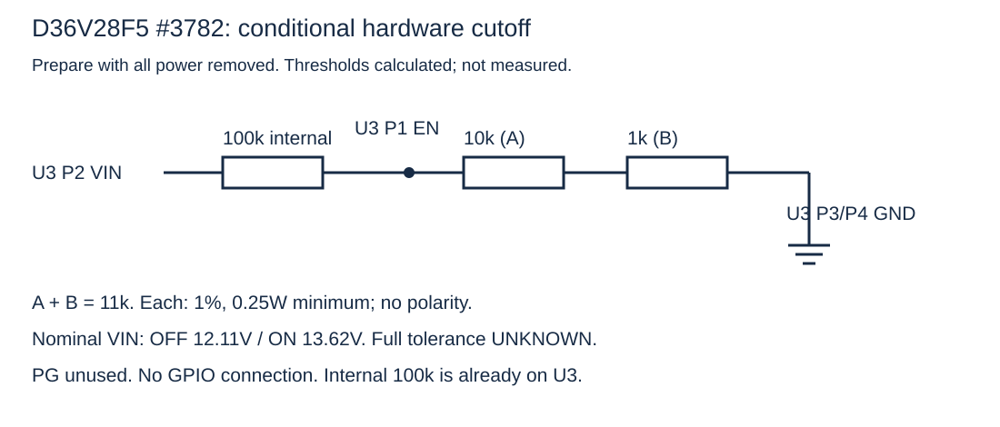
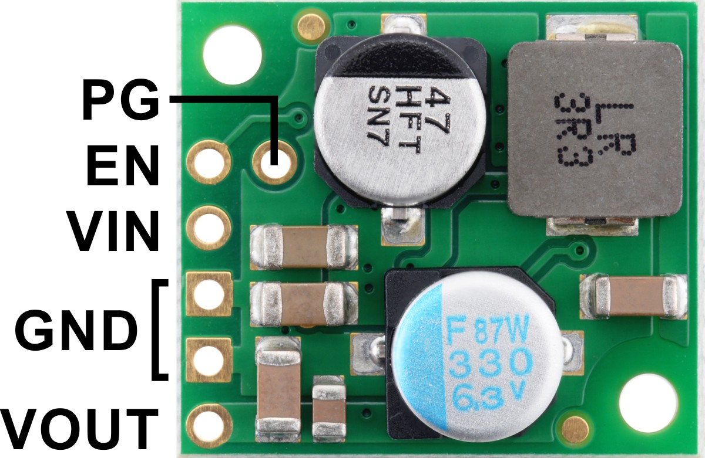

# RooCore — reviewed module assembly instructions
2026-11-14 • electronics + esp32-development • Revision 11 — compact EN divider, controller-managed LiDAR shutdown and guide synchronization
[Hebrew version](../README.md)


[Illustrated wiring guide](RooCore-assembly.html) · [Combined photo wiring](combined-wiring.html) · [Module audit](MODULE_AUDIT.md) · [Electrical review and pin maps](ELECTRICAL_REVIEW.md) · [Module schematic](electrical-schematic.svg)

**This assembly is not yet qualified for Roomba battery connection.** Every stage condition applies.

## Initial setup — USB, Wi-Fi selection and server connection

Integrated and compiled source; the setup page was tested against a mock server. No flashing, RF test, on-board NVS write or physical robot test has been performed. These are future procedures under the stated conditions, not a record of completed hardware steps.

**Prepare the software over USB before connecting the controller to the harness. Disconnect XIAO from every external wire, including power and signals, the Roomba and charger. Power it only through a USB data cable. This stage does not connect the robot battery, operate motors or change hardware-verification flags.**

### Prepare the private configuration

| Field | Setting | Purpose |
|---|---|---|
| ROO_WIFI_SSID / ROO_WIFI_PASSWORD | Leave empty to choose a network in the setup page; they may remain empty after the controller saves the network. | Home-network connection only; these are not website account credentials. |
| ROO_SETUP_AP_PASSWORD | A unique password of 12–63 printable ASCII characters without spaces. Empty disables the setup network. | Access to the temporary RooCore-Setup network. |
| ROO_CLOUD_ENABLED / ROO_CLOUD_REQUIRE_POLICY | true / true in the private cloud configuration. | Server streaming and a motion hold until the matching zone policy is stored. |
| ROO_CLOUD_DEVICE_TOKEN | A private server-issued key for roomba-620. Do not use a sim-620 key or a user password. | Controller authentication to the server; the Wi-Fi page cannot change it. |
| ROO_API_TOKEN / ROO_OTA_ENABLED | For this preparation, leave the LAN API token empty and OTA disabled unless separately needed. | Separate LAN/update services; outbound HTTPS streaming does not require them. |
| ROO_COMMISSIONED and all verification/calibration flags | Keep flags false and unverified measured fields at 0. | Server connectivity does not authorize hardware operation. |

### 1 · Identify the controller and prepare the file

1. The target is the regular XIAO ESP32S3 with 8MB Flash and OPI PSRAM. This procedure uses the full RooCoreXiao firmware, not RooCoreMatterSim, the LinkSetup example or the synthetic test configuration.
2. On the owner workstation, the configuration file is /Users/ransaymour/Documents/Codex/RooCore Server/XIAO-cloud-config.private.h. Keep it private; do not put passwords in chat, the guide, Git or the assembly kit. On another workstation, start with a copy of config.example.h and obtain the device key privately from the administrator.
3. Copy the private contents to firmware/xiao/RooCoreXiao/config.local.h, which Git ignores, and check the table above. The file outside the project is not loaded automatically by the build. Do not put secrets into public config.example.h.
4. The current server already has a roomba-620 key provisioned. For a new device, only the server administrator provisions a matching key and transfers it privately; selecting Wi-Fi neither registers a device nor creates a key.
5. After creating config.local.h, run the command below to restrict it to owner read/write. It changes file permissions only, without accessing the board.

```sh
chmod 600 firmware/xiao/RooCoreXiao/config.local.h
```

**End-of-step check:** A private config.local.h contains the device key and separate AP password, with hardware operation still disabled.

### 2 · Build the firmware before flashing

1. Use Arduino CLI and esp32:esp32 version 3.3.12, the toolchain used for the recorded builds. Prepare the tools first on a new workstation; do not ignore a missing package or library error.
2. Run the command below from the RooCore repository root. It builds with PSRAM=opi, FlashSize=8M and PartitionScheme=default_8MB. It does not flash or open a serial port. The restrictive umask applies to new artifacts; after a successful build, output permissions are restricted to the owner too.
3. Require a successful exit. Outputs in output/xiao-ota include the application image, bootloader, partition table and manifest.json. Because they are built from private configuration, these artifacts contain secrets: retain them locally and do not attach them to Git or a public ZIP.
4. tests/build_xiao.sh is a compiler check and includes a synthetic configuration with enabled flags. Never flash those test artifacts onto the robot.

```sh
umask 077
sh tools/build_xiao_ota.sh && chmod -R go-rwx output/xiao-ota
```

**End-of-step check:** RooCoreXiao artifacts were built from the private configuration; compilation is not hardware verification.

### 3 · Identify the USB port and recovery route

1. With the controller fully disconnected from the harness, connect it using a USB data cable. The command below lists ports without opening them. Establish the actual board and port identity; do not choose a debug console, Bluetooth port or speaker from the list.
2. If identity is unclear, stop and check the USB cable/device identification. Never guess a port. A listed port alone proves neither XIAO identity nor download mode.
3. Before flashing, identify the intended image, memory size and partitions, retain a known previous image if one exists, and establish the Seeed ROM-download procedure for USB reflashing. Recovery has not been tested on our unit. Do not erase all Flash/NVS/LittleFS as a general troubleshooting step.

```sh
arduino-cli board list
```

**End-of-step check:** The actual XIAO port and a board-specific flashing/recovery plan are known. Do not flash if either is missing.

### 4 · Flash only after identification and isolation

1. The command below is conditional on every previous prerequisite being satisfied. Set the shell variable ROO_XIAO_PORT to the port actually verified; this guide has no fixed port value. The first line refuses to continue if the variable is missing.
2. This writes Flash, replacing firmware and the boot/partition components in the artifacts. The Espressif recipe resets before flashing and hard-resets afterwards; serial tools may also reset through DTR/RTS. No robot or harness is connected.
3. Use the freshly built artifacts and the same FQBN. Do not guess Flash offsets or substitute a Matter/simulator image for RooCoreXiao. If upload fails, remain USB-only and return to identification/recovery; do not connect the robot to bypass the failure.

```sh
: "${ROO_XIAO_PORT:?Set the confirmed USB-only XIAO port first}"
arduino-cli upload --fqbn 'esp32:esp32:XIAO_ESP32S3:PSRAM=opi,FlashSize=8M,PartitionScheme=default_8MB' \
  --port "$ROO_XIAO_PORT" --input-dir output/xiao-ota \
  firmware/xiao/RooCoreXiao
```

**End-of-step check:** Proceed to Wi-Fi only after successful upload and boot of the intended image. No upload is claimed to have occurred here.

### 5 · Join the controller setup network

1. When no home network is saved or compiled and a valid AP password is configured, firmware requests setup mode. Uncommissioned USB preparation also requires no verified robot link and no motion ownership. Software cannot prove physical disconnection, so the first-step isolation remains mandatory.
2. On the phone/computer, open Wi-Fi networks and select RooCore-Setup-xxxxxx. Enter ROO_SETUP_AP_PASSWORD from the private file, not the home password, device key or website password. The setup network accepts one client.
3. The phone may report no Internet. Stay connected for setup. Manually open exactly http://192.168.4.1/setup — local HTTP inside a WPA2-PSK/CCMP protected AP. No automatic window or DNS name is required.
4. Setup closes after five minutes. If a home network was already saved, firmware tries it instead of opening an AP automatically; use step 11 to change networks.

**End-of-step check:** The RooCore network-selection page is visible locally. Home-network and server connectivity are not yet established.

### 6 · Scan and choose the home network

1. Press the scan button and wait for the list. Select a 2.4GHz home network; its name fills the network-name field. For a hidden network or one absent from the scan, enter the exact SSID manually.
2. Enter the home-network password and press connect and save. Passwords are 8–63 printable ASCII characters, or empty for an open network. SSIDs are limited to 32 bytes, so a non-ASCII name can reach the limit before 32 characters. Enterprise networks and 64-digit raw PSKs are not supported by this form.
3. Wait for a result; a connection attempt is limited to 25 seconds. On failure, check the name/password and retry within the same setup window. Do not change the device key or safety flags to fix Wi-Fi.

**End-of-step check:** An explicit success or failure message appears; pressing the button alone does not prove a connection.

### 7 · Confirm persistence and return to home Wi-Fi

1. Only after local Wi-Fi connection is one NVS record written and read back. Wait for the saved-network message. A storage error is a failure even if RF association succeeded; correct/retry rather than assuming the details will survive a reboot.
2. On success, the password field is cleared and the setup network closes after an eight-second response window. Reconnect the phone to home Wi-Fi. The controller retains the network, so the configuration file does not need to be filled again.
3. The saved message tests Wi-Fi, not Internet/server reachability. The record checksum is not Flash encryption. Setup, expiry and reboot do not start cleaning.

**End-of-step check:** Software reports home-network connection and saved credentials; verify the server separately in the next step.

### 8 · Sign in to management and select the robot

1. Open https://roocore.saymour.co.il/ in the browser and sign in with your personal username/password. Complete the eight-digit code sent to the registered email. No built-in/public user password is provided by this guide; controller configuration is not the website account file.
2. Use Forgot password and the personal email link if needed. The owner creates users and assigns per-robot permissions in the website, not in Wi-Fi setup.
3. Select roomba-620. sim-620 is labelled simulation and is not the physical robot. A successful website login alone does not prove the controller connected.

**End-of-step check:** The correct account is open and roomba-620 is selected; simulation data must not be presented as physical robot data.

### 9 · Verify authenticated controller streaming

1. Wait for roomba-620 to report online and update its last-seen time. The software cadence is sensors/status each second and map/coverage each ten seconds when a snapshot is available. The server reports online only from a fresh report, up to five seconds old; verify the time keeps updating.
2. The controller initiates HTTPS to a fixed address using its roomba-620 key and certificate/hostname verification. Internet, DNS and time synchronization are needed before TLS. Do not open router ports, expose home MQTT or weaken certificate validation.
3. An isolated USB test has no qualified Roomba/LiDAR sensors or verified home localization. Online state or a received controller map does not make those measurements valid. Record server connectivity, sensor validity, localization and policy acknowledgement separately.
4. If no reports arrive, use the troubleshooting table: Wi-Fi, Internet/time, ROO_CLOUD_ENABLED and device key. Diagnostic logs must not contain passwords or Authorization headers.

**End-of-step check:** The server received a fresh authenticated report from the correct device identity. Physical sensor/safety validation remains separate.

### 10 · Save maps/zones and distinguish storage from enforcement

1. In the map editor, choose the current controller-observed map for roomba-620. Planning, imported, old or sim-620 maps do not validate the physical home map. Physical localization anchoring and calibration are required before robot operation.
2. Mark the intended zones, save the server edit, then use the send-zones-to-controller button. This requires map-edit permission. A cloud-only saved edit is not yet active on the controller.
3. Wait for the acknowledgement that the controller reports local storage of the exact revision. Application requires a matching map and an already stopped robot with qualified sensors/encoders and flash-save voltage; both mission slots are read back before acknowledgement. On USB without the robot, pending policy is expected; never enable synthetic verification flags to bypass it.
4. A software acknowledgement is still not physical enforcement proof. Missing/corrupt required policy holds motion. Website room-clean/go-to actions currently save drafts and do not dispatch physical motion. Do not press native Clean to test map barriers: independent native cleaning does not enforce the RooCore map.

**End-of-step check:** Cloud storage, pending delivery and controller acknowledgement are recorded separately. Cleaning is not released before hardware/enforcement tests.

### 11 · Change Wi-Fi, reboot and handle Internet loss

1. To change network, after firmware is running and the robot is already stopped, hold BOOT for three seconds and release. On XIAO ESP32S3 this is GPIO0; header D0 is GPIO1 used for OI, not the button. Do not hold BOOT during reset/power-on for Wi-Fi setup — that selects ROM download.
2. Requests during cleaning, undocking, native operation or OTA are rejected. A commissioned robot also needs the qualified stopped/Passive, sensor and flash-save voltage conditions; do not weaken missing conditions to open the AP. Setup holds motion and completion does not automatically resume a mission.
3. After successful storage, first test reboot in the same isolated USB preparation: verify reconnection to saved Wi-Fi and a new server update without re-entering credentials. This is a planned board test, not an already measured result.
4. Ordinary Wi-Fi/Internet loss neither opens setup nor erases received/stored maps and zones. Local cleaning can continue only with valid localization, sensors and local policy. A newly edited cloud restriction is unknown until received and stored. Reboot requires physical reanchoring and explicit resume; floor cleaning/Internet-loss tests occur only after hardware release.

**End-of-step check:** A network-change/recovery procedure is available without making local safety depend on the cloud or automatically starting from setup.

### If setup stops — checks and next action

| Symptom | Check or action | Stop condition |
|---|---|---|
| No RooCore-Setup network | Check that the flashed RooCoreXiao image has a valid AP password. Saved home credentials prevent automatic setup; try BOOT only after boot and while stopped. The setup window is five minutes. | Do not flash or connect the robot if board/image/USB isolation is unclear. |
| Phone connects but page does not open | Stay on setup Wi-Fi and type http://192.168.4.1/setup. Do not change to HTTPS or rely on an automatic window; check that the phone has not switched networks. | Do not open ports or disable router/server security. |
| Connection fails or network is absent | Check 2.4GHz, exact name/password; enter a hidden SSID manually. Correct/retry after an attempt of up to 25 seconds. | Resolve a storage error; do not assume credentials survive reset. |
| Network saved but roomba-620 is offline | Check Internet and DNS/time, cloud enablement and the roomba-620 device key; ensure sim-620 is not selected. Website access on the phone does not test the controller link. | Do not substitute a user credential or bypass TLS/policy requirements. |
| Connected but sensors/localization invalid | Expected in isolated USB preparation. Valid hardware needs assembly, calibration and measurements under the guide release gates. | Do not enable commissioning just to change a dashboard indicator. |
| Zones saved in cloud but acknowledgement pending | Check current matching map, exact revision, communication and stopped write conditions. A disconnected robot cannot receive a new edit. | Do not rely on new restrictions before acknowledgement, or treat software acknowledgement as a floor test. |

After preparation, keep the controller disconnected from the harness until the guide electrical/physical checks are complete. Record what actually passed and what remains pending. Wi-Fi connection, website login, sensor reception and policy persistence are four separate checks; none alone releases robot operation.

## 1 · Lay out and label the parts

**Take:** D36V28F5 regulator, Pololu #2810 switch, plain XIAO ESP32S3, an XT30 pair, wires and insulation.

**Condition:** Disconnect every part from the battery, charger and USB. Remove the fuse; no power source may be connected to the harness.

1. Label the regulator U3, the switch S1 and the controller XIAO. One NOYITO remains planned for the Roomba after its supply routing is identified; the other is spare and is not needed for LiDAR. Neither belongs to these LiDAR harness stages.
2. Prepare two separate insulated distribution junctions: 5V BUS and GND BUS. Each bus joins only wires bearing that same net name.
3. On a perforated solder board, check pad connectivity while the board is empty. Adjacent pads and pads on opposite faces are not necessarily connected.
4. Use the purchased 18AWG wire for the power harness. Do not carry load power through Dupont leads or a solderless breadboard.
5. Stages 1–7 have no resistor or transistor connections. The EN resistor pair has a separate unpowered section below, without a PCB. Q2/BRC still needs qualification; Q1 belongs to the old path.

**At completion:** The parts are identified and the two distribution junctions are separate. Nothing is connected to the robot.

## 2 · Prepare U3 and the XT30 load side

**Take:** U3, the load half of the XT30 pair, 18AWG wire, and the 5V BUS / GND BUS junctions.

**Condition:** Confirm D36V28F5. Leave the XT30 source half disconnected and insulated. Verify +/− by markings and continuity, not wire color alone.

1. In the Pololu photograph, the five outer holes on the left are EN, VIN, GND, GND, VOUT from top to bottom. PG is the inner hole beside EN.
2. Choose the connector halves so the future live source side has recessed metal contacts. Do not connect the source side to the battery.
3. LOAD + and LOAD − are before voltage conversion. They will carry the battery branch voltage after the selected fuse; they are not 5V wires. The robot power-return pad has not yet been physically identified.
4. Connect the four wires in the table one at a time. Check the pad marking before each solder joint.
5. Leave EN and PG unconnected during this preparation. There is no calibrated battery discharge protection in this state.

| Wire | First endpoint | Second endpoint | Net | Wire and check |
|---|---|---|---|---|
| 1 | XT30 LOAD + | U3 VIN | BAT_BRANCH_PLUS | 18AWG; Continuity only between connector + and VIN; the other connector half is disconnected. |
| 2 | XT30 LOAD − | U3 GND 1 | GND | 18AWG; Identify GND from the photograph and marking. Both U3 GND pads share the same return. |
| 3 | U3 VOUT | 5V BUS | 5V | 18AWG; VOUT is the bottom outer hole. No wire connects VIN to 5V BUS. |
| 4 | U3 GND 2 | GND BUS | GND | 18AWG; Keep this ground junction separate from 5V. |

[Photo wiring for this stage](photo-power.svg)

**At completion:** U3 is connected only to the load harness. No battery or Roomba board is attached; EN and PG are open.

## 3 · Add the LiDAR power switch

**Take:** S1 — the switch purchased through 4project/5274, identified as POL-2810.

**Condition:** The regulator and harness are unpowered. This is the #2810 slide-switch model, not a pushbutton model.

1. Set the small switch on S1 to OFF using the manufacturer map at the end of this stage. The LED is lit in the original demonstration photograph; that is not our assembly state.
2. Connect VIN and GND using the table. S1 receives regulated 5V, not the battery branch voltage.
3. Leave ON open until stage 5 and VOUT open until stage 6. Leave SW and the external-switch holes open.
4. Do not add R8 or a resistor in series with ON. This switch already has its control resistors. The photograph does not instruct you to add an external switch.

| Wire | First endpoint | Second endpoint | Net | Wire and check |
|---|---|---|---|---|
| 5 | 5V BUS | S1 VIN | 5V | 18AWG; VIN is the input side. S1 receives only regulated 5V from U3. |
| 6 | GND BUS | S1 GND | GND | 18AWG; Use a marked GND pad. Never connect GND to SW. |

[Photo wiring for this stage](photo-switch.svg)

**At completion:** S1 has its 5V input and ground wired in the disconnected harness. Its switch is OFF and SW has no wire.

## 4 · Connect controller power

**Take:** Plain XIAO ESP32S3, its antenna and two power leads.

**Condition:** First test U3 alone as described in the checks section. Then disconnect the supply again. USB and all external signal wires must be disconnected from XIAO.

1. Gently attach the antenna to the unpowered controller antenna socket.
2. Connect GND, then 5V, using the table. The manufacturer photograph calls the 5V pin VBUS.
3. Leave 3V3 and BAT open. Do not connect 3V3 to NOYITO or use it to supply the LiDAR.
4. In the chosen arrangement without an added diode, remove XIAO from the entire external harness before every USB connection: power and signals. EN LOW or a disabled supply does not disconnect the wires.

| Wire | First endpoint | Second endpoint | Net | Wire and check |
|---|---|---|---|---|
| 7 | GND BUS | XIAO GND | GND | Short 22AWG; Component side, USB at top: GND is the second pad down the right edge. |
| 8 | 5V BUS | XIAO 5V | 5V | Short 22AWG; Top-right pad. USB disconnected; do not use 3V3 or BAT. |

[Photo wiring for this stage](photo-xiao.svg)

**At completion:** Two power leads supply the controller from one source. All signal pins are still open.

## 5 · Connect the switch control wire

**Take:** One short 22AWG signal wire between XIAO and S1.

**Condition:** Both boards must be unpowered. Energizing the harness requires firmware configured and checked to hold D3/GPIO4 LOW at startup. Factory firmware does not establish this.

1. Connect XIAO D3 to S1 ON. Viewed from the component side with USB at the top, D3 is the fourth pad down the left edge. It is GPIO4 in software, not IC package pin 4.
2. There is no external resistor in this connection. Keep the mechanical switch OFF.
3. Leave the other D pins open at this stage. D4 and D5 connect to UART in stage 7; BRC and EN cutoff are not wired here.

| Wire | First endpoint | Second endpoint | Net | Wire and check |
|---|---|---|---|---|
| 9 | XIAO D3 / GPIO4 | S1 ON | LIDAR_ENABLE | Short 22AWG; Continuity from D3 to ON only; no connection to SW. |

[Photo wiring for this stage](photo-control.svg)

**At completion:** One control wire is connected. The full firmware now starts with LiDAR off and implements the power/signal sequence; flashing and physical GPIO checks have not been performed.

## 6 · Prepare the LiDAR power leads

**Take:** T-mini Plus and a four-position GH1.25 plug from kit B0H3Q98C58.

**Condition:** Disconnect both LiDAR and the harness. Match the plug to the socket and map every contact before wiring power. Do not connect it if the viewing direction is unclear.

1. Look into the socket on the sensor as shown in the manufacturer figure. In that view the order is VCC, TX, GND, RX. Do not copy that order onto the wire-entry view of the cable plug.
2. Map and label each lead by its contact in the disconnected plug. Wire colors are your choice and do not prove function. Check that contacts lock in place and adjacent contacts are not shorted.
3. Connect only the power pair in the table. The GH kit has 28AWG tails; do not force incompatible 18AWG wire or contacts into it.
4. Insulate TX and RX separately and leave them unconnected during the power-only test. These are the two 3.3V UART contacts in the GH connector. They become permanent connections in the finished system; this is not an instruction to unplug them on every shutdown.
5. Keep the GH plug disconnected from the sensor until the harness passes its checks. Later, the LiDAR contacts must stay within 4.8–5.2V under load and during startup, accounting for instrument accuracy. A no-load 5V reading at U3 does not prove this.
6. U3 is also specified at 4.8–5.2V. At its low limit there is no voltage-drop margin for wires and the switch. Do not attach the sensor if the cable-end measurement fails.

| Wire | First endpoint | Second endpoint | Net | Wire and check |
|---|---|---|---|---|
| 10 | S1 VOUT | LiDAR cable VCC | 5V_LIDAR_SWITCHED | 28AWG GH tail; The contact mapped as VCC using the sensor-socket view, not wire color. |
| 11 | GND BUS | LiDAR cable GND | GND | 28AWG GH tail; The mapped GND contact. Insulate TX and RX separately. |

[Photo wiring for this stage](photo-lidar.svg)

**At completion:** The power harness is prepared but disconnected from LiDAR. TX/RX are added in stage 7. This is not yet a system ready for battery connection.

## 7 · Add the two permanent UART wires

**Take:** The two signal tails of the same GH cable. This connection needs no extra NOYITO, resistor, capacitor or transistor.

**Condition:** Everything is unpowered, USB is disconnected and the GH contacts have been mapped. The full firmware includes the shutdown sequence; before operation, flash the correct version and perform the assembly checks in LIDAR_POWER_UART.md. Enable settings remain false/0 until physical qualification.

1. Viewed from the XIAO component side with USB at the top, D4 is the fifth pad down the left edge and D5 is the sixth. They are GPIO5 and GPIO6 in software. The SDA/SCL labels do not force I²C operation; these pins are reserved for LiDAR UART in this configuration.
2. Wire 12: connect D4/GPIO5 to the LiDAR cable lead labeled RX. This carries controller transmit to the LiDAR receive input.
3. Wire 13: connect the LiDAR cable lead labeled TX to D5/GPIO6. This carries LiDAR transmit to the controller receive input. Do not connect TX to TX.
4. Both communication signals use 3.3V levels. Do not connect them to 5V BUS or switch VOUT. Wires 7 and 11 already provide the common ground; no extra ground wire is needed.
5. Solder and insulate each connection separately. Keep the supplied 15cm GH tails and do not extend them before signal qualification. There is no series resistor or capacitor in either wire.
6. On a normal shutdown, software stops accepting writes, finishes or cancels transmission, and detaches UART from the pins. D4 then drives LOW and D5 becomes an input with an internal pulldown. Only then does D3 go LOW to turn S1 off. No wire is unplugged.
7. At startup, software holds the signals in their off state, raises D3 and continues polling robot sensors during rail settling. Only after the configured interval does it enable UART2 at 230400, 8N1, without an RX pullup. ROO_LIDAR_POWER_VERIFIED=false and ROO_LIDAR_RISE_MS=0 prevent operation before hardware qualification. The settling interval has not been measured.
8. The same sequence handles normal shutdown, charging policy and battery cutoff. D8/OE control has been removed. Failure to open UART or send the scan command turns LiDAR off and latches a fault; there are no automatic repeated power-on attempts.
9. During charging, the local controller requires valid charger state before preparing LiDAR for departure. Preparation stays latched during warm-up; battery percentage alone is not a departure command. Charging does not consume the active cleaning budget. Dock geometry, departure and temperature remain unqualified until physical calibration; the server receives read-only progress reports.
10. This handles intentional LiDAR shutdown while XIAO remains powered. It does not isolate signals during an unexpected rail collapse, switch failure or total controller shutdown. Reset and whole-system power-loss qualification remain separate requirements before robot use.

| Wire | First endpoint | Second endpoint | Net | Wire and check |
|---|---|---|---|---|
| 12 | XIAO D4 / GPIO5 | LiDAR cable RX | MCU_TX_LIDAR_RX | Short 28AWG GH tail; D4 to RX only. RX is rightmost in the sensor-socket figure; do not rely on color. |
| 13 | LiDAR cable TX | XIAO D5 / GPIO6 | LIDAR_TX_MCU_RX | Short 28AWG GH tail; TX is second from the left in the sensor-socket figure; connect it to D5 only. |

[Photo wiring for this stage](photo-uart.svg)

**At completion:** The harness defines 13 wires. TX/RX stay connected through every ordinary LiDAR shutdown. The sequence is integrated into the full RooCoreXiao application; it remains disabled by default pending hardware qualification. No flashing has been performed.

## Hardware cutoff — two series resistors without a PCB

Unpowered preparation only: battery, charger and USB disconnected. For Pololu D36V28F5 #3782 after matching the actual pads to the manufacturer photograph. Thresholds are calculated and unmeasured; this does not authorize robot-battery connection.

Routine LiDAR shutdown is decided by ESP32 firmware: stop UART, drive D4 LOW and configure D5 as input with pull-down, then D3/GPIO4 LOW switches S1 #2810 off through ON. The mechanical switch stays OFF and ESP32 remains powered. This EN divider is separate undervoltage protection for the entire add-on; it does not decide routine LiDAR shutdown.

R_UV_A: 10kΩ; R_UV_B: 1kΩ. Each 1%, at least 0.25W, from the recorded assortment. No polarity. Together they provide a nominal 11kΩ.

U3 EN → short flexible wire → 10kΩ → 1kΩ → short flexible wire → U3 GND





In the Pololu component-side photograph, the five outer left pads top-to-bottom are P1 EN, P2 VIN, P3 GND (square), P4 GND, P5 VOUT. Inner P6 beside EN is PG. These are local positions, not IC pin numbers.

| Net | From | To |
|---|---|---|
| EN_SENSE | U3 P1 EN | R_UV_A 10kΩ — 1 |
| UV_MID | R_UV_A — 2 | R_UV_B 1kΩ — 1 |
| GND | R_UV_B — 2 | U3 P3/P4 GND |

1. Measure the resistors separately from U3 in ohms mode: 10kΩ within 9.90–10.10kΩ and 1kΩ within 990–1010Ω, accounting for meter accuracy. Join in series and check 10.89–11.11kΩ across the free ends before attaching to U3.
2. Connect the free 10kΩ end to EN and the free 1kΩ end to either GND pad on the same regulator. The midpoint connects to nothing else. Resistor order can be reversed.
3. No separate PCB is needed for this pair. Use short, flexible insulated signal wire, for example 22AWG, so the resistors do not lever the regulator pads. Solder and heat-shrink every exposed metal joint; leave no bare leads that can touch.
4. Use removable retention and strain relief without drilling or cutting the robot. Keep clear of moving and hot parts. With all power removed, check that the original cover closes without pressing the resistors or pinching wires. Actual robot clearance has not yet been measured.
5. PG stays unused. The schematic 100kΩ is already inside U3; do not add it. The divider has no XIAO, D10 or Q1 connection.

Calculated cutoff near 12.11V and restart near 13.62V at VIN. This disables the add-on rail, not the Roomba motors or battery. EN is neither a charger-only latch nor USB/UART isolation. First threshold testing uses a current-limited bench supply without the robot. The basic 12V U3 check in the tests section applies before adding the EN divider; after installing the pair, use the rising/falling threshold plan and do not expect startup at 12V. Robot pads, fuse and actual thresholds still require qualification.

[Full calculation, schematic and measurement table](POWER_DOCKING_PLAN.md)

## Wire endpoint map

J1 is the XT30 half, J2 the LiDAR cable and U4 the XIAO. Module pad names are not IC package pin numbers. Wire numbers 1–13 match in every diagram.

| Wire endpoint | Part / pad | Location | Net |
|---|---|---|---|
| XT30 LOAD + | J1 / + | Marked + on the connector half; lead identified by continuity | BAT_BRANCH_PLUS |
| XT30 LOAD − | J1 / − | Marked − on the connector half; future branch return, not an identified robot pad | GND |
| U3 VIN | U3 / VIN | Second hole down the outer row in the Pololu photograph | BAT_BRANCH_PLUS |
| U3 GND 1 | U3 / GND | Third hole down; suffix 1 distinguishes two common GND holes | GND |
| U3 GND 2 | U3 / GND | Fourth hole down; suffix 2 distinguishes two common GND holes | GND |
| U3 VOUT | U3 / VOUT | Bottom hole in the outer row in the Pololu photograph | 5V |
| 5V BUS | BUS5 / 5V | Insulated distribution junction after the regulator | 5V |
| GND BUS | BUSG / GND | Distribution junction separate from 5V | GND |
| S1 VIN | S1 / VIN | VIN pad identified in the #2810 map | 5V |
| S1 GND | S1 / GND | GND pad identified in the #2810 map | GND |
| S1 ON | S1 / ON | Marked ON pad, not SW | LIDAR_ENABLE |
| S1 VOUT | S1 / VOUT | Marked VOUT pad, switched output | 5V_LIDAR_SWITCHED |
| XIAO GND | U4 / GND | USB at top, component side: second pad down the right edge | GND |
| XIAO 5V | U4 / 5V / VBUS | USB at top, component side: top-right pad | 5V |
| XIAO D3 / GPIO4 | U4 / D3 / GPIO4 | USB at top, component side: fourth pad down the left edge | LIDAR_ENABLE |
| XIAO D4 / GPIO5 | U4 / D4 / GPIO5 | USB at top, component side: fifth pad down the left edge | MCU_TX_LIDAR_RX |
| XIAO D5 / GPIO6 | U4 / D5 / GPIO6 | USB at top, component side: sixth pad down the left edge | LIDAR_TX_MCU_RX |
| LiDAR cable VCC | J2 / VCC | Mates with leftmost contact in the sensor-socket figure; not plug-cavity numbering | 5V_LIDAR_SWITCHED |
| LiDAR cable GND | J2 / GND | Mates with third contact from left in sensor-socket figure; not by color | GND |
| LiDAR cable RX | J2 / RX | Mates with rightmost contact in sensor-socket figure; not the plug wire-entry view | MCU_TX_LIDAR_RX |
| LiDAR cable TX | J2 / TX | Mates with second contact from left in sensor-socket figure; not by color | LIDAR_TX_MCU_RX |

## Pins left unconnected — NC

- **U3:** EN, PG — Open in the 13-wire harness. The separate EN-divider section adds 10kΩ+1kΩ to GND; PG stays open. No calibrated discharge protection
- **S1:** SW and external-switch holes — Open; onboard switch OFF
- **U4 / XIAO:** 3V3, BAT, D0/D1/D2/D6/D7/D8/D9/D10 — Unwired in this configuration; USB disconnected
- **U1 / NOYITO for Roomba:** All connectors at this stage — Still planned; map board supplies before OI wiring
- **U2 / extra NOYITO:** All connectors — Spare; not needed in the LiDAR path
- **Q1, Q2, fuse and robot:** Outside the preparation harness — Do not complete these connections by guessing

## Checks — start with U3 alone

A current-limited bench supply was not found in the reviewed purchases. If none is available, remain with unpowered checks; the robot battery is not a substitute for the first test. The electrical review defines TP1–TP4 and their limits.

1. Unpowered: Check every wire against the table, gently tug each joint, and inspect insulation and solder debris. Measure disconnected-wire continuity against probe resistance. A beep is not a complete short-circuit test; capacitors can cause changing readings.
2. U3 alone: Disconnect every load. Leave EN and PG open. With a bench supply switched off, set 12V and a 0.1A current limit, then connect positive to VIN and negative to GND. These are temporary test conditions, not battery thresholds. No robot is attached.
3. TP1 — regulator output: Black lead in COM, red in V/Ω, meter in DC-voltage mode. Attach insulated probes between VOUT and GND while the supply is off, then turn it on. Expect about 5V within 4.8–5.2V, allowing for instrument accuracy. Turn off and investigate sustained current limiting, an incorrect voltage or abnormal heating. Brief capacitor-charging current limiting does not alone prove a short; do not raise the limit to bypass an unexplained fault.
4. Turn off and disconnect the supply before changing wires. A no-load reading does not qualify LiDAR startup voltage. The regulator’s 4% range leaves no voltage-drop margin at a 4.8V output.
5. TP4 — later, at the LiDAR cable end: VCC/GND must remain within 4.8–5.2V under load, including startup and controller activity. A multimeter checks DC; short dips and overshoots require waveform measurement. If measurement uncertainty crosses a limit, the result is not a pass. This is a qualification requirement, not an instruction to attach LiDAR now.
6. TP5 — UART while off: Perform the D4/D5, S1 shutdown order and rail-rise checks in LIDAR_POWER_UART.md before operation. Wires stay connected during normal shutdown. Sequence and waveform measurements require an oscilloscope; they have not been performed.
7. USB checks or flashing require XIAO to be disconnected from the entire external harness, including signals. Before S1 control, check firmware that holds D3/GPIO4 LOW at startup and reset. The full RooCoreXiao firmware now implements the sequence, including battery cutoff, and has built in two configurations. See FIRMWARE_INTEGRATION.md and VALIDATION.md. Enable settings stay false/0 until assembly qualification. No flashing or hardware test has been performed.

**Stop here:** A complete system still requires NOYITO mapping, protection qualification and robot connection points. Load measurements, EN thresholds and battery rebound have not been measured. This guide does not instruct you to connect the assembly to the battery.

Never place a multimeter in current mode across the battery. Never measure resistance or continuity on a powered circuit. Details and decisive tests.

## What remains unqualified

- **Management server and maps — HTTPS code and local zone holds:** Firmware now includes an outbound HTTPS device stream, sensors and map, with networking separate from control. Zones are checked and stored in both mission slots before acknowledgement; Internet loss does not erase them. Missing or corrupt required policy holds motion. Native fallback/docking is blocked with map barriers. Private configuration, flashing and physical tests remain; no connected robot is claimed. Hardware flags stay disabled and no wire is added. Private Wi-Fi setup now includes a protected AP, network list and save after successful connection; it opens for first setup or a stopped BOOT request, never because Internet was lost. No real-board test has occurred. See WIFI_SETUP.md, CLOUD_STREAM.md and the management-server documentation.
- **Apple Home — separate simulator:** RooCoreMatterSim is a separate Matter sketch compiled and tested in a host model only. It has not been flashed, paired or integrated with real control. Future tests require a XIAO fully disconnected from the robot harness and powered only by USB; installing the simulator replaces the main firmware on that board. No Apple Home wire is added. See the Apple Home source below.
- **Battery monitoring and learning:** Firmware integrates current/energy, retains 32 cycles and 256 traces in two snapshots, and estimates OI-gauge-referenced capacity and return reserve. Gaps/reboot invalidate continuity; learned return can only start earlier. Voltage thresholds, EN and fallback approval stay unchanged. Persistence/adaptive use remain blocked until measurement accuracy, all add-on loads, Flash voltage and docking margin are qualified. No new wiring. Documentation: ../../BATTERY_LEARNING.md.
- **Native-cleaning capture and wireless XIAO updates:** RooCoreXiao now provides record-start/record-stop, computer-side OI sensor logging and energy estimates. Extended data require opt-in; internal PWM and separate vacuum current are not reported. Password-protected OTA requires stopped service hold, fresh telemetry and a measured voltage floor; it defaults off. Initial USB installation and physical qualification remain required. See NATIVE_RECORDING.md.
- **Power management and docking — new trial decision:** The chosen trial values are a 13.8V alert, 13.5V return, 13.0V urgent return, 12.5V stop with optional fallback offer, and a calculated RooCore cutoff near 12.1V using 11kΩ from EN to GND. Native iRobot handoff requires explicit user approval and a local safety check; without both the robot stays stopped. The policy and approval are integrated in firmware; the old D10 path is inactive. Hardware flags stay false and measured values zero until qualification. Dock at the approach also requires approval; there is no bypass. POWER_DOCKING_PLAN.md now includes an unpowered conditional appendix with schematic and table: U3 EN → 10kΩ → 1kΩ → U3 GND, each 1% and at least 0.25W. No GPIO connection. This design appendix is separate from the 13-wire preparation harness; actual thresholds remain unmeasured.
- **Body and brush dimensions — approximate measurements:** User report: body about 33 cm, main brushes 16×7 cm, side radius 7 cm and up to 5 cm protrusion beyond the body. Code now uses 160×70 mm, an estimated 35 mm rearward offset and a 70 mm side radius. Planning no longer recentres at the start cell and stalls at a furniture corner; cleaning targets now account for brush offset. Clearance checks were not weakened. The collision envelope remains 340 mm; side pivot and the 17×8 frame discrepancy remain uncalibrated. Calibration stays false. See ROBOT_GEOMETRY.md.
- **One NOYITO for Roomba; the other is spare:** The Roomba UART uses 5V levels and the controller uses 3.3V, so one module remains planned for that interface. Its VCC/3V3 and OE routing must be established before wiring. LiDAR already uses 3.3V UART with software power sequencing, so the second module is unnecessary. Do not add R9/R10/R11 or C1–C4.
- **UART is integrated; hardware qualification remains:** Wires 12–13 connect D4→RX and TX→D5. RooCoreXiao uses UART2 and a shared shutdown path; configure rail settling only after measurement. Flashing, signal levels, reset and total power loss remain untested. This is not hardware fault isolation; see LIDAR_POWER_UART.md.
- **Q1/Q2 — reference pinout found:** These are two 2N3904 transistors, not two new models. The onsemi TO-92 reference is E–B–C left to right with the flat face toward you and leads down. No matching BOJACK specification was found for the supplied parts. Match markings/manufacturer or identify E/B/C appropriately; a two-diode test identifies the base only. Q1 belongs to the old software EN path and Q2 to BRC; neither is in the preparation wiring. The new 11kΩ divider does not require Q1.
- **Fuse already purchased — placement known; rating pending:** Place the fuse holder in series with the positive project branch, near the battery source and before XT30 LOAD + and U3. No duplicate purchase is requested. Select the fuse from the kit using operating/startup current and DC interrupt capability; 2A remains a candidate only. A 250V marking and a 13A listing claim do not establish those properties.
- **Roomba power connection points:** No physical positive or power-return pad has been identified on your board. The R3 schematic separates J14 and SYS_RTN with a shunt; do not bridge them. A continuity beep cannot distinguish its two sides.
- **Low-profile OI harness — no plug body:** The user chose direct wires retained with adhesive to close the original cover. A Mini-DIN 7 cable has been removed from missing purchases. Retain the Roomba socket contact map for identification; verify each lead and insulate adjacent contacts before retention. Pins 1/2 do not power the project.
- **Assembly measurements are not unidentified pins:** U3/S1/XIAO and LiDAR pin maps are documented. Cable-end LiDAR voltage, controller current, EN thresholds and battery rebound still require measurements. 12.81/14.41V belong to the old divider; the new 11kΩ design calculates nominal 12.11/13.62V, not yet measured. See POWER_DOCKING_PLAN.md and the electrical review.

## Sources

- [Pololu D36V28F5 — model and pins](https://www.pololu.com/product/3782)
- [Pololu #2810 — operation and schematic](https://www.pololu.com/product/2810)
- [User purchase link: 4project 5274 = POL-2810](https://www.4project.co.il/product/5274)
- [Original switch schematic](https://www.pololu.com/file/0J888/mini-mosfet-slide-switch-schematic-diagram.pdf)
- [Seeed XIAO ESP32S3 — pads and power](https://wiki.seeedstudio.com/xiao_esp32s3_getting_started/)
- [NOYITO B07GMF3BWR — product photographs](https://www.amazon.com/dp/B07GMF3BWR)
- [TI TXB0104 — IC datasheet only](https://www.ti.com/lit/ds/symlink/txb0104.pdf)
- [YDLIDAR — manufacturer document, Figure 3 and Tables 2–4](https://cdn.robotshop.com/media/Y/Ydl/RB-Ydl-28/pdf/ydlidar-t-mini-plus-2d-compact-lidar-sensor-datasheet.pdf)
- [EGSCST GH1.25 — 28AWG leads](https://www.amazon.com/dp/B0H3Q98C58)
- [Yiqigou XT30U — 18AWG leads](https://www.amazon.com/dp/B0CFJKK6BX)
- [BOJACK — purchased transistor assortment](https://www.amazon.com/dp/B07T61SY9Y)
- [Supplied R3 schematic — draft, not a physical pad map](../sources/R3.MainPCA.Pwr.n.Gnd.pdf)
- [Electrical review — findings, pin maps and checks](ELECTRICAL_REVIEW.md)
- [Espressif — ESP32-S3 v2.2, pins and logic levels](../sources/Espressif-ESP32-S3-v2.2.pdf)
- [onsemi 2N3904 — reference pinout; not a BOJACK specification](../sources/onsemi-2N3904-Rev9.pdf)
- [electronics — skill used for the review](https://github.com/magnus919/agent-skills/blob/main/electronics/SKILL.md)
- [esp32-development — skill used for the review](https://github.com/magnus919/agent-skills/blob/main/esp32-development/SKILL.md)
- [Espressif — GPIO configuration and internal pulls](https://docs.espressif.com/projects/esp-idf/en/stable/esp32s3/api-reference/peripherals/gpio.html)
- [Espressif Arduino 3.3.12 — UART detachment and RX pull configuration](https://github.com/espressif/arduino-esp32/blob/3.3.12/cores/esp32/esp32-hal-uart.c)
- [Integration in the full RooCoreXiao firmware](FIRMWARE_INTEGRATION.md)
- [Permanent UART wiring and power sequence — code and qualification](LIDAR_POWER_UART.md)
- [Trial voltage thresholds, EN divider and fallback approval](POWER_DOCKING_PLAN.md)
- [Body and brush dimensions — user reports and integration status](ROBOT_GEOMETRY.md)
- [Apple Home — separate simulator firmware](../../APPLE_HOME.md)
- [Management server — communication and map status](../../../server/control/README.md)

Detailed checks and test points: [ELECTRICAL_REVIEW.md](ELECTRICAL_REVIEW.md). Artifact validation results: [VALIDATION.md](VALIDATION.md).

