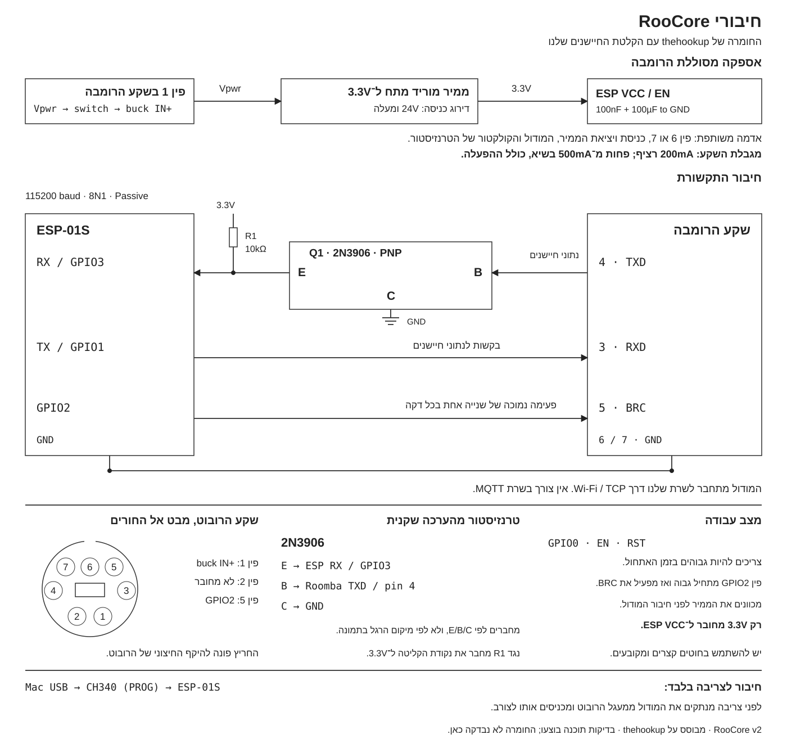

# חיבור הרומבה למודול

[פתיחת SVG](diagrams/wiring-he.svg) · [פתיחת PNG](diagrams/wiring-he.png) · [English](wiring.md)

משתמשים ב־2N3906 מסוג PNP מתוך ערכת BOJACK שכבר קנית, במודול ESP-01S ובממיר Buck שמכוון ל־3.3V.
הבסיס הוא פרויקט thehookup, כולל הזנה מסוללת הרומבה. את חיבור BRC ל־GPIO2 לוקחים מהקוד שלו לסדרת 600.

| מקור | יעד |
|---|---|
| פין 1 ברומבה, מתח סוללה | מפסק ואז Buck IN+ |
| פין 6 או 7 ברומבה | אדמה משותפת: Buck IN-/OUT-, המודול ו־C בטרנזיסטור |
| Buck OUT+ במתח 3.3V | VCC ו־EN במודול |
| פין 4 ברומבה, TXD | רגל B בטרנזיסטור |
| רגל E בטרנזיסטור | RX / GPIO3 במודול |
| נקודת RX במודול | נגד 10kΩ אל 3.3V |
| TX / GPIO1 במודול | פין 3 ברומבה, RXD |
| GPIO2 במודול | פין 5 ברומבה, BRC |
| פין 2 ברומבה | נשאר מנותק ומבודד |

יש ממיר מתח אחד. אין צורך במסילת 5V או בשני ממירי האות שהופיעו בתרשים הקודם.
סמוך למודול מחברים קבלי 100nF ו־100µF בין VCC לאדמה, בנוסף לקבלים הנדרשים לפי יצרן הממיר.
GPIO0, EN ו־RST צריכים להיות גבוהים באתחול. חלק מנגדי המשיכה כבר קיימים ב־ESP-01S.
GPIO2 מתחיל גבוה ואחר כך מפעיל את BRC; אין לקבע אותו ישירות ל־VCC.

## רגלי הטרנזיסטור

התרשים מציג את תפקידי הרגליים, לא את המיקום הפיזי שלהן. מחברים לפי E/B/C.
במפרט onsemi של 2N3906: רגל 1 היא E, רגל 2 היא B ורגל 3 היא C. את הכיוון הפיזי בודקים מול הסימון על הרכיב שקנית.

בקובץ Fritzing המקורי יש רכיב PNP כללי. לפי הגדרת הרכיב הנוכחית שם, נקודת הקליטה מחוברת ל־C והאדמה ל־E.
אצלנו הגדרתי במפורש **E אל RX, B אל TX של הרומבה ו־C לאדמה**, כדי להשתמש ב־2N3906 בכיוון העבודה הרגיל שלו.
זהו שינוי נקודתי ביחס לחיבורי הסמל המקורי. נגד ה־10kΩ מגדיר גם את המשיכה של RX ל־3.3V.

TX ו־BRC נשארים בחיבור הישיר של פרויקט המקור. פין TX הרגיל משדר גם הודעות ROM בעת אתחול ה־ESP;
בניגוד לגרסה הקודמת, אין כאן ניתוב שלהן לפין אחר. התוכנה שלנו לא מדפיסה הודעות דיבוג לקו הזה.

## הזנה וצריבה

בוחרים Buck לא מבודד שטווח הכניסה שלו מכסה את מתח הסוללה גם בטעינה. דירוג כניסה של 24V לפחות הוא נקודת פתיחה.
נדרשת יכולת יציאה של לפחות 500mA ב־3.3V; דירוג 1A נותן מרווח. מכוונים ומודדים את היציאה לפני חיבור המודול.
מגבלת שקע הרומבה היא 200mA רציפים ועד 500mA בשיא, בצד הסוללה, כולל זרם ההתנעה.
בסיום מכבים את התוספת במפסק. פעימות BRC מונעות שינה ואין בתכנון ניתוק אוטומטי בסוללה חלשה.

מספור השקע בתרשים הוא במבט אל החורים ברובוט. צד ההלחמה של התקע עלול להיות הפוך.
בצריבה מוציאים את המודול ממעגל הרובוט ומכניסים אותו לצורב CH340; לא מחברים את שניהם במקביל.

[מקורות והשוואה לפרויקט המקורי](wiring.md#sources). הקוד נבנה ונבדק בתוכנה; לא בוצע כאן ניסוי בחומרה.
