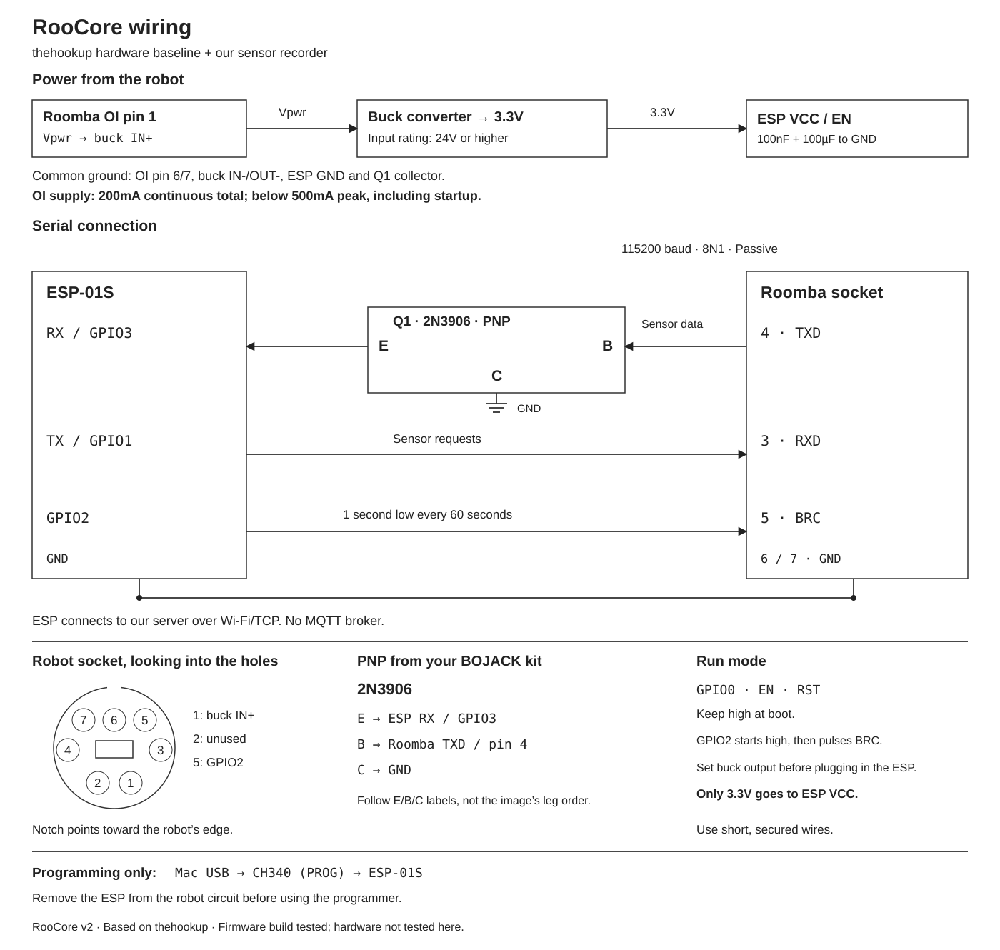

# Wiring

[SVG](diagrams/wiring.svg) · [PNG](diagrams/wiring.png) · [עברית](wiring-he.md)

Use the 2N3906 PNP from the BOJACK kit, the ESP-01S and a buck converter set to 3.3V.
The battery/buck/PNP arrangement comes from thehookup. GPIO2-to-BRC comes from its 600-series sketch.

| From | To |
|---|---|
| Roomba OI pin 1 (Vpwr) | Switch, then buck IN+ |
| Roomba OI pin 6 or 7 | Buck IN-/OUT-, ESP GND and Q1 collector (C) |
| Buck OUT+ at 3.3V | ESP VCC and EN |
| Roomba OI pin 4 (TXD) | Q1 base (B) |
| Q1 emitter (E) | ESP RX / GPIO3 |
| ESP RX node | 10kΩ resistor to 3.3V (R1) |
| ESP TX / GPIO1 | Roomba OI pin 3 (RXD) |
| ESP GPIO2 | Roomba OI pin 5 (BRC) |
| Roomba OI pin 2 | Unused and insulated |

There is one buck converter and no 5V rail or separate level-shifter ICs in this version.
Place 100nF and 100µF across ESP VCC and GND; use the buck manufacturer's specified capacitors as well.
Keep GPIO0, EN and RST high at startup. The ESP-01S may already have pull-ups fitted. GPIO2 starts high and is then driven by the BRC timer; do not tie it directly to VCC.

## PNP pin names

Q1 is a functional block in the diagram. Its left/right positions do not show the physical leg order.
Connect by E, B and C. The cited onsemi 2N3906 drawing numbers E=1, B=2, C=3; the BOJACK part's marking/orientation must correspond before using that numbering.

The upstream Fritzing component is generic `PNP-CBE`, not a named 2N3906.
Its saved footprint connections put the receive node on the connector called C and ground on E in the current Fritzing part definition.
RooCore explicitly uses **E to ESP RX, B to Roomba TX and C to ground**, so the receive-side PNP operates in its normal orientation.
This is a deliberate component-specific change, not a claim that the original picture labels those legs.
R1 also makes the RX pull-up explicit; the firmware enables the UART RX pull-up without changing the pin's UART function.

The TX and BRC lines follow the upstream direct connections. The diagram uses the ordinary GPIO1 TX, which carries the ESP ROM's boot output too; it no longer claims that boot output is routed away from the robot.
No application debug output is written to that UART.

## Battery supply

Use a non-isolated buck whose input range covers the robot battery during operation and charging, with margin.
An input rating of at least 24V and an output capability of at least 500mA at 3.3V are starting requirements; 1A output capability gives margin.
Set the output before inserting the ESP. Battery voltage must never reach ESP VCC directly.

The OI specification limits pins 1 and 2 together to 200mA continuous and 500mA peak on the battery side.
Connecting both pins does not double that allowance. Include startup capacitor charging when checking the load.
Turn the added circuit off at its switch after use. BRC keeps the robot awake; this prototype has no automatic low-battery cutoff.

## Connector and programming

The circle shows the robot's female socket, looking into its holes, with the notch toward the outside of the robot.
The solder side of a cable plug may be mirrored. Check continuity from each socket position to its wire.

To flash the ESP, disconnect it from all robot wiring and insert it in the CH340 programmer.
Remove the programmer before reconnecting the robot. The programmer's UART must not share the RX node with the robot interface.

## Sources

- [Upstream schematic and Fritzing source](https://github.com/thehookup/MQTT-Roomba-ESP01/tree/7ad7cd09321a43e0b74d5bf430566a7bcb32051b).
- [Upstream 600-series sketch](https://github.com/thehookup/MQTT-Roomba-ESP01/blob/7ad7cd09321a43e0b74d5bf430566a7bcb32051b/Roomba_600_ESP01_CONFIGURE.ino): normal UART0 and GPIO2 BRC.
- [Fritzing PNP-CBE definition](https://github.com/fritzing/fritzing-parts/blob/develop/core/transistor_signal_PNP_TO92_CBE.fzp): connector names.
- [2N3906 datasheet](https://www.onsemi.com/pdf/datasheet/2n3906-d.pdf): device type and E/B/C pin numbering.
- [iRobot OI specification](https://github.com/iRobotSTEM/CreateDocs/blob/main/Getting_Started/Create-2_Open-Interface-Specification.pdf): socket, power limits and UART.

This update has software build/test evidence, not a physical test of this circuit. Regenerate both SVGs with `python3 tools/draw_wiring.py`.
